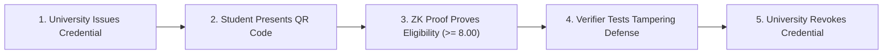

# DEMO_RUNBOOK.md — VERICRED Master Demonstration & Evaluation Guide

> **Target Audience**: Hackathon Judges, Academic Accreditation Evaluators, Cloud Architects, and Engineers  
> **Platform Version**: `v1.0.0-rc1` (Production-Ready Release)  
> **Demonstration Network**: Polygon Amoy Testnet (Chain ID `80002`) & Ephemeral Hardhat EVM

---

## 1. Quick Start & Prerequisites

### 1.1 Automated Monorepo Startup
Ensure Node.js 20+ and pnpm are installed:

```bash
# 1. Install all dependencies across all 9 monorepo workspaces
pnpm install

# 2. Build shared packages (crypto, schema, contracts, shared)
pnpm build

# 3. Start PostgreSQL and Redis containers
docker compose up -d

# 4. Run Prisma database migrations and seed with RCC-IIT fictional data
pnpm --filter @vericred/api db:migrate
pnpm --filter @vericred/api db:seed

# 5. Start development servers (Frontend: 3000, API: 4000)
pnpm dev
```

### 1.2 Master Demonstration Personas & Seed Accounts

| Persona | Role | Email | Password | Access Area |
| :--- | :--- | :--- | :--- | :--- |
| **System Administrator** | `ADMIN` | `admin@vericred.net` | `AdminPass123!` | `/admin/overview` |
| **Dr. Elena Rostova** | `INSTITUTION` | `dean.academic@rcciit.ac.in` | `InstitutePass123!` | `/institution/overview` |
| **Aarav Sen** | `STUDENT` | `aarav.sen@student.rcciit.ac.in` | `StudentPass123!` | `/student/wallet` |
| **Independent Verifier** | `VERIFIER` | Public Portal (No login needed) | N/A | `/verify` |

---

## 2. Master Demonstration Scenarios (1 to 5)



---

### Scenario 1: Sovereign Academic Credential Issuance
**Objective**: Demonstrate that the university issues a tamper-proof W3C VC 2.0 academic credential with dual Ed25519 & BabyJubjub cryptographic signatures and a salted Poseidon commitment.

1. Open your browser and navigate to `http://localhost:3000/login`.
2. Sign in as the University Officer:
   - Email: `dean.academic@rcciit.ac.in`
   - Password: `InstitutePass123!`
3. In the navigation sidebar, select **Single Credential Issuance**.
4. Fill out the academic credential issuance form:
   - **Student ID**: Select *Aarav Sen* (`VC2026001`)
   - **Degree Name**: `Bachelor of Technology`
   - **Department**: `Computer Science and Engineering`
   - **Graduation Year**: `2026`
   - **CGPA**: `8.72`
5. Click **Issue Verifiable Credential**:
   - The backend converts $8.72$ to fixed-point integer $872$ ($\times 10^2$).
   - Computes salted Poseidon commitment $C = \text{Poseidon}(872, s)$.
   - Signs $C$ using the university's BabyJubjub private key.
   - Anchors the transaction on Polygon Amoy testnet.

---

### Scenario 2: Standard QR Presentation Verification & Replay Protection
**Objective**: Demonstrate that a student can share an ephemeral 15-minute presentation via QR code, and a verifier can validate all 5 integrity dimensions without exposing permanent links.

1. Sign in as student Aarav Sen at `http://localhost:3000/login`:
   - Email: `aarav.sen@student.rcciit.ac.in`
   - Password: `StudentPass123!`
2. Navigate to `/student/wallet` to view Aarav's sovereign credential card.
3. Click **Share QR Presentation**:
   - Select claims to disclose (e.g. Degree Name, Department, Graduation Year).
   - Set expiration window to 15 minutes.
   - An ephemeral presentation QR code is generated containing a single-use cryptographic nonce.
4. Navigate to the Public Verification Portal at `http://localhost:3000/verify`.
5. Under the **Standard QR Presentation** tab, submit the presentation payload:
   - The verification engine checks: (1) W3C schema, (2) BabyJubjub signature, (3) Expiration timestamp, (4) Nonce freshness, and (5) On-chain status.
   - Result: **Status: VALID (VERIFIED)** with green status checkmarks.
6. Re-submit the exact same presentation:
   - Result: Request rejected with `PRESENTATION_NONCE_ALREADY_CONSUMED` replay protection defense!

---

### Scenario 3: Privacy-Preserving Zero-Knowledge Groth16 Proof Verification
**Objective**: Demonstrate that a student can prove they satisfy a high-stakes scholarship or job requirement ($\text{CGPA} \ge 8.00$) **without ever revealing their raw CGPA ($8.72$)** to the verifier or employer!

1. In Aarav Sen's wallet (`http://localhost:3000/student/wallet`), click **Generate ZK Proof**.
2. Set the **Minimum CGPA Requirement** to `8.00` ($T = 800$).
3. Click **Generate Proof in Browser**:
   - `snarkjs` runs inside the client with `CgpaThresholdValidator.wasm` and `circuit_final.zkey`.
   - The circuit verifies in zero-knowledge:
     $$\text{Commitment } C == \text{Poseidon}(872, s) \quad \text{and} \quad 872 \ge 800$$
   - A Groth16 proof is generated along with public signals $[C, 800, A_x, A_y]$.
   - **Crucial Privacy Guarantee**: The public signals contain $800$, but $872$ is completely concealed in the private witness!
4. Click **Copy ZK Proof & Signals**.
5. Go to the Public Verification Portal at `http://localhost:3000/verify` and select the **Zero-Knowledge Proof** tab.
6. Click **Load Sample Eligible Proof** (or paste the copied JSON) and click **Verify Groth16 Proof**:
   - The verification engine executes pairing checks on BN254 curve (`0x08` precompile on EVM).
   - Resolves $[A_x, A_y]$ against accredited institutions in `InstitutionRegistry`.
   - Validates that $C$ is not revoked in `RevocationRegistry`.
   - Result: **ELIGIBILITY MATHEMATICALLY PROVEN: CGPA $\ge 8.00$**!

---

### Scenario 4: Tampering Detection & Cryptographic Defense
**Objective**: Demonstrate that any fraudulent modification of academic claims or public signals is mathematically detected and rejected immediately.

1. **Test 4A (Tampered Claim)**:
   - If an applicant modifies their degree name or alters their raw score from $8.72$ to $9.99$:
   - The recomputed Poseidon commitment does not match the commitment in the credential.
   - Result: Verification fails with `Cryptographic commitment mismatch: academic claims have been modified`.
2. **Test 4B (Forged ZK Public Signals)**:
   - If an applicant modifies the public threshold signal from `800` to `900` to claim a higher achievement:
   - The Groth16 bilinear pairing check rejects the proof immediately.
   - Result: Verification fails with `Groth16 pairing check failed (tampered proof or public signals)`.
3. **Test 4C (Witness Generation for Ineligible Student)**:
   - In student Diya Roy's profile (CGPA: $7.65$), attempt to generate a proof for threshold $8.00$:
   - Circom's `GreaterEqThan` constraint fails during witness calculation.
   - Result: Prover throws an error; no forged proof can ever be generated!

---

### Scenario 5: Dynamic On-Chain Revocation
**Objective**: Demonstrate that when a university revokes an issued credential for disciplinary or administrative reasons, all subsequent standard and ZK verifications fail immediately.

1. In the University Officer dashboard (`/institution/overview`), find Aarav Sen's credential.
2. Click **Revoke Credential**:
   - Select reason: `DISCIPLINARY`
   - Confirm transaction: State transitions to `REVOKED` in the database and `RevocationRegistry.sol`.
3. Return to the Public Verification Portal (`/verify`) and attempt to verify Aarav's QR presentation:
   - Result: Verification rejected with red status badge **REVOKED: DISCIPLINARY**.
4. Attempt to verify Aarav's ZK Proof:
   - The verifier queries the commitment $C$ against the revocation registry.
   - Result: Verification rejected with **CREDENTIAL REVOKED: Underlying academic credential has been revoked**.

---

## 3. Production Cloud Deployment Guide

### 3.1 Deploy via Docker Compose (Single Host / VPS)
```bash
# Start full production stack
docker compose -f docker-compose.prod.yml up -d --build

# View logs
docker compose -f docker-compose.prod.yml logs -f api
```

### 3.2 Deploy to Cloud Platforms
- **Next.js Frontend (`apps/web`)**:
  - Connect repository to **Vercel** or **Cloudflare Pages**.
  - Root directory: `apps/web`.
  - Build command: `pnpm --filter @vericred/web build`.
  - Configure environment variables from `apps/web/.env.example`.
- **Backend REST API (`apps/api`)**:
  - Deploy to **AWS ECS Fargate**, **Render**, or **Railway** using `apps/api/Dockerfile`.
  - Set `DATABASE_URL` to managed PostgreSQL (e.g. AWS RDS or Neon).
  - Set `REDIS_URL` to managed Redis (e.g. AWS ElastiCache or Upstash).
- **Smart Contracts (`blockchain`)**:
  - Deployed to **Polygon Amoy Testnet** (Chain ID `80002`).
  - Contract addresses bound in `packages/contract-client/src/constants.ts`.

---

## 4. Test Suite Execution & Verification Proof

To execute the automated test suites locally:

```bash
# Run all unit and integration tests across monorepo (79 tests)
pnpm test

# Run monorepo TypeScript typecheck across all 9 packages (0 errors)
pnpm -r typecheck

# Run Next.js production build (14/14 static pages generated)
pnpm --filter @vericred/web build
```

---

*VERICRED — Sovereign, Privacy-Preserving Academic Credentials Powered by Web3 & Zero-Knowledge Proofs.*
