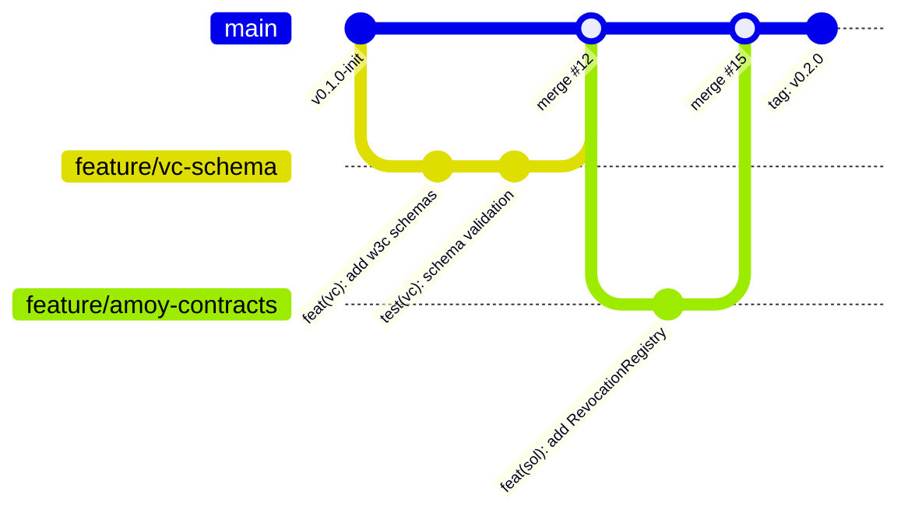

# DEVELOPMENT_GUIDELINES.md — Engineering Standards and Practices

> **Target Audience**: Human software engineers, technical contributors, and autonomous AI coding agents collaborating on the VERICRED repository.

---

## 1. Source Control & Branching Strategy

VERICRED employs a modified **Trunk-Based Development** workflow with short-lived feature branches to guarantee continuous integration and auditability.



### 1.1 Branch Naming Conventions
- `main`: Protected production-ready branch. Direct pushes are disabled.
- `feature/<module>-<description>`: e.g., `feature/zk-cgpa-circuit`, `feature/auth-argon2`.
- `fix/<issue-number>-<description>`: e.g., `fix/104-nonce-expiration`.
- `chore/<task>`: e.g., `chore/bump-snarkjs-dependencies`.
- `docs/<topic>`: e.g., `docs/update-threat-model`.

### 1.2 Conventional Commit Standard
All commit messages must adhere strictly to the **Conventional Commits 1.0.0** specification:

```text
<type>(<scope>): <short description in imperative mood>

[optional body explaining motivation and architectural trade-offs]

[optional footer(s) such as Closes #123, Breaking Changes]
```

**Permitted Types**:
- `feat`: A new user-facing or system capability.
- `fix`: A bug fix or defect correction.
- `docs`: Documentation generation or modification only.
- `style`: Formatting, missing semi-colons, no code logic changes.
- `refactor`: Code change that neither fixes a bug nor adds a feature.
- `perf`: Code change that improves compute, gas, or network performance.
- `test`: Adding missing tests or correcting existing tests.
- `chore`: Updating build tasks, package configurations, or dependencies.

**Permitted Scopes**:
`auth`, `credential`, `institution`, `student`, `verifier`, `blockchain`, `zk`, `crypto`, `db`, `ui`, `api`.

---

## 2. Code Quality, Formatting & Linting

### 2.1 Tooling & Configuration
- **Package Manager**: `pnpm` (workspace mode enabled).
- **Linter**: `eslint` with `@typescript-eslint/recommended`, `eslint-plugin-react-hooks`.
- **Formatter**: `prettier` (single quotes: `true`, trailing commas: `all`, print width: `100`, tab width: `2`).
- **Pre-commit Hooks**: Managed via `husky` and `lint-staged`.

### 2.2 TypeScript Standards
- **Strict Mode**: `"strict": true`, `"noImplicitAny": true`, `"strictNullChecks": true`.
- **No `any`**: The use of `any` is strictly prohibited. Use `unknown` with runtime type guards or Zod schema validation.
- **Explicit Return Types**: All exported functions, service methods, and API handlers must have explicit return type signatures.
- **Type Colocation**: Types shared across apps must be declared in `@vericred/shared` or `@vericred/credential-schema`.

---

## 3. Frontend Architecture & Component Standards

### 3.1 Next.js 14 & React Best Practices
- **Server vs. Client Components**:
  - Keep components as React Server Components (RSC) by default for data fetching and static UI rendering.
  - Mark with `'use client'` only when state (`useState`), effects (`useEffect`), browser APIs (WebCrypto, Canvas/QR scanner), or ZK prover execution are strictly required.
- **Forms & Validation**: Use `react-hook-form` coupled with `@hookform/resolvers/zod` for zero-overhead client validation.
- **State Management**: Server state managed via `@tanstack/react-query`; ephemeral UI state handled via React context or standard hooks.
- **Accessibility (a11y)**:
  - All interactive elements must support keyboard navigation (`Tab`, `Enter`, `Space`).
  - Colors must maintain WCAG 2.1 AA contrast ratios ($4.5:1$ for normal text, $3:1$ for large text).
  - Use Radix UI primitives underlying `shadcn/ui` for ARIA-compliant modals, dropdowns, and tabs.

---

## 4. Backend & API Engineering Standards

### 4.1 REST API Design
- Adhere strictly to the URI patterns and HTTP verbs defined in [API_SPECIFICATION.md](docs/03_DATABASE_AND_BACKEND/API_SPECIFICATION.md).
- Version all endpoints with `/api/v1/`.
- Plural nouns for resource collections (e.g., `/api/v1/credentials`, `/api/v1/institutions`).
- Use idempotent methods (`GET`, `PUT`, `DELETE`) properly; use `POST` for resource creation and non-idempotent operations (such as `/api/v1/verification/verify`).

### 4.2 Controller-Service-Repository Pattern
- **Controllers**: Handle HTTP serialization, parse cookies/headers, invoke Zod validation schemas, and return standardized JSend payloads. No business or cryptographic logic inside controllers.
- **Services**: Encapsulate all business logic, credential signing, hashing, ZK proof checks, and blockchain relay calls.
- **Repositories / Prisma**: Handle direct database CRUD operations, transactions, and row-level locks.

---

## 5. Database & Migration Standards

### 5.1 Prisma Workflow
- All database modifications must proceed via declarative migrations:
  ```bash
  pnpm --filter @vericred/api prisma migrate dev --name <migration_name>
  ```
- Never execute ad-hoc SQL schema mutations directly in production databases.
- Foreign keys must always specify cascade or restrict behavior explicitly.
- Add composite indexes on high-throughput query paths (e.g., `[institutionId, status]`, `[holderId, issueDate]`).
- Sensitive academic or personal data must never be logged or duplicated in audit tables without masking.

---

## 6. Smart Contract Engineering Standards

### 6.1 Solidity 0.8.24 Practices
- Use official OpenZeppelin contracts for standard access control (`Ownable2Step`, `AccessControlDefaultAdminRules`) and reentrancy protection (`ReentrancyGuard`).
- **Simplicity Over Upgradeability**: Per project architectural decisions, favor clean, immutable, auditable contracts with key rotation logic over complex proxy architectures (`UUPS`/`TransparentUpgradeableProxy`), minimizing governance attack surfaces.
- **Custom Errors**: Always use custom errors (e.g., `revert UnauthorizedIssuer(address caller);`) instead of string error messages (`require(..., "Unauthorized");`) to conserve contract bytecode and deployment gas.
- **Gas Optimization**: Pack storage variables into 32-byte slots where appropriate (e.g., `uint32 timestamp`, `uint8 status`).

---

## 7. Zero-Knowledge Circuit Standards

### 7.1 Circom 2.1 Engineering
- **Template Modularity**: Each mathematical primitive (range check, Poseidon hashing, EdDSA signature check) must reside in an independent template within `zk/circuits/common/`.
- **Constraint Minimization**: Profile every circuit using `circom --r1cs --info` to track constraint counts.
- **Deterministic Range Enforcements**: Ensure all private numeric inputs undergo explicit bit-length checks (`Num2Bits(n)`) to prevent field wraparound exploits ($\ge p$).
- **Formal Witness Verification**: Test all circuits against both valid and invalid witness vectors to ensure underconstrained circuits are immediately rejected.

---

## 8. Code Review & Definition of Done

Every pull request must fulfill the following mandatory checklist:
1. **Build & Typecheck**: `pnpm build` completes with zero TypeScript compiler errors.
2. **Linting**: `pnpm lint` completes with zero errors or warnings.
3. **Automated Tests**: All unit, integration, and contract tests pass with $\ge 85\%$ line coverage across critical cryptographic and authentication paths.
4. **Security Check**: No hardcoded secrets, test credentials, or plaintext PII present.
5. **Documentation Updated**: Relevant files in `docs/` and `TASK_TRACKER.md` reflect the newly committed changes.
