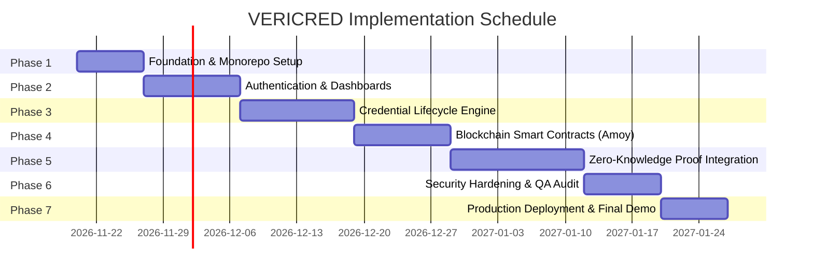

# PROJECT_ROADMAP.md — Strategic Implementation Roadmap

> **Platform**: VERICRED — Decentralized Academic Credential & ZK Verification Network  
> **Target Timeline**: Multi-Sprint Phased Delivery (Phases 1 through 7)  
> **Status**: Documentation Complete; Implementation Ready

---

## 1. High-Level Delivery Timeline Overview

---

## 2. Detailed Phase Specifications

### Phase 1: Project Foundation & Core Infrastructure
- **Objective**: Establish the monorepo architecture, developer tooling, database migrations, cryptographic utility packages, and documentation infrastructure.
- **Dependencies**: None.
- **Key Deliverables**:
  - Turborepo configuration with `apps/web`, `apps/api`, `packages/shared`, `packages/credential-schema`, `packages/crypto`, `packages/contract-client`.
  - PostgreSQL container configuration and Prisma schema migrations.
  - Environment variable validation pipelines (`@vericred/shared/env`).
  - Base design system integration (Tailwind CSS, shadcn/ui primitives).
- **Completion Conditions**:
  - `pnpm install` and `pnpm build` succeed cleanly across all workspaces.
  - Prisma migrations execute successfully on local PostgreSQL.
  - Cryptographic test harnesses (Poseidon hashing and WebCrypto) pass initial sanity checks.

---

### Phase 2: Authentication, Role-Based Access & Dashboards
- **Objective**: Implement secure multi-tenant authentication, user registration, institutional approval gates, and stakeholder user interfaces.
- **Dependencies**: Phase 1.
- **Key Deliverables**:
  - Argon2id password hashing and JWT/HTTP-only cookie session management.
  - Four distinct user role flows: `ADMIN`, `INSTITUTION`, `STUDENT`, `VERIFIER`.
  - Admin Institution Management Console (Approve, Suspend, Key Registry review).
  - Public Marketing & Product Landing Page (`/`, `/how-it-works`, `/features`).
  - Student Dashboard Shell and Institution Dashboard Shell.
- **Completion Conditions**:
  - Unapproved institutions cannot issue credentials or access issuer tools.
  - Protected API routes enforce strict role-based access control (RBAC).
  - Clean responsive UI layouts functional across mobile, tablet, and desktop viewports.

---

### Phase 3: Verifiable Credential Lifecycle (Off-Chain Engine)
- **Objective**: Construct the end-to-end W3C Verifiable Credential 2.0 issuance, signing, wallet storage, QR presentation, and public verification engine without blockchain dependencies.
- **Dependencies**: Phase 2.
- **Key Deliverables**:
  - Institutional Credential Issuance Form with instant schema validation.
  - CSV Bulk Issuance Parser with row-by-row dry-run validation and error reporting.
  - EdDSA / Poseidon institutional credential digital signing pipeline.
  - Student Wallet view (`/wallet`) with credential detail modals and export capabilities.
  - Ephemeral Verifiable Presentation generator with short-lived TTLs and verifier challenge nonces.
  - Public Verification Portal (`/verify`) with instant signature and integrity validation.
- **Completion Conditions**:
  - Tampered credential claims immediately trigger `INVALID_SIGNATURE` status.
  - Replay protection rejects expired or reused presentation nonces.
  - CSV parser successfully ingests 100+ simulated student records with zero data corruption.

---

### Phase 4: Blockchain Smart Contract Integration (Polygon Amoy)
- **Objective**: Deploy decentralized registries on Polygon Amoy EVM testnet and anchor credential commitments and revocation states on-chain.
- **Dependencies**: Phase 3.
- **Key Deliverables**:
  - `InstitutionRegistry.sol`: On-chain institutional verification and authorized public key directory.
  - `CredentialRegistry.sol`: Opaque commitment and issuance anchor registry.
  - `RevocationRegistry.sol`: Cryptographic revocation bitmask and timestamp registry.
  - Ethers.js / TypeChain contract interaction layer inside the backend API service.
  - Hardhat automated unit test suite with 100% contract method coverage.
- **Completion Conditions**:
  - Contracts deployed to local Hardhat node and Polygon Amoy testnet.
  - Credential verification dynamically queries on-chain revocation status.
  - Revoked credentials instantly reflect `REVOKED` status on the public portal.

---

### Phase 5: Zero-Knowledge Proof Integration (Circom & Groth16)
- **Objective**: Design, compile, test, and integrate the Circom ZK circuit enabling students to prove $\text{CGPA} \ge T$ bound to an authentic institutional EdDSA signature without revealing their exact CGPA.
- **Dependencies**: Phase 4.
- **Key Deliverables**:
  - Circom circuit (`CgpaThresholdValidator.circom`) enforcing:
    1. Scaled integer CGPA representation ($8.72 \rightarrow 872$).
    2. Salted Poseidon commitment verification: $C = \text{Poseidon}(x, s)$.
    3. Range constraint check: $x \ge T$.
    4. In-circuit EdDSA BabyJubjub signature verification over the commitment.
  - Trusted setup ceremony artifacts (`.zkey`, `.wasm`, `verification_key.json`).
  - Client-side witness calculator and proof generator (`snarkjs.groth16.fullProve`).
  - Verifier UI component checking the proof against on-chain issuer keys and status.
- **Completion Conditions**:
  - Valid proof verifies in $< 2.5$ seconds client-side.
  - Falsified witness ($x < T$) fails circuit constraint generation.
  - Forged issuer signature is decisively rejected by the circuit verifier.

---

### Phase 6: Comprehensive Testing, Security Hardening & Audit
- **Objective**: Conduct extensive end-to-end integration testing, fuzz testing, STRIDE threat validation, and performance optimization.
- **Dependencies**: Phase 5.
- **Key Deliverables**:
  - Automated Playwright end-to-end test suites covering all five demonstration workflows.
  - Smart contract static analysis (Slither) and reentrancy verification.
  - Rate-limiting, CORS, and CSRF security header hardening across all endpoints.
  - Performance audit: verification latency $< 500\text{ms}$ (standard) and $< 1500\text{ms}$ (ZK).
- **Completion Conditions**:
  - 100% of defined Test Cases in [TEST_CASES.md](docs/09_TESTING_AND_QUALITY/TEST_CASES.md) pass.
  - Zero critical or high-severity vulnerabilities identified during static security scans.

---

### Phase 7: Deployment, Operational Runbooks & Final Demonstration
- **Objective**: Deploy the full platform to cloud infrastructure (Vercel/Render/Docker), populate demonstration seed data, and execute the final evaluation walkthrough.
- **Dependencies**: Phase 6.
- **Key Deliverables**:
  - Containerized production build with Docker Compose and production orchestration guides.
  - Seed script establishing *RCC Institute of Information Technology* and 3 fictional student credentials.
  - Recorded interactive walkthrough demonstrating issuance, QR verification, ZK proof, tampering detection, and on-chain revocation.
- **Completion Conditions**:
  - Production deployment accessible via live HTTPS URLs.
  - Seamless demonstration without terminal crashes, unhandled errors, or mock stubs.
