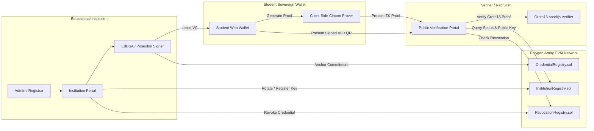

# VERICRED

> **Your Achievements. Your Credentials. Your Control.**
> Decentralized Academic Credential Issuance & Privacy-Preserving Verification Network

[](LICENSE)
[-cyan.svg)]()
[-8247e5.svg)]()
[]()
[]()
[]()

---

## 1. Executive Summary

VERICRED is an enterprise-grade, decentralized digital identity and verifiable credential network tailored for higher education institutions, students, and employers/verifiers. The platform solves the multi-billion-dollar global problem of academic credential fraud, slow manual background checks, and privacy-violating credential disclosures.

By synthesizing **W3C Verifiable Credentials (VC 2.0)**, **Zero-Knowledge Proofs (Groth16 zk-SNARKs via Circom)**, and **Ethereum Virtual Machine (EVM) Smart Contracts (Polygon Amoy testnet)**, VERICRED delivers a platform where:
- **Institutions** issue cryptographically signed, tamper-evident academic credentials anchored to decentralized registries.
- **Students** maintain sovereign ownership in a Web3-enabled credential wallet, sharing verifiable presentations via QR codes.
- **Verifiers** independently validate authenticity, issuer authorization, integrity, and revocation status in milliseconds without account walls.
- **Privacy-Preserving Verification (Zero-Knowledge)**: Students prove eligibility criteria (e.g., $\text{CGPA} \ge 8.0$) to recruiters without revealing transcripts, exact grades, or personal identifying attributes.

---

## 2. Key Architectural Highlights



- **Selective Disclosure & ZK-SNARKs**: Formal fixed-point integer representation for grades ($8.72 \rightarrow 872$). Salted Poseidon commitments ($C = \text{Poseidon}(x, s)$) bound directly to institution EdDSA signatures over BabyJubjub elliptic curves, verified natively inside Circom circuits.
- **Zero Academic Data On-Chain**: Academic records, names, enrollment IDs, and raw grades remain strictly off-chain. Only opaque cryptographic commitments, issuer public keys, and cryptographic revocation bit-indices reside on-chain.
- **Defense-in-Depth Cryptography**: W3C VC 2.0 compliance adapter, ephemeral verifier nonces preventing replay attacks, and rate-limited API gateways with Argon2id password hashing.

---

## 3. Technology Stack

| Domain | Technology | Description |
| :--- | :--- | :--- |
| **Monorepo Management** | Turborepo / pnpm | High-performance build orchestrator and workspace isolation |
| **Frontend Framework** | Next.js 14+ (App Router), React 18, TypeScript | Server Components, Client Prover integration |
| **Styling & UI** | Tailwind CSS, shadcn/ui, Radix UI, Lucide Icons | Accessible, institutional design system (`#0B1226`, `#458BFF`, `#45D7E0`) |
| **Backend & API** | Node.js, Express / NestJS, TypeScript, Zod | RESTful architecture, strict DTO schema validation |
| **Database & ORM** | PostgreSQL 16+, Prisma ORM | Relational ACID storage, audit logging, encrypted sensitive columns |
| **Smart Contracts** | Solidity 0.8.24, Hardhat, OpenZeppelin | Gas-optimized, audited registry architecture |
| **Blockchain Networks** | Polygon Amoy (Primary Testnet), Ethereum Sepolia, Hardhat Local | EVM compatibility with low gas fees and sub-second finality |
| **Zero-Knowledge Circuits**| Circom 2.1+, snarkjs, Groth16, BabyJubjub, Poseidon | High-performance algebraic proofs for range and membership checks |
| **Testing** | Vitest, Playwright, Hardhat/Chai, Circomlibjs | Unit, integration, E2E, fuzz, and cryptographic circuit tests |

---

## 4. Repository Structure

```text
VERICRED/
├── apps/
│   ├── web/                    # Next.js 14 Frontend Application (Student, Institution, Verifier, Admin)
│   └── api/                    # Express / NestJS Backend RESTful Service
├── packages/
│   ├── shared/                 # Shared TypeScript interfaces, DTOs, and constants
│   ├── credential-schema/      # W3C VC 2.0 JSON-LD schemas and Zod validators
│   ├── crypto/                 # EdDSA, BabyJubjub, Poseidon, and WebCrypto utilities
│   └── contract-client/        # TypeChain bindings and Ethers.js blockchain adapters
├── blockchain/
│   ├── contracts/              # Solidity Smart Contracts (Institution, Credential, Revocation)
│   ├── scripts/                # Deployment and contract verification scripts
│   └── test/                   # Hardhat Chai smart contract test suites
├── zk/
│   ├── circuits/               # Circom circuits for CGPA threshold and issuer binding
│   ├── scripts/                # Ceremony, compilation, zkey generation, and test scripts
│   └── build/                  # Compiled R1CS, WASM, and Groth16 verification keys
├── prisma/
│   ├── schema.prisma           # Relational schema definition
│   └── migrations/             # Database migration history
├── docs/                       # Complete Engineering Specification Documentation (70+ docs)
├── diagrams/                   # Architectural, sequence, and entity relationship diagrams
└── project_overview.md         # Master project blueprint
```

---

## 5. Getting Started (Local Development)

### Prerequisites
- **Node.js**: v20.x LTS or higher
- **Package Manager**: `pnpm` v9.x or higher
- **Database**: PostgreSQL 16+ (or Docker Engine)
- **Rust / Cargo**: (Required for compiling Circom circuits from source)
- **Circom & snarkjs**: Circom v2.1.8+ and snarkjs v0.7.4+

### Installation & Environment Setup

```bash
# Clone the repository
git clone https://github.com/vericred/vericred.git
cd vericred

# Install dependencies across all monorepo packages
pnpm install

# Configure environment variables
cp .env.example .env

# Start local PostgreSQL and Redis via Docker Compose
docker-compose up -d

# Run Prisma database migrations and generate client
pnpm --filter @vericred/api db:migrate
pnpm --filter @vericred/api db:seed

# Compile smart contracts and start local Hardhat EVM node
pnpm --filter @vericred/blockchain compile
pnpm --filter @vericred/blockchain node
```

### Running the Services

```bash
# Run all workspace applications concurrently (Frontend + Backend)
pnpm dev
```
- **Web Portal**: `http://localhost:3000`
- **Backend API**: `http://localhost:4000/api/v1`
- **API Swagger Documentation**: `http://localhost:4000/docs`
- **Local Hardhat RPC Node**: `http://127.0.0.1:8545`

---

## 6. Demonstration Workflow & Seed Accounts

The development database seeds a fictional university environment:
- **Institution**: *RCC Institute of Information Technology (RCC-IIT)*
- **Demo Accounts**:
  - **Platform Admin**: `admin@vericred.net` / `AdminPass123!`
  - **Institution Officer**: `registrar@rcciit.ac.in` / `InstitutePass123!`
  - **Student A (Aarav Sen - 8.72 CGPA)**: `aarav.sen@student.rcciit.ac.in` / `StudentPass123!`
  - **Student B (Diya Roy - 7.65 CGPA)**: `diya.roy@student.rcciit.ac.in` / `StudentPass123!`
  - **Student C (Rohan Das - 9.12 CGPA)**: `rohan.das@student.rcciit.ac.in` / `StudentPass123!`

For the step-by-step end-to-end evaluation scenario, consult [DEMO_RUNBOOK.md](DEMO_RUNBOOK.md) and [DEMONSTRATION_SCENARIO.md](docs/11_PROJECT_MANAGEMENT/DEVELOPMENT_PHASES.md#demonstration-scenarios).

---

## 7. Documentation Index

The complete documentation suite is organized systematically within the `docs/` and `diagrams/` directories:

| Section | Directory / Link | Description |
| :--- | :--- | :--- |
| **AI Instructions** | [AGENTS.md](AGENTS.md) | Permanent instruction manual for AI coding agents |
| **Development Rules** | [DEVELOPMENT_GUIDELINES.md](DEVELOPMENT_GUIDELINES.md) | Coding standards, git conventions, and PR criteria |
| **Project Roadmap** | [PROJECT_ROADMAP.md](PROJECT_ROADMAP.md) | 7-phase timeline, deliverables, and dependencies |
| **Task Tracker** | [TASK_TRACKER.md](TASK_TRACKER.md) | Granular execution backlog and status board |
| **Changelog** | [CHANGELOG.md](CHANGELOG.md) | Release history, architectural adjustments, and audit log |
| **01 Foundation** | [docs/01_PROJECT_FOUNDATION/](docs/01_PROJECT_FOUNDATION/) | Vision, formal SRS, scope boundaries, and glossary |
| **02 Architecture** | [docs/02_SYSTEM_ARCHITECTURE/](docs/02_SYSTEM_ARCHITECTURE/) | System topology, component breakdown, and auth model |
| **03 Database & API** | [docs/03_DATABASE_AND_BACKEND/](docs/03_DATABASE_AND_BACKEND/) | Schema design, ER models, REST API, and job processing |
| **04 Credential Design**| [docs/04_CREDENTIAL_AND_IDENTITY/](docs/04_CREDENTIAL_AND_IDENTITY/) | W3C VC 2.0 schemas, EdDSA crypto suite, and QR specs |
| **05 Blockchain** | [docs/05_BLOCKCHAIN/](docs/05_BLOCKCHAIN/) | Solidity contracts, EVM registry architecture, gas model |
| **06 Zero-Knowledge** | [docs/06_ZERO_KNOWLEDGE_PROOFS/](docs/06_ZERO_KNOWLEDGE_PROOFS/) | Mathematical model, Circom circuits, Groth16 pipelines |
| **07 Frontend & UX** | [docs/07_FRONTEND_AND_UX/](docs/07_FRONTEND_AND_UX/) | Design system, page specs, components, and user flows |
| **08 Security** | [docs/08_SECURITY_AND_PRIVACY/](docs/08_SECURITY_AND_PRIVACY/) | STRIDE threat model, key management, and privacy |
| **09 Testing & QA** | [docs/09_TESTING_AND_QUALITY/](docs/09_TESTING_AND_QUALITY/) | Test suites, formal test cases, and acceptance criteria |
| **10 Operations** | [docs/10_DEPLOYMENT_AND_OPERATIONS/](docs/10_DEPLOYMENT_AND_OPERATIONS/) | Local setup, CI/CD, Polygon Amoy, and monitoring |
| **11 Management** | [docs/11_PROJECT_MANAGEMENT/](docs/11_PROJECT_MANAGEMENT/) | Work breakdown, risk register, and Definition of Done |
| **Diagrams** | [diagrams/](diagrams/) | System, Sequence, ER, DFD, and Contract workflows |

---

## 8. Development Control Rules

All developers and autonomous agents working on VERICRED must adhere strictly to the governance policies defined in [AGENTS.md](AGENTS.md) and [DEVELOPMENT_GUIDELINES.md](DEVELOPMENT_GUIDELINES.md).

> **Important**: No private signing keys or plaintext academic records may ever be stored on-chain or committed to git. Mock cryptographic checks or simulated proofs are strictly forbidden in production code paths.
