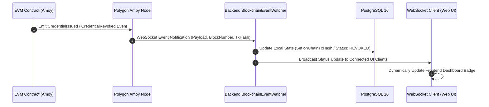

# BLOCKCHAIN_WORKFLOW.md — Smart Contract Interaction & Transaction Architecture

> **Document ID**: DIAG-006  
> **Status**: Confirmed Technical Specification

---

## 1. Smart Contract Inter-Call Graph

```mermaid
flowchart TD
    subgraph Governance ["Platform Governance"]
        AdminWallet[Admin EOA Address]
    end

    subgraph Issuers ["Educational Institutions"]
        InstWallet[Institution EOA Address]
    end

    subgraph Contracts ["Polygon Amoy Smart Contracts"]
        IR[InstitutionRegistry.sol]
        CR[CredentialRegistry.sol]
        RR[RevocationRegistry.sol]
    end

    subgraph Verifiers ["Verification Systems"]
        VerifyEngine[Public Verification Engine]
    end

    AdminWallet -->|approveInstitution(addr)| IR
    AdminWallet -->|suspendInstitution(addr)| IR
    
    InstWallet -->|updateIssuerKey(keyX, keyY)| IR
    InstWallet -->|issueCredential(credHash, commitment)| CR
    InstWallet -->|revokeCredential(credHash, reason)| RR

    CR -->|isAuthorized(msg.sender)| IR
    RR -->|getCredentialIssuer(credHash)| CR

    VerifyEngine -->|isAuthorized(issuer)| IR
    VerifyEngine -->|isIssuerKeyAuthorized(x, y)| IR
    VerifyEngine -->|isCredentialRevoked(credHash)| RR
    VerifyEngine -->|isCommitmentRevoked(C)| RR
```

---

## 2. Event Life Cycle & Indexing Flow



For complete smart contract function signatures, error definitions, and gas models, consult [SMART_CONTRACT_SPECIFICATION.md](../docs/05_BLOCKCHAIN/SMART_CONTRACT_SPECIFICATION.md).
