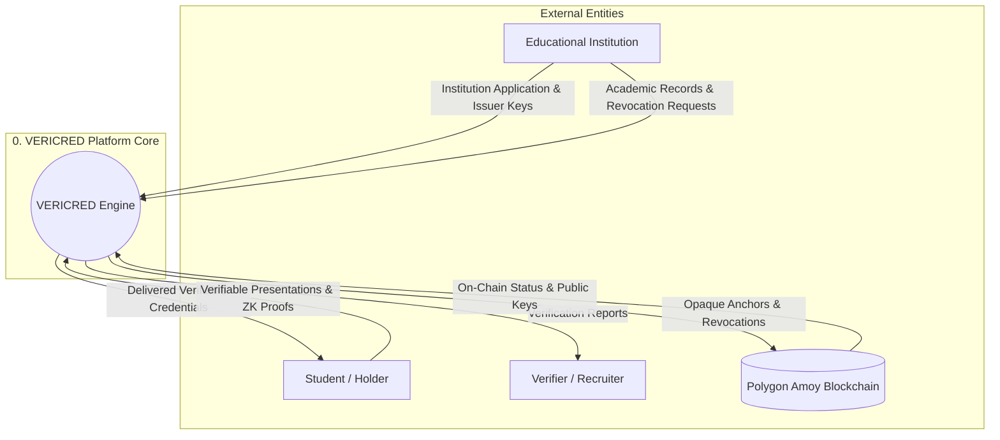
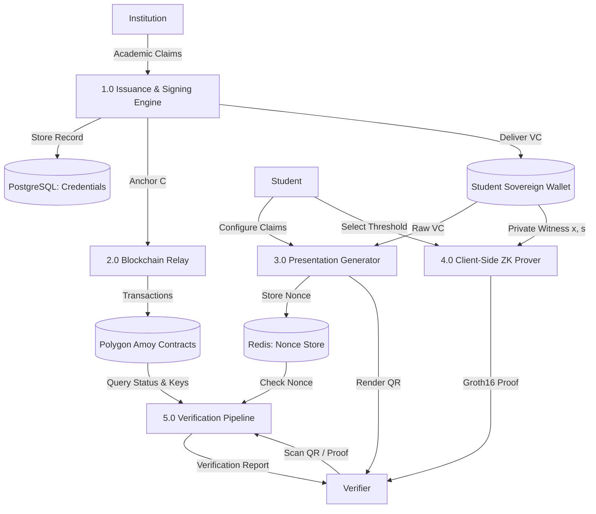

# DATA_FLOW_DIAGRAMS.md — Functional Data Flow Models (DFD Level 0 & Level 1)

> **Document ID**: DIAG-005  
> **Status**: Confirmed Technical Specification

---

## 1. DFD Level 0 — Context Diagram

---

## 2. DFD Level 1 — Detailed Functional Decomposition

