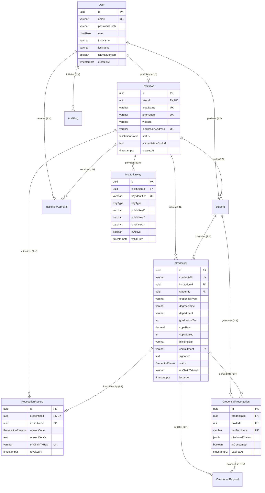

# ER_DIAGRAM.md — Canonical Entity Relationship Diagram

> **Document ID**: DIAG-003  
> **Status**: Confirmed Technical Specification  
> **Canonical Schema Reference**: [docs/03_DATABASE_AND_BACKEND/DATABASE_DESIGN.md](../docs/03_DATABASE_AND_BACKEND/DATABASE_DESIGN.md)

---

## 1. Full Relational Entity Relationship Diagram

For complete field types, indexes, and constraints, see [DATABASE_DESIGN.md](../docs/03_DATABASE_AND_BACKEND/DATABASE_DESIGN.md).
