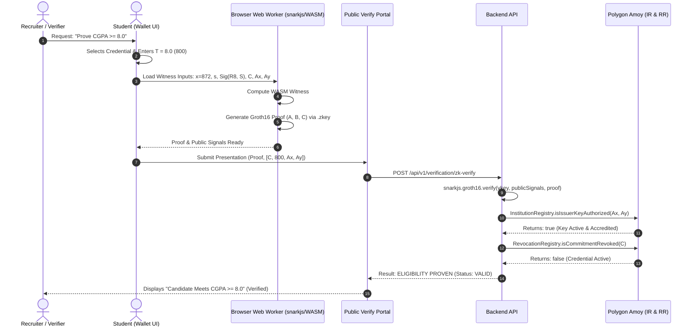
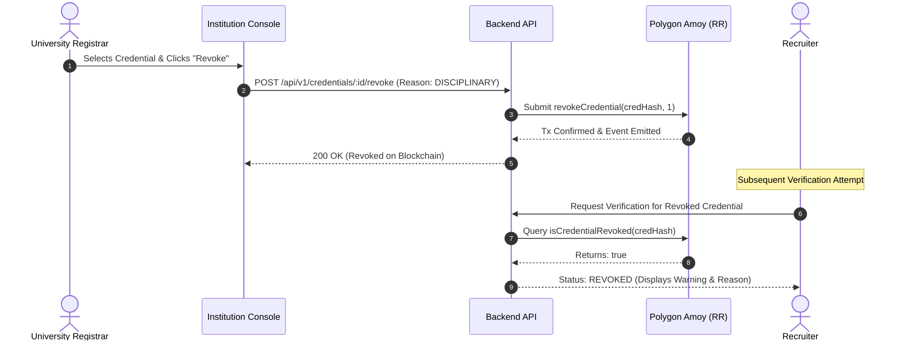

# SEQUENCE_DIAGRAMS.md — System Sequence Specifications

> **Document ID**: DIAG-004  
> **Status**: Confirmed Technical Specification

---

## 1. Zero-Knowledge Proof Generation & Verification Sequence

---

## 2. Dynamic Credential Revocation Sequence

For all other end-to-end data flow sequences, see [DATA_FLOW_ARCHITECTURE.md](../docs/02_SYSTEM_ARCHITECTURE/DATA_FLOW_ARCHITECTURE.md).
