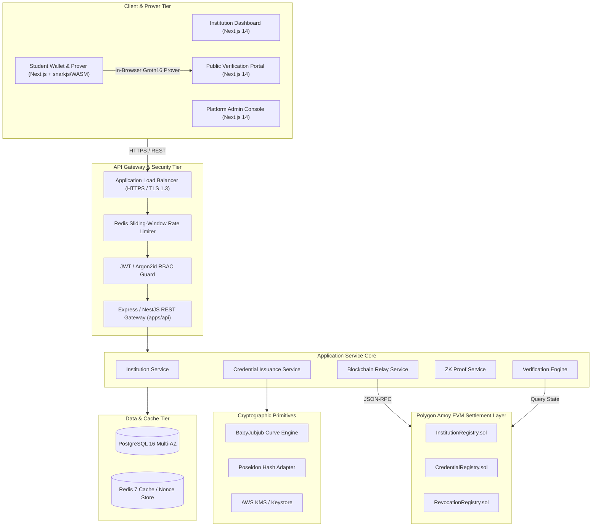
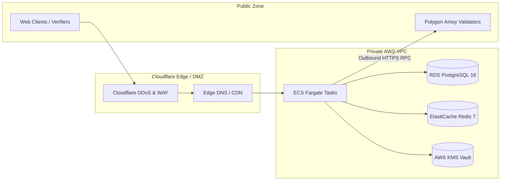

# SYSTEM_ARCHITECTURE.md — System Architecture & Topology Diagrams

> **Document ID**: DIAG-001  
> **Status**: Confirmed Technical Specification

---

## 1. High-Level System Architecture Diagram

---

## 2. Network Topology & Deployment Zones

