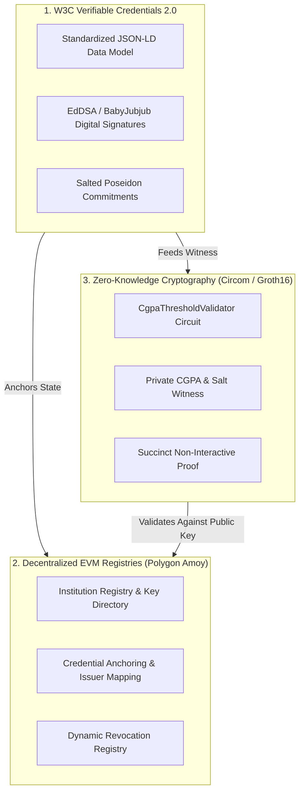

# PROJECT_VISION.md — Project Vision, Problem Statement & Strategy

> **Document ID**: DOC-FOUNDATION-001  
> **Status**: Confirmed  
> **Target Audience**: Stakeholders, Architects, Cryptographers, Developers

---

## 1. Problem Background & Industry Context

Academic credential fraud, degree fabrication, and diploma mills represent a multi-billion-dollar systemic challenge across the global higher education and employment ecosystem. Traditional academic credential management relies on archaic paradigms:
1. **Physical Paper Certificates**: Easily counterfeited with low-cost desktop publishing tools, vulnerable to physical deterioration, loss, and theft.
2. **Static Portable Document Files (PDFs)**: Digitized paper documents lack cryptographic integrity; visual signatures and letterheads can be modified or photoshopped in minutes without detection.
3. **Manual Third-Party Verification**: Background check companies and university registrars charge exorbitant fees ($20 to $150 per check) and take weeks to manually authenticate transcripts via telephone, postal mail, or unauthenticated emails.
4. **All-or-Nothing Data Disclosure**: When applying for employment or licensure requiring a minimum qualification (e.g., minimum CGPA of 8.0 or degree completion), candidates are forced to disclose their full academic transcript—exposing courses failed, personal identification numbers, dates of birth, and home addresses to untrusted recruiters.

---

## 2. Existing Limitations

| Dimension | Legacy Paper / PDF Systems | Centralized Portals (e.g., National Academic Depository) | Early Blockchain Stamp Solutions |
| :--- | :--- | :--- | :--- |
| **Authenticity** | Low (easily forged) | Moderate (single point of failure / breach) | High (hash anchored on-chain) |
| **Privacy / Disclosure**| None (entire document exposed) | None (full record exposed) | Poor (often stores unhashed/unsalted PII on-chain) |
| **Verification Speed** | 2–4 weeks manual turnaround | Dependent on proprietary API uptime | Instant via RPC node |
| **Holder Sovereignty** | Physical custody only | Institutional custody (student locked out) | Wallet-based ownership |
| **Selective Disclosure**| Impossible | Impossible | Generally unsupported |
| **Revocation Support** | Unreliable / Out of band | Supported, but proprietary | Complex, often neglected |

---

## 3. The VERICRED Vision

VERICRED envisions a sovereign, decentralized, privacy-preserving digital credential infrastructure that empowers students with unalienable cryptographic ownership over their academic achievements while granting institutions and employers a trustless, instant, and mathematically verifiable validation network.

> **Master Tagline**: *Your Achievements. Your Credentials. Your Control.*

### Core Differentiator: Privacy-Preserving Proof of Eligibility
The defining innovation of VERICRED is:
$$\text{"Prove your academic eligibility without revealing your academic history."}$$

Through the application of **Zero-Knowledge Proofs (zk-SNARKs via Circom/Groth16)**, a graduate can mathematically prove to an employer:
$$\text{CGPA} \ge 8.0$$
without revealing their exact CGPA (e.g., 8.72), individual course marks, or transcript details. The employer learns strictly that the claim is true, authenticated by an accredited institution, and currently active—with mathematical certainty.

---

## 4. Proposed Solution Architecture

VERICRED combines three foundational technology layers:

1. **W3C Verifiable Credentials Data Model 2.0**: Ensures schema interoperability, structured academic claims, and digital signature envelopes.
2. **EVM Blockchain Registries (Polygon Amoy)**: Establishes a decentralized source of truth for institutional accreditation, authorized issuer public keys, and real-time revocation status without placing personal academic data on-chain.
3. **Zero-Knowledge Proof Subsystem**: Executes client-side proof generation in the student's browser using Circom and snarkjs, binding private academic claims to institutional signatures.

---

## 5. Unique Value Proposition

- **For Educational Institutions**: Eliminates administrative overhead of responding to manual verification inquiries; prevents institutional reputation damage from degree fraud; provides modern bulk issuance workflows.
- **For Students (Holders)**: Grants permanent sovereign ownership of credentials; eliminates credential re-issuance fees; protects personal privacy through selective disclosure and zero-knowledge eligibility proofs.
- **For Employers & Verifiers**: Provides sub-second, zero-cost credential verification; eliminates reliance on slow background screening agencies; guarantees mathematical non-repudiation.

---

## 6. Target User Personas

1. **University Registrar (Dr. Elena Rostova)**: Oversees graduation certification for 5,000+ students annually. Needs a reliable bulk-issuance portal that integrates with existing student information systems (SIS via CSV) and signs credentials with an institutional key.
2. **Graduating Student (Aarav Sen)**: B.Tech Computer Science graduate applying for competitive software engineering positions. Wants to store his degree in his mobile/web wallet and prove his high academic standing without displaying his marks in non-core electives.
3. **Corporate Technical Recruiter (Sarah Jenkins)**: High-volume talent acquisition partner filtering 1,000+ applicants for an elite internship requiring $\text{CGPA} \ge 8.0$. Needs instant, automated verification without logging into disparate university portals.
4. **Platform Governance Administrator**: Ensures only legally accredited, vetted higher education institutions are registered as authorized credential issuers.

---

## 7. Business & Strategic Objectives

| Metric | Target | Timeframe |
| :--- | :--- | :--- |
| **Verification Latency** | $< 500\text{ms}$ (standard QR), $< 2.5\text{s}$ (ZK proof) | MVP / Hackathon |
| **Issuance Cost per Credential** | $< \$0.005$ on Polygon Amoy EVM network | Production |
| **Revocation Resolution Time** | Sub-block finality ($\le 2$ seconds) | MVP |
| **Privacy Guarantee** | Zero PII or raw grades stored on-chain | Non-negotiable |
| **Cryptographic Soundness** | 128-bit security level across curve & hashing primitives | Production |

---

## 8. Strategic Roadmap Links
- Formal Requirements: [SRS.md](SRS.md)
- Scope Boundaries: [SCOPE_AND_REQUIREMENTS.md](SCOPE_AND_REQUIREMENTS.md)
- Architectural Blueprint: [SYSTEM_ARCHITECTURE.md](../02_SYSTEM_ARCHITECTURE/SYSTEM_ARCHITECTURE.md)
