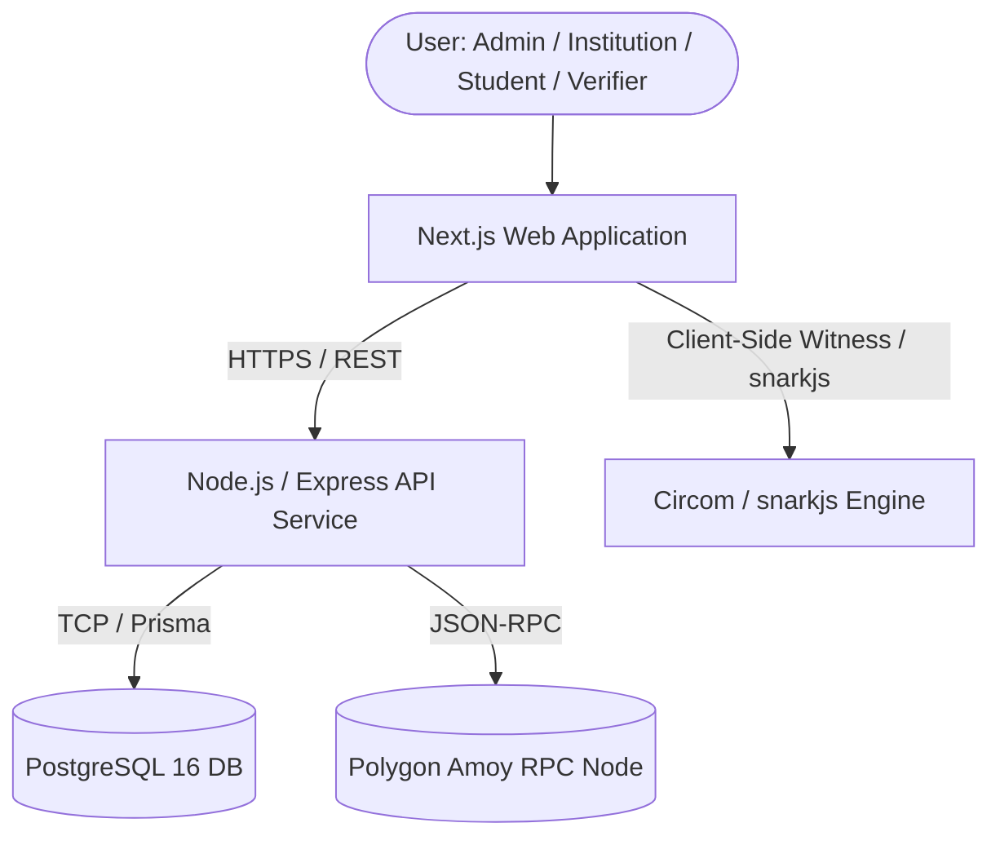

# SRS.md — Software Requirements Specification (IEEE 830-Aligned)

> **Document ID**: DOC-FOUNDATION-002  
> **System Name**: VERICRED (Verifiable Academic Credential Network)  
> **Version**: 1.0.0-PROPOSED  
> **Status**: Confirmed Technical Specification

---

## 1. Introduction

### 1.1 Purpose
This Software Requirements Specification (SRS) defines the functional, non-functional, interface, and cryptographic requirements for the VERICRED platform. It serves as the authoritative technical benchmark for development, testing, security auditing, and acceptance.

### 1.2 Scope
VERICRED is an end-to-end decentralized network enabling accredited academic institutions to issue W3C-compliant Verifiable Credentials (VC 2.0), students to securely manage them via sovereign web wallets, and verifiers to authenticate claims or verify Zero-Knowledge eligibility proofs (Groth16 zk-SNARKs) anchored to Polygon Amoy EVM smart contracts.

### 1.3 Definitions and Acronyms
- **VC**: Verifiable Credential (W3C standard data container).
- **VP**: Verifiable Presentation (Holder-derived presentation of credential claims).
- **zk-SNARK**: Zero-Knowledge Succinct Non-Interactive Argument of Knowledge.
- **Poseidon**: Algebraic hash function optimized for arithmetic circuits over prime fields.
- **BabyJubjub**: Twisted Edwards elliptic curve birationally equivalent to a Montgomery curve over the scalar field of BN254.
- **EVM**: Ethereum Virtual Machine.

---

## 2. Overall Description & Product Perspective

### 2.1 System Context
VERICRED interfaces with higher education registrar databases, client web browsers, mobile device cameras for QR scanning, and decentralized EVM RPC nodes.

### 2.2 User Classes and Characteristics
1. **Platform Administrator**: High technical literacy. Responsible for platform governance, reviewing and whitelisting institutions, and monitoring system integrity.
2. **Institution Registrar**: Moderate technical literacy. Responsible for managing student cohorts, issuing individual or batch credentials, and initiating credential revocations.
3. **Student (Holder)**: Varied technical literacy. Manages wallet, generates presentations, exports credentials, and triggers client-side ZK proof calculations.
4. **Verifier / Recruiter**: General public. Accesses public verification portals without authentication; scans QR codes or pastes verification URLs.

---

## 3. Functional Requirements (FR)

### 3.1 Authentication & Institutional Governance
- **FR-001**: The system shall authenticate users via email and password using Argon2id password hashing with salt length $\ge 16$ bytes, memory cost $\ge 64\,\text{MB}$, and time cost $\ge 3$ iterations.
- **FR-002**: The system shall issue HTTP-only, `SameSite=Strict`, TLS-secured JWT access and refresh tokens.
- **FR-003**: The system shall enforce Role-Based Access Control (RBAC) across four roles: `ADMIN`, `INSTITUTION`, `STUDENT`, `VERIFIER`.
- **FR-004**: An institution registration shall default to `PENDING` approval. An institution shall be prohibited from issuing credentials or registering on-chain keys until explicitly approved by an `ADMIN`.
- **FR-005**: The system shall provide an administrator dashboard to approve, suspend, or reactivate institutions and audit their activity logs.

### 3.2 Credential Schema & Issuance
- **FR-006**: The system shall generate academic credentials conforming to the W3C Verifiable Credentials Data Model 2.0 specification in JSON-LD format.
- **FR-007**: Every issued credential shall include an integer-scaled academic claim for CGPA:
  $$\text{scaledCgpa} = \text{round}(\text{cgpa} \times 100), \quad \text{scaledCgpa} \in [0, 1000]$$
- **FR-008**: The system shall compute a cryptographic salted commitment:
  $$C = \text{Poseidon}(\text{scaledCgpa}, \text{salt})$$
  where $\text{salt}$ is a cryptographically secure 254-bit random field element.
- **FR-009**: The institution service shall sign the credential commitment and digest using the institution's authorized EdDSA private key over the BabyJubjub curve.
- **FR-010**: The system shall support bulk credential issuance via CSV upload, validating schema constraints on every row before executing atomic batch issuance.
- **FR-011**: Private signing keys shall never be stored in plaintext. In development, keys shall reside in encrypted keystores; production requirements specify AWS KMS or HashiCorp Vault.

### 3.3 Blockchain & Decentralized Registries
- **FR-012**: The system shall anchor approved institutions and their active public signing keys to the `InstitutionRegistry.sol` smart contract on Polygon Amoy.
- **FR-013**: The system shall record opaque credential references and commitments in `CredentialRegistry.sol`. No personally identifiable information (PII) or plaintext grades shall be written to the blockchain.
- **FR-014**: The system shall provide revocation capabilities in `RevocationRegistry.sol`, permitting only the original issuing institution address to revoke a credential reference.

### 3.4 Student Sovereign Wallet & Presentations
- **FR-015**: The student wallet shall securely store issued credentials in indexed browser storage or encrypted backend storage.
- **FR-016**: The student wallet shall generate Verifiable Presentations with selective claim disclosure, binding each presentation to an ephemeral verifier challenge/nonce and expiration time ($\text{TTL} \le 15$ minutes).
- **FR-017**: The student wallet shall render an dynamic QR code containing only an opaque presentation URI (`https://vericred.net/verify/p/<presentationId>`), never embedding raw academic transcripts in the QR payload.

### 3.5 Zero-Knowledge Proof Subsystem
- **FR-018**: The system shall execute client-side Groth16 zk-SNARK proof generation within the student's browser using `snarkjs` and WebAssembly.
- **FR-019**: The ZK circuit shall mathematically enforce:
  1. $\text{scaledCgpa} \ge \text{threshold}$
  2. $C == \text{Poseidon}(\text{scaledCgpa}, \text{salt})$
  3. Valid EdDSA BabyJubjub signature by the institution's authorized public key over commitment $C$.
- **FR-020**: The proof generation process shall expose strictly the public inputs: $[C, \text{threshold}, \text{issuerPubKeyX}, \text{issuerPubKeyY}]$. The raw CGPA and salt shall remain strictly private.

### 3.6 Verification Engine & Public Portal
- **FR-021**: The verification portal shall allow unauthenticated users to verify credentials via QR scanning, URL entry, or JSON upload.
- **FR-022**: The verification engine shall execute a multi-step pipeline:
  1. Schema format and structure validation.
  2. Cryptographic signature and tamper-evidence verification.
  3. On-chain issuer authorization check via `InstitutionRegistry.sol`.
  4. Expiration date check.
  5. Dynamic on-chain revocation check via `RevocationRegistry.sol`.
  6. Groth16 zero-knowledge proof verification (when applicable).
- **FR-023**: If any single verification step fails, the system shall decisively return status `INVALID` or `REVOKED`, specifying the exact failure reason without exposing internal server errors.

---

## 4. Non-Functional Requirements (NFR)

### 4.1 Performance & Scalability
- **NFR-001**: The public verification endpoint shall process and return standard credential validation results within $\le 500\,\text{ms}$ under nominal network conditions.
- **NFR-002**: Browser-based Groth16 zero-knowledge proof generation on a standard consumer laptop (4-core x86_64 or Apple Silicon) shall complete in $\le 2.5\,\text{seconds}$.
- **NFR-003**: The backend API shall sustain a minimum throughput of 200 verification requests per second with horizontal scaling.

### 4.2 Security & Cryptography
- **NFR-004**: All external communication must be encrypted using TLS 1.3.
- **NFR-005**: All cryptographic primitives must achieve at least 128-bit security level ($\text{BN254}$ / BabyJubjub / Poseidon / Argon2id).
- **NFR-006**: Replay protection must ensure that a presentation nonce cannot be re-verified once consumed or after its expiration timestamp.
- **NFR-007**: Smart contracts must be immune to reentrancy attacks, integer overflows, and unauthorized access, verified via automated static analysis (Slither).

### 4.3 Privacy & Data Protection
- **NFR-008**: The system shall adhere strictly to data minimization: no plaintext student PII or raw grades shall ever be emitted in blockchain transactions or events.
- **NFR-009**: Verification logs must not retain private witness data, salts, or student session cookies.

### 4.4 Availability & Reliability
- **NFR-010**: The platform API and web portal shall target 99.9% uptime.
- **NFR-011**: If the primary Polygon Amoy RPC endpoint fails, the blockchain client must automatically failover to secondary configured RPC providers.

---

## 5. External Interface Requirements

- **User Interfaces**: Responsive web application supporting viewports from $375\,\text{px}$ (mobile) to $3840\,\text{px}$ (4K displays).
- **Software Interfaces**:
  - PostgreSQL 16 connection via Prisma ORM.
  - EVM JSON-RPC connection to Polygon Amoy (`https://rpc-amoy.polygon.technology/`).
  - IPFS / Decentralized storage gateways (for public schema and verification key hosting).

---

## 6. Assumptions and Dependencies
1. Educational institutions maintain legally recognized authority over the grades they assign. VERICRED establishes authenticity, non-repudiation, and integrity, but does not arbitrate academic disputes.
2. The BN254 elliptic curve and Groth16 proof system remain computationally sound against discrete logarithm and pairing-based cryptanalytic attacks.
3. Polygon Amoy testnet remains active and accessible for smart contract execution during development and testing phases.
