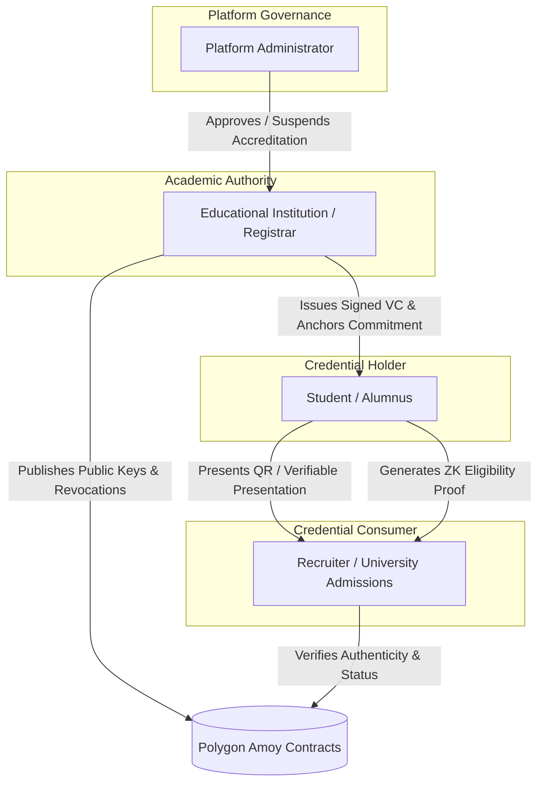

# STAKEHOLDER_ANALYSIS.md — Stakeholder Governance & Authority Model

> **Document ID**: DOC-FOUNDATION-004  
> **Status**: Confirmed Technical Specification

---

## 1. Stakeholder Matrix Overview

The VERICRED ecosystem is architected around four primary stakeholders, each operating within distinct cryptographic and organizational boundaries.

---

## 2. Comprehensive Stakeholder Profiles

### 2.1 Educational Institutions — Credential Issuers
Educational institutions (universities, colleges, accreditation boards) represent the sole **issuing authorities** of academic credentials.

- **Primary Responsibilities**:
  - Registering the institutional profile (accreditation details, domain, official contact).
  - Provisioning and rotating authorized institutional signing keys (EdDSA BabyJubjub).
  - Managing student registries and academic cohorts.
  - Constructing, signing, and delivering academic credentials.
  - Submitting opaque commitments to the blockchain `CredentialRegistry`.
  - Submitting dynamic revocation transactions to `RevocationRegistry` upon academic misconduct or degree retraction.
  - Analyzing issuance and verification telemetry.
- **Authority Boundaries**:
  - Institutions hold exclusive authority over the academic correctness of the claims they sign.
  - Institutions **cannot** access or tamper with credentials once issued into a student's personal custody, except via on-chain revocation of the commitment identifier.

---

### 2.2 Students — Credential Holders
Students (graduates, current students, certificate recipients) represent the **sovereign owners** of their credentials.

- **Primary Responsibilities**:
  - Maintaining custody of their credential wallet and personal cryptographic keys.
  - Receiving and inspecting digitally signed credentials issued to them.
  - Creating time-bounded, audience-restricted Verifiable Presentations.
  - Selectively disclosing specific attributes while withholding others.
  - Generating client-side Zero-Knowledge Proofs to demonstrate threshold eligibility (e.g., $\text{CGPA} \ge 8.0$) without exposing transcripts.
  - Monitoring verification attempts and tracking presentation history.
- **Authority Boundaries**:
  - Students have full sovereignty over presentation: credentials cannot be shared without holder consent.
  - Students **cannot** alter academic claims within a credential without invalidating the cryptographic signature.

---

### 2.3 Recruiters & Universities — Credential Verifiers
Verifiers (corporate recruiters, HR managers, graduate school admissions officers, government bodies) consume academic proofs to validate candidate qualifications.

- **Primary Responsibilities**:
  - Scanning student QR codes or inspecting secure presentation links.
  - Formulating verification policies (e.g., minimum CGPA threshold, accredited issuing body).
  - Executing automated multi-factor cryptographic verification pipelines.
  - Verifying zero-knowledge proofs and checking on-chain revocation status.
  - Generating compliance and audit verification reports.
- **Authority Boundaries**:
  - Verifiers require **zero platform authentication** for basic public verification, preventing friction.
  - Verifiers **never** receive access to raw academic data when a student supplies a zero-knowledge proof.

---

### 2.4 Platform Administrators — System Stewards
The platform administrator oversees the technical and governance infrastructure of VERICRED.

- **Primary Responsibilities**:
  - Reviewing institutional registration applications, accreditation documents, and domain ownership.
  - Approving, suspending, or revoking an institution's status as a trusted issuer.
  - Monitoring system uptime, smart contract health, and audit logs.
  - Managing platform configuration parameters.
- **Crucial Separation of Concerns**:
  > **Principle of Non-Interference**: A platform administrator possesses **zero academic authority**. Administrators cannot issue credentials, alter student grades, forge institutional signatures, or revoke credentials on behalf of institutions. System administrators govern platform membership; institutions govern academic truth.

---

## 3. Stakeholder Interaction & Permission Matrix

| Capability / Action | Platform Admin | Educational Institution | Student (Holder) | Verifier (Public) |
| :--- | :---: | :---: | :---: | :---: |
| Register Institution Account | ❌ | ✅ | ❌ | ❌ |
| Approve / Suspend Institution | ✅ | ❌ | ❌ | ❌ |
| Manage Issuer Signing Keys | ❌ | ✅ (Own keys only) | ❌ | ❌ |
| Manage Student Cohorts | ❌ | ✅ (Own campus) | ❌ | ❌ |
| Issue Academic Credential | ❌ | ✅ (Approved only) | ❌ | ❌ |
| Anchor Credential Commitment | ❌ | ✅ | ❌ | ❌ |
| Revoke Issued Credential | ❌ | ✅ (Issuer only) | ❌ | ❌ |
| View Sovereign Wallet | ❌ | ❌ | ✅ (Own wallet) | ❌ |
| Export Credential JSON | ❌ | ❌ | ✅ | ❌ |
| Generate QR / Presentation | ❌ | ❌ | ✅ | ❌ |
| Generate ZK CGPA Proof | ❌ | ❌ | ✅ | ❌ |
| Scan QR & Verify Credential | ✅ | ✅ | ✅ | ✅ (Unauthenticated) |
| Verify ZK Proof | ✅ | ✅ | ✅ | ✅ (Unauthenticated) |
| View Platform Audit Logs | ✅ | ❌ | ❌ | ❌ |

---

## 4. Trust Boundaries & Anti-Coercion Measures

1. **Issuer Key Containment**: Institution private signing keys remain confined to secure server hardware or KMS modules. Even compromised administrator accounts cannot extract private keys.
2. **Replay & Impersonation Prevention**: Verifiers challenge presentations with a cryptographic nonce ($N$). Students sign $(VP \parallel N)$, proving active consent and rendering intercepted QR screenshots unusable after expiration.
3. **Correlation Resistance**: When generating ZK proofs, random 254-bit blinding salts ($s$) prevent verifiers from correlating multiple proofs submitted by the same candidate across different job applications.
