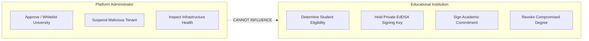

# AUTHENTICATION_AND_AUTHORIZATION.md — Identity, RBAC & Session Security

> **Document ID**: DOC-ARCH-004  
> **Status**: Confirmed Technical Specification

---

## 1. Authentication Architecture

VERICRED employs a stateless, token-based authentication mechanism reinforced with secure, encrypted, HTTP-only cookie delivery to neutralize Cross-Site Scripting (XSS) and token theft vectors.

```mermaid
flowchart TD
    User([User Client]) -->|1. POST /auth/login (Email, Password)| AuthController[Auth Controller]
    AuthController -->|2. Query User & Salt| DB[(PostgreSQL)]
    AuthController -->|3. Argon2id Verify| Hasher[Argon2id Verifier]
    Hasher -->|Valid| TokenIssuer[Token Service]
    TokenIssuer -->|4. Issue Access Token 15m & Refresh Token 7d| CookieJar[Set HTTP-only Cookies]
    TokenIssuer -->|5. Store Session / JTI| Redis[(Redis Token Blacklist)]
    CookieJar -->|6. Set-Cookie Header| User
```

### 1.1 Password Security & Hashing
All user credentials undergo cryptographic hashing using **Argon2id** (OWASP Password Storage Cheat Sheet compliant):
- **Algorithm**: Argon2id
- **Memory Cost ($m$)**: $65,536\,\text{KiB}$ ($64\,\text{MB}$)
- **Time Cost ($t$)**: 3 iterations
- **Parallelism ($p$)**: 4 threads
- **Salt Length**: 16 bytes generated via CSPRNG (`crypto.randomBytes`)
- **Key Length**: 32 bytes

---

## 2. Token Lifecycle & Session Management

VERICRED enforces a dual-token lifecycle with sliding session renewal and instant revocation.

| Token Type | Payload Contents | Transport Mechanism | Lifetime | Storage Location |
| :--- | :--- | :--- | :--- | :--- |
| **Access Token** | `sub`, `email`, `role`, `institutionId`, `jti`, `exp` | `Set-Cookie: access_token; HttpOnly; Secure; SameSite=Strict` | 15 minutes | In-memory / Cookie |
| **Refresh Token**| `sub`, `jti`, `tokenFamily`, `exp` | `Set-Cookie: refresh_token; HttpOnly; Secure; SameSite=Strict; Path=/api/v1/auth` | 7 days | Redis / DB Table |

### 2.1 Refresh Token Rotation & Theft Detection
- Refresh tokens belong to a unique `tokenFamily`.
- Each invocation of `/api/v1/auth/refresh` invalidates the old refresh token and issues a new pair.
- If an already invalidated refresh token is presented, the authentication engine flags **token theft**, immediately invalidating the entire `tokenFamily` and forcing all active sessions for that user to terminate.

---

## 3. Role-Based Access Control (RBAC)

VERICRED defines four mutually exclusive system roles:

```text
[ ADMIN ] ---- Governs platform institutions, views audit logs, manages system configuration
    |
[ INSTITUTION ] - Manages campus student cohort, issues signed credentials, submits revocations
    |
[ STUDENT ] ----- Custodies credentials in web wallet, generates presentations & ZK proofs
    |
[ VERIFIER ] ---- Unauthenticated public or registered recruiter conducting credential validation
```

### 3.1 Permission Matrix

| Resource / Action | ADMIN | INSTITUTION | STUDENT | VERIFIER (Public) |
| :--- | :---: | :---: | :---: | :---: |
| `POST /auth/register-institution` | ❌ | Allowed | ❌ | ❌ |
| `POST /admin/institutions/:id/approve` | **Allowed** | ❌ | ❌ | ❌ |
| `POST /admin/institutions/:id/suspend` | **Allowed** | ❌ | ❌ | ❌ |
| `GET /admin/audit-logs` | **Allowed** | ❌ | ❌ | ❌ |
| `POST /institution/keys/rotate` | ❌ | **Allowed** | ❌ | ❌ |
| `POST /credentials/issue` | ❌ | **Allowed** (Approved only) | ❌ | ❌ |
| `POST /credentials/bulk-issue` | ❌ | **Allowed** (Approved only) | ❌ | ❌ |
| `POST /credentials/:id/revoke` | ❌ | **Allowed** (Issuer only) | ❌ | ❌ |
| `GET /student/wallet` | ❌ | ❌ | **Allowed** (Self only) | ❌ |
| `POST /presentations/generate` | ❌ | ❌ | **Allowed** (Self only) | ❌ |
| `POST /verification/verify` | Allowed | Allowed | Allowed | **Allowed (Public)** |
| `POST /verification/zk-verify` | Allowed | Allowed | Allowed | **Allowed (Public)** |

---

## 4. Separation of Administrative Authority vs. Academic Authority

A fundamental architectural boundary in VERICRED is the immutable separation between platform administration and academic certification:



1. **Admins Cannot Forge Credentials**: The platform administrator has no access to an institution's private signing keys. Credentials signed by unauthorized administrator keys will be rejected by smart contracts and client verification engines.
2. **Admins Cannot Alter Issued Records**: Even if a database administrator tampers with database rows, the cryptographic signature on the credential remains broken unless signed by the authorized on-chain public key.
3. **Admins Cannot Revoke Credentials**: The `RevocationRegistry.sol` smart contract enforces that caller `msg.sender == issuerAddress`. An administrator cannot execute an on-chain revocation of a university degree.

---

## 5. Protected Endpoint Implementation & Middleware

Backend endpoints are protected through composable Express middleware:

```typescript
// Example Route Definition
router.post(
  '/api/v1/credentials/issue',
  authenticateJwt,                     // Validates JWT & checks token blacklist in Redis
  requireRole(['INSTITUTION']),        // Asserts user.role === 'INSTITUTION'
  requireApprovedInstitution,          // Asserts institution.status === 'APPROVED'
  validateBody(issueCredentialSchema), // Zod payload validation
  credentialController.issue
);
```
