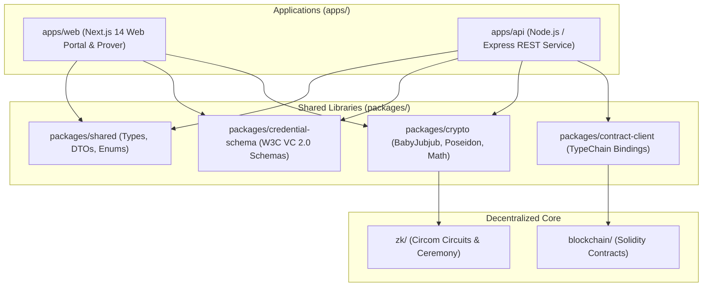
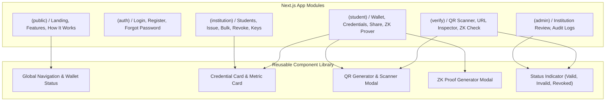

# COMPONENT_ARCHITECTURE.md — Component Breakdown & Interfaces

> **Document ID**: DOC-ARCH-002  
> **Status**: Confirmed Technical Specification

---

## 1. Monorepo Component Topology

The VERICRED codebase is partitioned into distinct modular components across applications, packages, contracts, and circuits.

---

## 2. Shared Packages (`packages/`)

### 2.1 `@vericred/shared`
- **Responsibility**: Provides universal constants, TypeScript interface definitions, HTTP response envelopes, custom error classes, and runtime environment validation schemas.
- **Key Modules**:
  - `types/`: `UserRole`, `CredentialStatus`, `VerificationResult`, `AuditAction`.
  - `dto/`: Request/response transfer objects with Zod schemas.
  - `errors/`: `VeriCredError`, `InvalidSignatureError`, `RevokedCredentialError`.
  - `env/`: Zod environment variable parsing rules for runtime safety.

### 2.2 `@vericred/credential-schema`
- **Responsibility**: Implements the W3C Verifiable Credentials 2.0 JSON-LD data models, JSON Schema definitions, and semantic context definitions.
- **Key Modules**:
  - `academicCredential.schema.json`: Formal JSON Schema for university degrees and transcripts.
  - `contexts/`: JSON-LD context files mapping `@context` to VERICRED vocabulary.
  - `validators/`: Zod validation functions verifying credential claim structure before signing.

### 2.3 `@vericred/crypto`
- **Responsibility**: Houses all non-standard and zero-knowledge cryptographic primitives.
- **Key Modules**:
  - `poseidon.ts`: Wrapper around `circomlibjs.buildPoseidon`, providing deterministic multi-input hashing.
  - `babyjubjub.ts`: Curve point multiplication, keypair generation, and EdDSA signing/verification over BabyJubjub.
  - `scaling.ts`: Deterministic fixed-point conversion ($x \times 100 \rightarrow \mathbb{Z}$) and range bounding $[0, 1000]$.
  - `salt.ts`: CSPRNG 254-bit field element blinding generator.

### 2.4 `@vericred/contract-client`
- **Responsibility**: Exposes strongly typed Ethers.js v6 contract wrappers generated via TypeChain.
- **Key Modules**:
  - `InstitutionRegistryClient`: Methods to query approved issuers and active public keys.
  - `CredentialRegistryClient`: Methods to record opaque issuance anchors.
  - `RevocationRegistryClient`: Methods to inspect and submit revocation flags.

---

## 3. Backend Services & Controllers (`apps/api`)

| Backend Module | Primary Responsibility | Dependencies | Exported Interface / Endpoints |
| :--- | :--- | :--- | :--- |
| **AuthModule** | Registration, login, password hashing, JWT lifecycle, RBAC | Prisma, Argon2, Redis | `/api/v1/auth/*` |
| **InstitutionModule**| Institutional onboarding, approval, and key management | Prisma, InstitutionRegistryClient | `/api/v1/institutions/*` |
| **StudentModule** | Cohort management, student profile mapping | Prisma | `/api/v1/students/*` |
| **CredentialModule** | Issuance form processing, bulk CSV parsing, EdDSA signing | Prisma, `@vericred/crypto` | `/api/v1/credentials/*` |
| **PresentationModule**| Ephemeral VP generation, nonce management, TTL validation | Redis, Prisma | `/api/v1/presentations/*` |
| **VerificationModule**| Multi-step verification pipeline (signature, on-chain status, ZK) | Prisma, ContractClients, snarkjs | `/api/v1/verification/*` |
| **BlockchainRelay** | Nonce tracking, gas estimation, contract transaction submission | Ethers.js, Polygon Amoy RPC | Internal background service |
| **AuditModule** | Immutable administrative and activity logging | Prisma | `/api/v1/admin/audit-logs` |

---

## 4. Frontend Application Components (`apps/web`)

- **CredentialCard**: Polymorphic card displaying degree type, institution logo, issue date, and quick actions.
- **QrScannerModal**: Camera-based scanner leveraging `html5-qrcode` to read ephemeral presentation URIs.
- **ZkProofGeneratorModal**: Multi-step wizard allowing students to select an eligibility threshold (e.g., 8.0), execute the browser-based WASM witness calculation, and emit the Groth16 proof presentation.
- **VerificationReport**: High-fidelity breakdown itemizing cryptographic signature, issuer authorization, blockchain revocation, and ZK eligibility outcomes.

---

## 5. Smart Contracts (`blockchain/contracts/`)

1. **`InstitutionRegistry.sol`**:
   - Manages authorized university addresses, accreditation status (`PENDING`, `APPROVED`, `SUSPENDED`), and active EdDSA BabyJubjub public keys.
2. **`CredentialRegistry.sol`**:
   - Stores credential existence anchors consisting of: `bytes32 credentialHash`, `bytes32 commitment`, `address issuer`, and `uint64 issuanceTimestamp`.
3. **`RevocationRegistry.sol`**:
   - Maintains an immutable mapping `mapping(bytes32 => bool) public isRevoked`. Restricts revocation execution exclusively to the authenticated issuer address recorded in `CredentialRegistry`.

---

## 6. Zero-Knowledge Circuit Components (`zk/circuits/`)

1. **`CgpaThresholdValidator.circom`**: Main circuit coordinating private inputs (scaled CGPA $x$, salt $s$, signature $R8, S$) and public inputs (commitment $C$, threshold $T$, issuer key $\text{Ax}, \text{Ay}$).
2. **`RangeCheck.circom`**: Ensures $x \ge T$ and bounds $x \in [0, 1000]$ using $n$-bit decomposition.
3. **`PoseidonHash2.circom`**: Verifies commitment $C == \text{Poseidon}(x, s)$.
4. **`EdDSAPoseidonVerifier.circom`**: Verifies the institution's EdDSA BabyJubjub signature over the credential commitment and claim hash.
