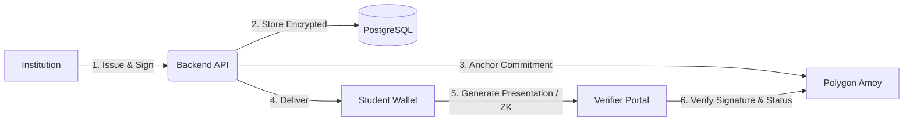
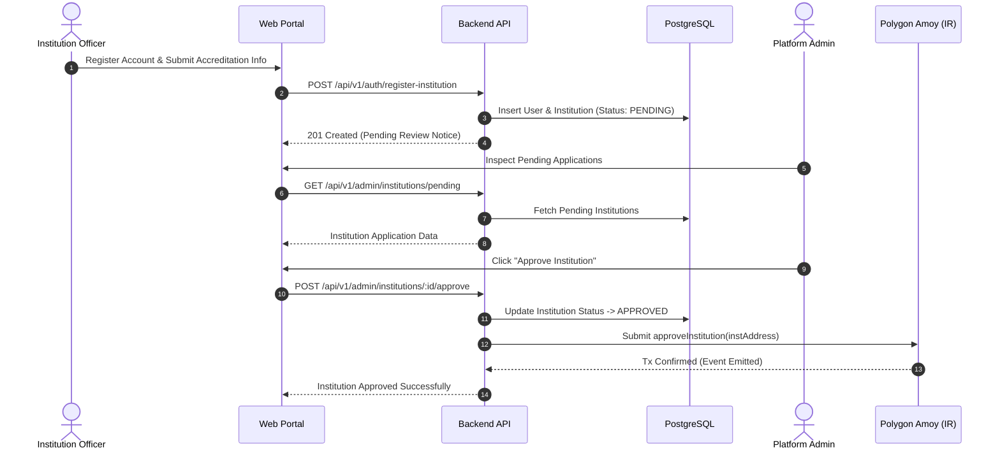
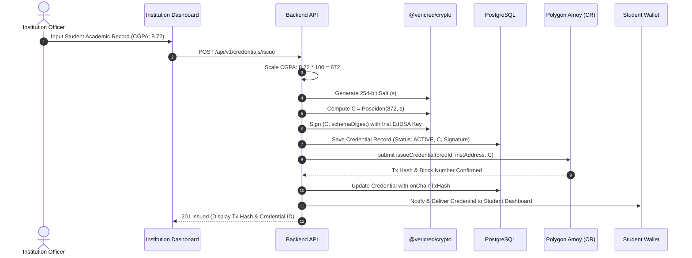
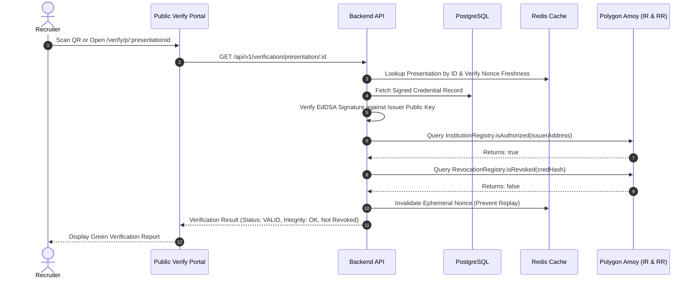
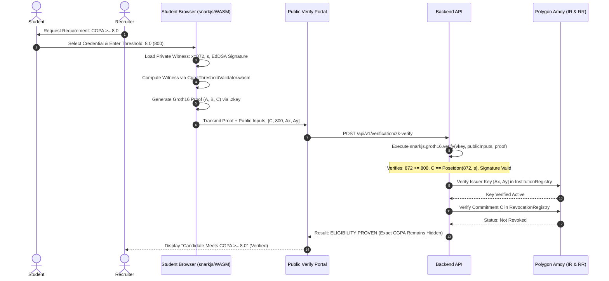
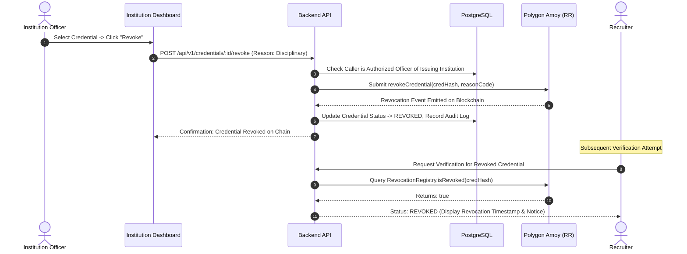

# DATA_FLOW_ARCHITECTURE.md — System Data Flows & Sequences

> **Document ID**: DOC-ARCH-003  
> **Status**: Confirmed Technical Specification

---

## 1. End-to-End System Data Flow Overview

This document specifies the step-by-step movement of data across actors, frontend applications, API gateways, databases, cryptographic engines, and the Polygon Amoy blockchain.



---

## 2. Sequence 1: Institution Registration & Approval



---

## 3. Sequence 2: Academic Credential Issuance & Anchoring



---

## 4. Sequence 3: Student Sovereign Sharing & QR Generation

```mermaid
sequenceDiagram
    autonumber
    actor Stud as Student
    participant Wallet as Student Web Wallet
    participant API as Backend API
    participant Redis as Redis Cache
    actor Verifier as Recruiter

    Stud->>Wallet: Select Credential & Click "Share"
    Wallet->>Wallet: Select Claims to Disclose (Degree, Year; Omit Exact Marks)
    Wallet->>API: POST /api/v1/presentations/generate
    API->>API: Generate 128-bit Ephemeral Nonce & UUID (presentationId)
    API->>Redis: Store Presentation Metadata (TTL: 15 mins, Nonce, Scope)
    API-->>Wallet: Return presentationUrl: https://vericred.net/verify/p/:id
    Wallet->>Wallet: Render Dynamic QR Code on Screen
    Verifier->>Wallet: Scan QR Code with Smartphone / Webcam
```

---

## 5. Sequence 4: Public Credential Verification



---

## 6. Sequence 5: Zero-Knowledge Proof Generation & Verification



---

## 7. Sequence 6: Credential Revocation Workflow


