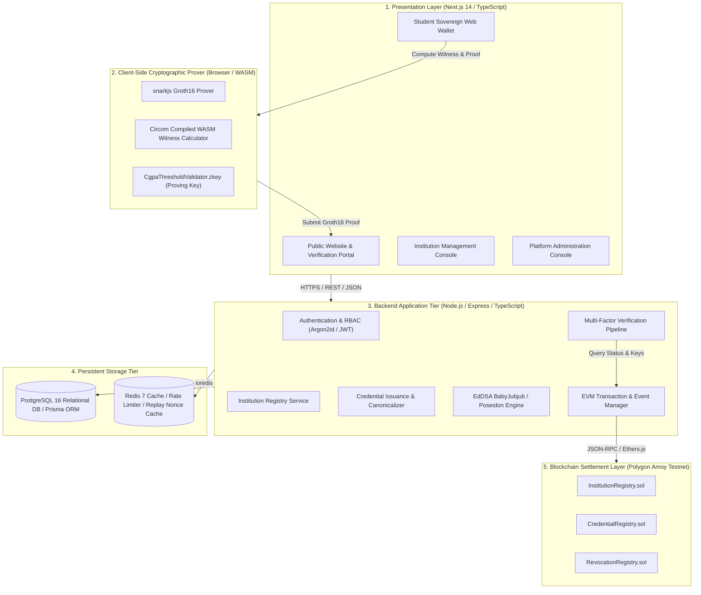

# SYSTEM_ARCHITECTURE.md — System Architecture & Topology

> **Document ID**: DOC-ARCH-001  
> **Status**: Confirmed Technical Specification

---

## 1. System Architecture Overview

VERICRED is an enterprise-grade, multi-tier decentralized credential and zero-knowledge verification network. The platform separates presentation layers, business orchestration, relational persistence, zero-knowledge witness generation, cryptographic signing, and decentralized EVM settlement layers.

---

## 2. Architectural Subsystems

### 2.1 Frontend Presentation Tier (`apps/web`)
Built on Next.js 14 utilizing the App Router architecture:
- **Server Components (RSC)**: Used for initial page loads, metadata injection, and pre-rendering marketing and static documentation pages.
- **Client Components**: Used for interactive forms, real-time QR code rendering (`qrcode.react`), camera feed processing (`html5-qrcode`), and browser-based ZK proof generation.
- **State Management**: TanStack Query (React Query) manages asynchronous server state and caching; local UI states are encapsulated via React hooks.
- **Design System**: Tailored with Tailwind CSS and `shadcn/ui`, enforcing strict institutional design tokens (Navy `#0B1226`, Electric Blue `#458BFF`, Cyan `#45D7E0`).

### 2.2 Client-Side ZK Proving Engine (`zk/build`)
Executes directly within the student's browser sandbox to guarantee zero data leakage:
- **WASM Witness Generator**: Compiled from Circom source, calculating wire assignments for input $(x, s, T, \text{Ax}, \text{Ay}, R8, S)$.
- **Groth16 Prover**: Utilizes `snarkjs` to produce succinct non-interactive arguments of knowledge ($A \in \mathbb{G}_1, B \in \mathbb{G}_2, C \in \mathbb{G}_1$) in $< 2.5\,\text{seconds}$.
- **Artifact Hosting**: Circuit `.wasm` and `.zkey` files are served via CDN with strict cache-control headers and integrity hashes (`SRI`).

### 2.3 Backend Application Tier (`apps/api`)
Constructed as a modular Node.js/TypeScript REST service:
- **Security & Middleware**: Helmet HTTP security headers, CORS origin restrictions, body parsers with strict size limits, and Redis-backed sliding-window rate limiters.
- **Authentication**: Stateless JWT issuance paired with encrypted HTTP-only cookies and database-backed session revocation tables.
- **Cryptographic Service**: Encapsulates Poseidon hashing, BabyJubjub elliptic curve operations, and fixed-point integer math within `@vericred/crypto`.
- **Blockchain Relay**: Asynchronous worker that signs and broadcasts transactions to Polygon Amoy with automatic nonce management, gas price estimation, and RPC failover.

### 2.4 Persistence Layer
- **PostgreSQL 16**: Primary relational database managed through Prisma ORM. Stores user profiles, institutions, encrypted keys, issued credential metadata, presentations, and tamper-evident audit logs.
- **Redis 7**: High-performance in-memory key-value store used for rate-limiting counters, ephemeral presentation nonces, and blockchain status caching ($60\,\text{s}$ TTL).

### 2.5 Decentralized Settlement Layer (Polygon Amoy)
EVM-compatible Layer-2 testnet providing low transaction fees ($\approx \$0.001$) and fast finality ($\approx 2\,\text{seconds}$):
- `InstitutionRegistry.sol`: Maintains whitelisted institution addresses and their authorized EdDSA BabyJubjub public signing keys.
- `CredentialRegistry.sol`: Anchors opaque credential IDs mapped to issuer addresses, issue timestamps, and salted Poseidon commitments ($C$).
- `RevocationRegistry.sol`: Tracks dynamic revocation status flags immutably. Only the issuing institution can execute a revocation for its own credentials.

---

## 3. Communication Protocols & Security Boundaries

| Interaction Path | Protocol | Security Mechanism | Payload Type |
| :--- | :--- | :--- | :--- |
| Client $\leftrightarrow$ API | HTTPS / TLS 1.3 | HTTP-Only JWT / CSRF Token / Rate Limiter | JSON / JSend Envelope |
| API $\leftrightarrow$ PostgreSQL | TCP / TLS | Scram-SHA-256 Authentication, Connection Pooling | SQL via Prisma Engine |
| API $\leftrightarrow$ Redis | RESP / TLS | Password-authenticated Redis Socket | Raw Strings / JSON |
| API $\leftrightarrow$ Polygon Amoy | HTTPS / JSON-RPC | Ethers.js Provider with API Key & Fallback RPCs | EVM Transactions / ABI Calls |
| Student $\leftrightarrow$ Verifier | Offline QR / HTTPS | Ephemeral Verifiable Presentation (Nonce + TTL) | Opaque URI / JSON-LD Presentation |

---

## 4. Key Architectural Decisions (ADR Summary)

1. **Client-Side vs. Server-Side ZK Prover**:
   - *Decision*: Prove client-side using `snarkjs` in the browser.
   - *Rationale*: A server-side prover would require transmitting the student's exact CGPA and salt to a remote backend, defeating the fundamental privacy guarantee of Zero-Knowledge Proofs.
2. **Curve Selection for In-Circuit Signatures**:
   - *Decision*: EdDSA over BabyJubjub curve with Poseidon hashing.
   - *Rationale*: Standard Ed25519 or ECDSA secp256k1 signature verification in Circom requires tens of thousands of non-native field arithmetic constraints, causing severe browser performance degradation. BabyJubjub is native to BN254, verifying signatures in $\approx 3,500$ constraints.
3. **Smart Contract Upgradeability**:
   - *Decision*: Simple, immutable contracts with explicit key rotation methods over proxy patterns (`UUPS`).
   - *Rationale*: Avoids complex proxy storage slot collisions and guarantees to verifiers that registry rules cannot be arbitrarily modified by platform administrators.
