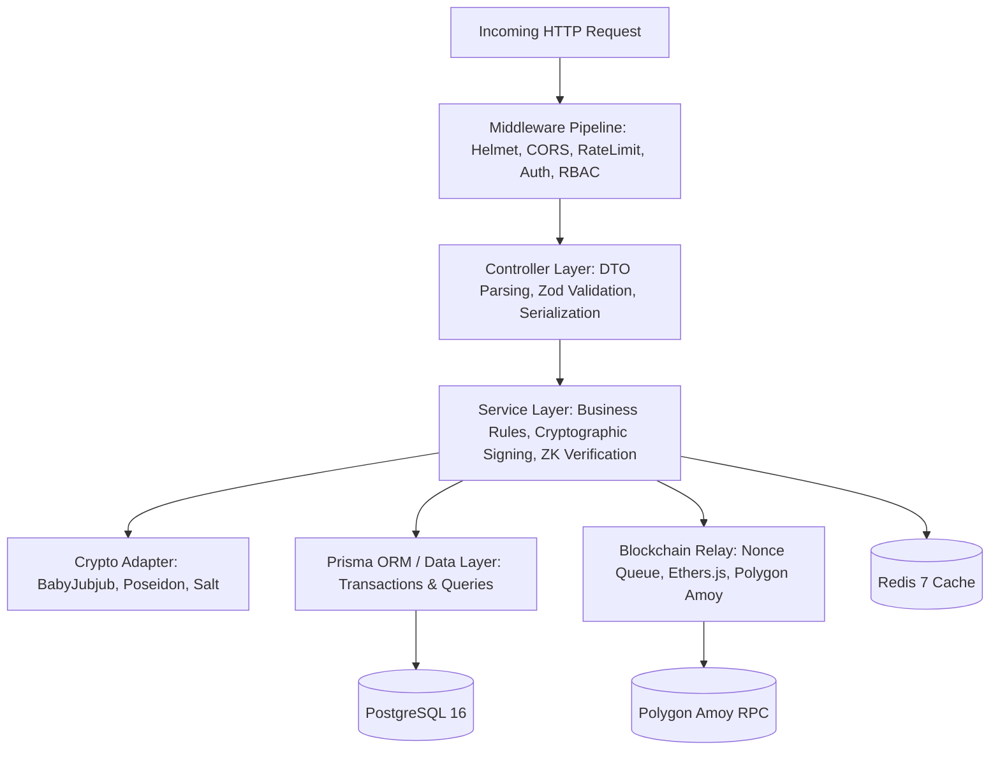

# BACKEND_ARCHITECTURE.md — Service Architecture & Server Engineering

> **Document ID**: DOC-BACKEND-001  
> **Status**: Confirmed Technical Specification  
> **Runtime**: Node.js 20+ / TypeScript / Express (or NestJS architecture)

---

## 1. Modular Layered Architecture

The VERICRED backend service (`apps/api`) follows the **Controller-Service-Repository** architectural pattern with clear separation of transport, business logic, persistence, and external integration concerns.



---

## 2. Directory Layout & Module Structure

```text
apps/api/src/
├── app.ts                  # Express application factory & middleware registration
├── server.ts               # Server entry point & graceful shutdown hooks
├── config/                 # Environment variables & runtime constants
├── middleware/
│   ├── authenticate.ts     # JWT verification & cookie parsing
│   ├── requireRole.ts      # RBAC authorization guard
│   ├── rateLimiter.ts      # Redis sliding-window rate limiter
│   └── errorHandler.ts     # Global unhandled error & JSend formatter
├── modules/
│   ├── auth/               # Registration, Login, Token Refresh, Password Reset
│   ├── admin/              # Institution approvals, system configuration, audit logs
│   ├── institutions/       # Institution profile, key rotation, campus analytics
│   ├── students/           # Cohort rosters, student profile mapping
│   ├── credentials/        # Single & bulk issuance, schema canonicalization, EdDSA signing
│   ├── presentations/      # Presentation generation, nonce creation, TTL enforcement
│   ├── verification/       # Multi-step verification engine & ZK snarkjs verifier
│   └── blockchain/         # Ethers.js client, contract listeners, transaction relay
└── utils/
    ├── logger.ts           # Structured Pino JSON logger
    └── response.ts         # JSend API envelope utilities
```

---

## 3. Core Architectural Layers

### 3.1 Controller Layer
Controllers are strictly transport adapters:
- Read request cookies, query parameters, and HTTP headers.
- Validate request bodies against Zod schemas using `validateBody(schema)`.
- Pass typed DTOs to the appropriate service methods.
- Format results into standard JSend envelopes: `{ success: true, data: { ... } }`.
- Never execute SQL queries or cryptographic algorithms directly inside controllers.

### 3.2 Service Layer
Services encapsulate the core domain logic:
- **`CredentialService`**: Converts raw CGPA to fixed-point integer ($8.72 \rightarrow 872$), derives salted Poseidon commitment, signs with institutional EdDSA private key, writes database records in an atomic transaction, and dispatches the on-chain anchoring task.
- **`VerificationService`**: Executes the 6-factor verification pipeline:
  1. Payload integrity check.
  2. Cryptographic signature check.
  3. Issuer authorization against `InstitutionRegistry.sol`.
  4. Expiration date check.
  5. On-chain revocation check against `RevocationRegistry.sol`.
  6. Optional Groth16 zk-SNARK proof verification.

### 3.3 Data Layer (Prisma ORM)
All database interactions use Prisma Client wrapped in repository functions:
- Supports ACID multi-model transactions (`prisma.$transaction`).
- Enforces strict TypeScript compile-time checking for database queries.
- Utilizes connection pooling via PgBouncer for horizontal server scalability.

---

## 4. Middleware & Cross-Cutting Concerns

1. **Helmet Security**: Injects strict HTTP response headers (`Content-Security-Policy`, `X-Content-Type-Options: nosniff`, `Strict-Transport-Security`).
2. **CORS Policy**: Configured strictly to whitelist trusted origins (`https://vericred.net`, `http://localhost:3000` in dev).
3. **Sliding-Window Rate Limiting**: Redis-backed rate limiter:
   - Public Verification: 60 requests / minute per IP.
   - Authentication Endpoints: 5 attempts / minute per IP.
   - Credential Issuance: 120 requests / minute per institution.
4. **Audit Interceptor**: Asynchronously emits audit log records to the `AuditLog` table for state-mutating administrative or institutional actions.
