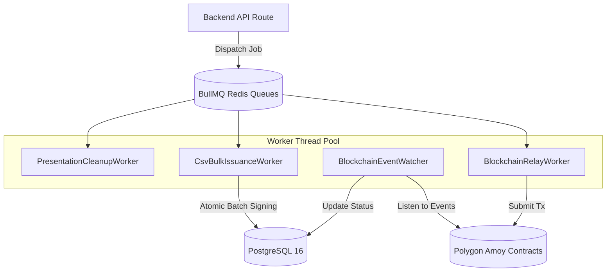

# BACKGROUND_JOBS_AND_EVENTS.md — Asynchronous Processing & Blockchain Indexing

> **Document ID**: DOC-BACKEND-002  
> **Status**: Confirmed Technical Specification  
> **Queue Engine**: BullMQ with Redis 7

---

## 1. Asynchronous Architecture Overview

To maintain low latency on synchronous HTTP requests, computationally intensive or external network operations are dispatched to asynchronous background job queues powered by **BullMQ** and **Redis**.



---

## 2. Queue Directory & Job Profiles

### 2.1 `blockchain-relay-queue`
- **Purpose**: Submits on-chain transactions (`issueCredential`, `revokeCredential`, `approveInstitution`) with managed gas pricing and nonce sequencing.
- **Concurrency**: 1 worker per active relayer wallet address (to prevent nonce conflicts).
- **Retry Policy**: Exponential backoff with up to 5 retries:
  - Attempt 1: $+10\%$ priority gas fee after 30 seconds.
  - Attempt 2: $+25\%$ priority gas fee after 60 seconds.
  - Attempt 3: $+50\%$ priority gas fee after 120 seconds.
- **Dead-Letter Queue (DLQ)**: Jobs failing after 5 attempts are routed to `blockchain-relay-dlq` and alert administrators via Slack/Discord webhooks.

### 2.2 `csv-bulk-issuance-queue`
- **Purpose**: Ingests, validates, signs, and anchors large student cohort records (up to 5,000 rows).
- **Processing Logic**:
  1. Streams CSV file using `csv-parser` to minimize memory overhead.
  2. Runs Zod validation across all records; halts if invalid rows exceed zero during dry-run.
  3. Batches EdDSA signature generation across Node.js worker threads.
  4. Executes chunked `prisma.$transaction` database insertions (chunks of 100).
  5. Queues a batched on-chain anchoring transaction.

### 2.3 `presentation-cleanup-queue`
- **Purpose**: Housekeeping job scheduled via BullMQ Repeatable Jobs (runs every 10 minutes).
- **Actions**: Marks expired presentations (`expiresAt < NOW()`) as consumed in PostgreSQL and purges expired nonces from Redis memory.

---

## 3. Blockchain Event Indexing & Real-Time Sync

The backend runs a dedicated event listener daemon (`BlockchainEventWatcher`) using Ethers.js WebSocket providers to detect on-chain contract events:

```typescript
// Contract Event Listeners
institutionRegistry.on(
  'InstitutionApproved',
  async (institutionAddress, name, event) => {
    logger.info(`Detected on-chain approval for ${name} (${institutionAddress})`);
    await institutionService.syncOnChainApproval(institutionAddress, event.log.transactionHash);
  }
);

revocationRegistry.on(
  'CredentialRevoked',
  async (credentialHash, issuer, reasonCode, event) => {
    logger.warn(`On-chain revocation detected for ${credentialHash}`);
    await credentialService.syncOnChainRevocation(credentialHash, event.log.transactionHash);
  }
);
```

### Event Reconciliation Daemon
Because WebSocket connections can drop during network interruptions, an hourly reconciliation job queries historical event logs (`eth_getLogs`) spanning the previous 10,000 blocks to identify and process any missed blockchain events.
