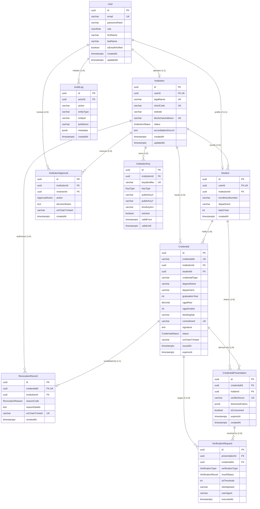

# ER_DIAGRAM.md — Entity Relationship Architecture

> **Document ID**: DOC-DATA-002  
> **Status**: Confirmed Technical Specification

---

## 1. Relational Entity Relationship Diagram

The following Mermaid diagram visualizes the tables, columns, primary keys (`PK`), foreign keys (`FK`), and cardinalities across the VERICRED PostgreSQL relational schema.

---

## 2. Referential Cardinality Summary

1. **`User` $\leftrightarrow$ `Institution`**: $1 \text{ to } 0..1$. An administrative user account may administer exactly one educational institution profile.
2. **`User` $\leftrightarrow$ `Student`**: $1 \text{ to } 0..1$. A student user account links to exactly one student profile.
3. **`Institution` $\leftrightarrow$ `InstitutionKey`**: $1 \text{ to } 1..N$. An institution holds at least one active EdDSA signing key and history of rotated keys.
4. **`Institution` $\leftrightarrow$ `Credential`**: $1 \text{ to } 0..N$. An approved institution issues many academic credentials.
5. **`Student` $\leftrightarrow$ `Credential`**: $1 \text{ to } 0..N$. A student holds one or more academic credentials (e.g., Degree and Transcript).
6. **`Credential` $\leftrightarrow$ `RevocationRecord`**: $1 \text{ to } 0..1$. A credential can be revoked at most once by its issuing institution.
7. **`Credential` $\leftrightarrow$ `CredentialPresentation`**: $1 \text{ to } 0..N$. A credential generates multiple ephemeral QR presentations over its lifetime.
