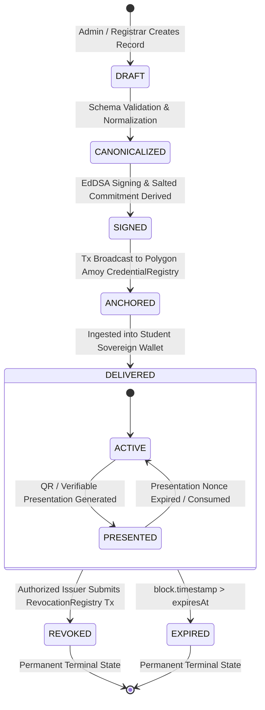

# CREDENTIAL_LIFECYCLE.md — Credential State Machine & Lifecycle Management

> **Document ID**: DOC-CRED-003  
> **Status**: Confirmed Technical Specification

---

## 1. Formal State Machine Specification

Every academic credential managed within VERICRED transitions through a deterministic, auditable state machine.

---

## 2. State Transition Definitions

| State | Entry Conditions | Cryptographic Invariants | Permitted Actions | Exit Transition |
| :--- | :--- | :--- | :--- | :--- |
| **`DRAFT`** | Form filled or CSV parsed | Data unvalidated; no signatures | Edit, Delete | `CANONICALIZED` |
| **`CANONICALIZED`** | Zod schema validation passes | RDF/JSON-LD canonical form derived | Abort | `SIGNED` |
| **`SIGNED`** | Institution EdDSA key signs digest | Commitment $C$ generated, signature valid | Store off-chain | `ANCHORED` |
| **`ANCHORED`** | Polygon Amoy confirms receipt | Credential ID & $C$ recorded in smart contract | Deliver to student | `DELIVERED` |
| **`ACTIVE`** | Student receives in wallet | Full signature, integrity, and non-revocation verified | Share, ZK Prove, Export | `REVOKED` or `EXPIRED` |
| **`REVOKED`** | On-chain revocation confirmed | Commitment bit flipped in `RevocationRegistry.sol` | View revocation report | **None (Terminal)** |
| **`EXPIRED`** | Expiration timestamp passed | Validity window terminated | View expired notice | **None (Terminal)** |

---

## 3. Revocation Mechanics & Immutable Status

Revocation is a permanent state transition executed exclusively by the authorized issuing institution address recorded during anchoring:
1. **Trigger**: An institution officer identifies an academic integrity breach, graduation error, or administrative nullification.
2. **On-Chain Assertion**: The institution executes `RevocationRegistry.revokeCredential(credHash, reasonCode)`.
3. **Event Emission**: The smart contract emits `CredentialRevoked(bytes32 indexed credHash, address indexed issuer, uint8 reasonCode, uint256 timestamp)`.
4. **Instant Invalidation**: Any subsequent presentation, QR scan, or ZK proof referencing this credential or commitment immediately returns `REVOKED` on the public verification portal.
