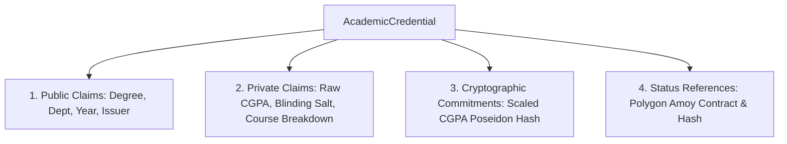

# CREDENTIAL_SCHEMA.md — Academic Credential Data Model & Schema

> **Document ID**: DOC-CRED-002  
> **Status**: Confirmed Technical Specification  
> **Schema Type**: JSON-LD with JSON Schema Validation Draft 2020-12

---

## 1. Schema Classification Structure

The VERICRED Academic Credential schema partitions claims into explicit visibility tiers to guarantee that sensitive academic data is never accidentally broadcast:



---

## 2. Complete Realistic Credential Example (Aarav Sen)

```json
{
  "@context": [
    "https://www.w3.org/ns/credentials/v2",
    "https://vericred.net/contexts/academic-credential-v1.jsonld"
  ],
  "id": "urn:uuid:f47ac10b-58cc-4372-a567-0e02b2c3d479",
  "type": [
    "VerifiableCredential",
    "AcademicDegreeCredential"
  ],
  "issuer": {
    "id": "did:vericred:institution:rcciit",
    "name": "RCC Institute of Information Technology",
    "legalEntityCode": "IN-WB-COLLEGE-042",
    "ethereumAddress": "0x71C83648E75C4782F485B8F9A1058D14881E995F",
    "publicKeyX": "1029384756102938475610293847561029384756102938475610293847561029",
    "publicKeyY": "9847561029384756102938475610293847561029384756102938475610293847"
  },
  "validFrom": "2026-06-15T10:00:00Z",
  "credentialSubject": {
    "id": "did:vericred:student:vc2026001",
    "studentName": "Aarav Sen",
    "enrollmentNumber": "VC2026001",
    "degreeName": "Bachelor of Technology",
    "department": "Computer Science and Engineering",
    "academicSession": "2022-2026",
    "graduationYear": 2026,
    "classification": "First Class with Distinction",
    "academicStanding": {
      "cgpaRaw": 8.72,
      "cgpaScaled": 872,
      "blindingSalt": "1948209481029481029481029481029481029481029481029481029481029481",
      "commitment": "12837192837192837192837192837192837192837192837192837192837192"
    }
  },
  "credentialStatus": {
    "id": "https://vericred.net/api/v1/status/0x3a4f9182bcde7102938475610293847561029384756102938475610293847561",
    "type": "VeriCredOnChainRevocation2026",
    "network": "polygon-amoy",
    "contractAddress": "0x5FbDB2315678afecb367f032d93F642f64180aa3",
    "credentialHash": "0x3a4f9182bcde7102938475610293847561029384756102938475610293847561"
  },
  "credentialSchema": {
    "id": "https://vericred.net/schemas/academic-credential-v1.json",
    "type": "JsonSchemaValidator2020"
  },
  "proof": {
    "type": "BabyJubjubPoseidonProof2026",
    "created": "2026-06-15T10:05:00Z",
    "verificationMethod": "did:vericred:institution:rcciit#key-1",
    "proofPurpose": "assertionMethod",
    "signatureValue": {
      "r8x": "1729381729381729381729381729381729381729381729381729381729381729",
      "r8y": "2837192837192837192837192837192837192837192837192837192837192837",
      "s": "1928371928371928371928371928371928371928371928371928371928371928"
    }
  }
}
```

---

## 3. Formal JSON Schema (Validation Definition)

```json
{
  "$schema": "https://json-schema.org/draft/2020-12/schema",
  "title": "VeriCredAcademicCredential",
  "type": "object",
  "required": [
    "@context",
    "id",
    "type",
    "issuer",
    "validFrom",
    "credentialSubject",
    "credentialStatus",
    "proof"
  ],
  "properties": {
    "id": { "type": "string", "format": "uri" },
    "credentialSubject": {
      "type": "object",
      "required": [
        "id",
        "studentName",
        "enrollmentNumber",
        "degreeName",
        "department",
        "graduationYear",
        "academicStanding"
      ],
      "properties": {
        "graduationYear": { "type": "integer", "minimum": 1900, "maximum": 2100 },
        "academicStanding": {
          "type": "object",
          "required": ["cgpaRaw", "cgpaScaled", "blindingSalt", "commitment"],
          "properties": {
            "cgpaRaw": { "type": "number", "minimum": 0.0, "maximum": 10.0 },
            "cgpaScaled": { "type": "integer", "minimum": 0, "maximum": 1000 },
            "blindingSalt": { "type": "string", "pattern": "^[0-9]+$" },
            "commitment": { "type": "string", "pattern": "^[0-9]+$" }
          }
        }
      }
    }
  }
}
```
