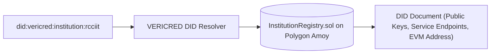

# DID_AND_ISSUER_IDENTITY.md — Decentralized Identifiers & Issuer Resolution

> **Document ID**: DOC-ID-001  
> **Status**: Confirmed Technical Specification  
> **Method**: `did:vericred` (EVM Registry-Bound DID Method)

---

## 1. The `did:vericred` Method Specification

VERICRED defines a lightweight, EVM-anchored Decentralized Identifier (DID) method designed for accredited educational institutions and student sovereign wallets:

$$\text{Format: } \mathbf{did:vericred:<entityType>:<identifier>}$$

- **`entityType`**: Either `institution` or `student`.
- **`identifier`**: For institutions, a unique alphanumeric slug (e.g., `rcciit`) or EVM address (`0x71C836...`). For students, an opaque UUID or enrollment digest.



---

## 2. Institutional DID Document Example

When resolving `did:vericred:institution:rcciit`, the resolver constructs the following compliant W3C DID Document by querying `InstitutionRegistry.sol`:

```json
{
  "@context": [
    "https://www.w3.org/ns/did/v1",
    "https://w3id.org/security/suites/ed25519-2020/v1"
  ],
  "id": "did:vericred:institution:rcciit",
  "alsoKnownAs": [
    "https://www.rcciit.org"
  ],
  "verificationMethod": [
    {
      "id": "did:vericred:institution:rcciit#key-1",
      "type": "BabyJubjubEdDSAVerificationKey2026",
      "controller": "did:vericred:institution:rcciit",
      "publicKeyJwk": {
        "kty": "OKP",
        "crv": "BabyJubjub",
        "x": "1029384756102938475610293847561029384756102938475610293847561029",
        "y": "9847561029384756102938475610293847561029384756102938475610293847"
      }
    }
  ],
  "authentication": [
    "did:vericred:institution:rcciit#key-1"
  ],
  "assertionMethod": [
    "did:vericred:institution:rcciit#key-1"
  ],
  "service": [
    {
      "id": "did:vericred:institution:rcciit#revocation-service",
      "type": "VeriCredRevocationService",
      "serviceEndpoint": "https://vericred.net/api/v1/institutions/rcciit/status"
    }
  ]
}
```

---

## 3. DID Resolution Algorithm

1. **Parse URI**: Split `did:vericred:institution:<id>`.
2. **Contract Call**: Execute `InstitutionRegistry.getInstitution(id)` on Polygon Amoy.
3. **Verify State**: Confirm `status == Status.APPROVED`.
4. **Extract Keys**: Retrieve active $(X, Y)$ coordinate representation of the BabyJubjub public signing key.
5. **Construct Document**: Dynamically assemble and return the JSON-LD DID Document with immutable cache headers ($1\,\text{hour}$ TTL).

---

## 4. Key Rotation & Historical Verifiability

When an institution executes key rotation via `InstitutionRegistry.updateIssuerKey(newKeyX, newKeyY)`:
- The historical key is marked inactive for **future issuance** (`validUntil = block.timestamp`).
- Credentials signed prior to the rotation timestamp remain cryptographically valid, as verifiers inspect historical key validity windows anchored in the smart contract's event log.
