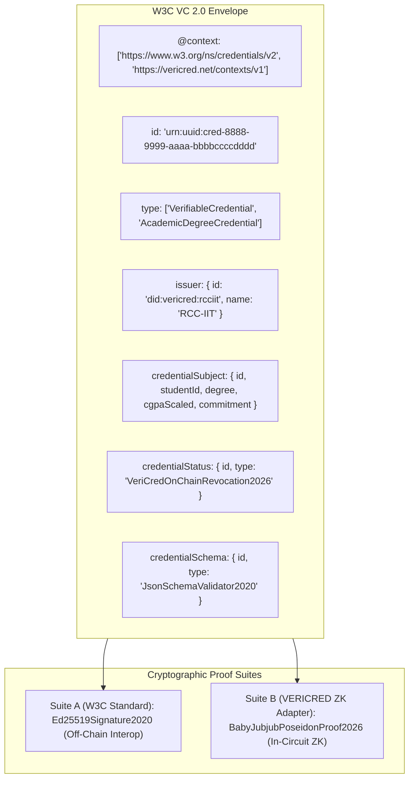

# VERIFIABLE_CREDENTIAL_DESIGN.md — W3C VC 2.0 Architecture & Cryptographic Adapter

> **Document ID**: DOC-CRED-001  
> **Status**: Confirmed Technical Specification  
> **Standard Alignment**: W3C Verifiable Credentials Data Model 2.0 (with documented BabyJubjub ZK Suite Adapter)

---

## 1. W3C Data Model 2.0 Compliance Architecture

VERICRED structures all academic credentials according to the **W3C Verifiable Credentials Data Model 2.0** specification. The data model decouples the JSON-LD semantic envelope from the underlying cryptographic signature suite.



---

## 2. Core VC 2.0 Envelope Components

### 2.1 Context Definition (`@context`)
Ensures global semantic unambiguous parsing:
```json
"@context": [
  "https://www.w3.org/ns/credentials/v2",
  "https://vericred.net/contexts/academic-credential-v1.jsonld"
]
```

### 2.2 Issuer Identification (`issuer`)
Identifies the issuing educational institution via Decentralized Identifier (DID):
```json
"issuer": {
  "id": "did:vericred:rcciit",
  "name": "RCC Institute of Information Technology",
  "ethereumAddress": "0x71C83648E75C4782F485B8F9A1058D14881E995F"
}
```

### 2.3 Credential Subject (`credentialSubject`)
Holds the academic claims asserted by the university. Sensitive claims include both plaintext claims for standard verification and cryptographic commitments for zero-knowledge range verification:
```json
"credentialSubject": {
  "id": "did:vericred:student:vc2026001",
  "studentName": "Aarav Sen",
  "enrollmentNumber": "VC2026001",
  "degreeName": "Bachelor of Technology",
  "department": "Computer Science and Engineering",
  "graduationYear": 2026,
  "cgpaRaw": 8.72,
  "cgpaScaled": 872,
  "commitment": "12837192837192837192837192837192837192837192837192837192837192",
  "blindingSalt": "98127391827391827391827391827391827391827391827391827391827391"
}
```

### 2.4 Credential Status (`credentialStatus`)
Points directly to the on-chain revocation smart contract address and status query method:
```json
"credentialStatus": {
  "id": "https://vericred.net/api/v1/status/0x3a4f...e12d",
  "type": "VeriCredOnChainRevocation2026",
  "contractAddress": "0x9876543210fedcba9876543210fedcba98765432",
  "network": "polygon-amoy",
  "credentialHash": "0x3a4f9182...e12d"
}
```

---

## 3. Cryptographic Signature Suites: Interoperability vs. ZK Efficiency

To maintain absolute technical precision, VERICRED explicitly differentiates between standard W3C signature suites and circuit-compatible ZK proof suites:

| Metric | W3C Standard Suite (`Ed25519Signature2020`) | VERICRED ZK Suite (`BabyJubjubPoseidonProof2026`) |
| :--- | :--- | :--- |
| **Elliptic Curve** | Curve25519 | BabyJubjub (Twisted Edwards over BN254 scalar field) |
| **Hash Function** | SHA-512 | Poseidon Hash |
| **W3C Global Interop** | High (universally supported by standard VC wallets) | Custom (requires VERICRED or Circom-aware wallet) |
| **Circom Constraint Cost**| $\approx 150,000$ constraints (prohibitive in browser) | $\approx 3,500$ constraints (executes in $< 2.5\,\text{s}$ client-side) |
| **Primary Use Case** | External off-chain verifier audits | In-browser privacy-preserving Zero-Knowledge Proofs |

> **Architectural Decision**: VERICRED credentials utilize a **Dual-Proof Representation**. When issued, the credential includes an authoritative EdDSA BabyJubjub signature over the Poseidon commitment $(C)$ and canonical claim digest. An optional Ed25519 signature is generated when standard W3C external interoperability is requested.
