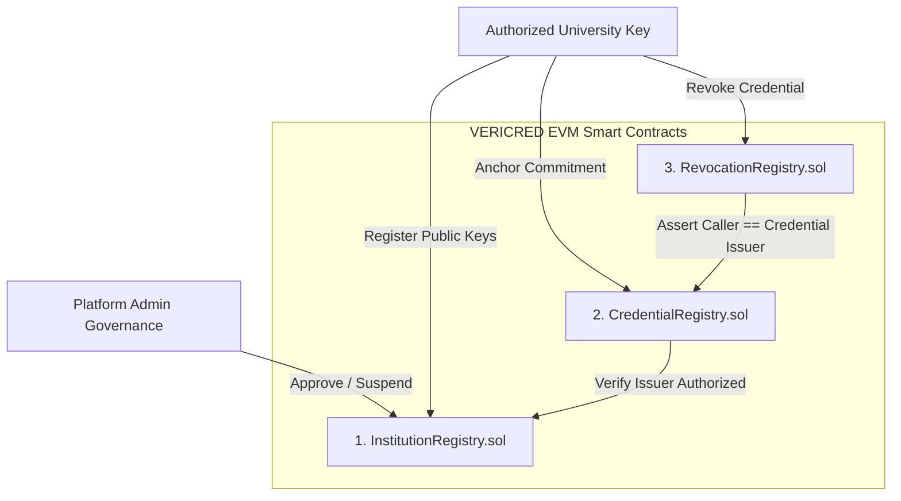

# BLOCKCHAIN_ARCHITECTURE.md — On-Chain Registries & EVM Settlement

> **Document ID**: DOC-BLOCKCHAIN-001  
> **Status**: Confirmed Technical Specification  
> **Primary Network**: Polygon Amoy Testnet (Chain ID: 80002)  
> **Secondary Option**: Ethereum Sepolia (Chain ID: 11155111)

---

## 1. Architectural Justification: Why Blockchain is Essential

In traditional academic certification, verification requires either trusting a single centralized database (which can be hacked, bribed, or taken offline) or contacting university registrars manually. 

Blockchain provides VERICRED with three irreplaceable cryptographic capabilities:
1. **Decentralized Root of Trust**: Prevents any single entity (including VERICRED platform operators) from secretly modifying institutional accreditations or authorized issuer keys.
2. **Immutable Revocation Ledger**: Once an institution revokes a credential on-chain, that revocation cannot be deleted, backdated, or hidden by corrupt administrators or compromised servers.
3. **Trustless Availability**: Verifiers globally can confirm credential status $24/7/365$ via public RPC nodes, even if VERICRED's proprietary API servers are undergoing maintenance or offline.

---

## 2. On-Chain vs. Off-Chain Data Boundary Policy

To preserve privacy, comply with data protection regulations (GDPR, FERPA), and minimize gas costs, VERICRED enforces a strict data boundary:

```mermaid
graph LR
    subgraph Strictly_OFF_CHAIN ["Strictly Off-Chain (PostgreSQL / Wallet)"]
        A1[Student Real Names & Emails]
        A2[Enrollment / Roll Numbers]
        A3[Unsalted CGPA / Exact Grades]
        A4[Course-by-Course Marksheets]
        A5[Private Cryptographic Signing Keys]
    end

    subgraph Strictly_ON_CHAIN ["Strictly On-Chain (Polygon Amoy Contracts)"]
        B1[Opaque Credential Hash: bytes32]
        B2[Salted Poseidon Commitment: C]
        B3[Institution Public Keys: Ax, Ay]
        B4[Institution Approval Status Flags]
        B5[Revocation Bitmask & Timestamps]
    end

    Strictly_OFF_CHAIN -.->|One-Way Salted Hash & Commitment| Strictly_ON_CHAIN
```

---

## 3. Network Selection: Polygon Amoy Testnet

VERICRED deploys primarily to **Polygon Amoy (EVM Testnet)**:
- **EVM Compatibility**: Full compatibility with Solidity 0.8.24 and OpenZeppelin contracts.
- **Sub-Second Finality**: 2-second block time ensures instant issuance and revocation updates.
- **Negligible Gas Costs**: Anchoring a credential costs $< \$0.005$, making high-volume university cohorts economically viable.
- **Ample Testnet Faucet Support**: Continuous testing without capital expenditure.

---

## 4. Smart Contract Architecture & Interaction Topology

The blockchain layer comprises three interconnected, single-responsibility Solidity contracts:

---

## 5. Gas Considerations & Optimization

| Smart Contract Method | Estimated Gas | Cost in POL ($0.50/POL, 30 Gwei) | Optimization Technique |
| :--- | :--- | :--- | :--- |
| `approveInstitution()` | $\approx 45,000$ | $\$0.0007$ | Packed struct storage slots |
| `updateIssuerKey()` | $\approx 55,000$ | $\$0.0008$ | Direct storage mapping |
| `issueCredential()` | $\approx 62,000$ | $\$0.0009$ | Emits event, minimal storage footprint |
| `revokeCredential()` | $\approx 35,000$ | $\$0.0005$ | Single SSTORE bitmask manipulation |
| `isRevoked()` (view) | $0$ (Free) | $\$0.0000$ | Static RPC read call (eth_call) |

---

## 6. RPC Integration & Failure Handling

1. **Auto-Reconnecting WebSocket Providers**: Enables instant event detection for `InstitutionApproved` and `CredentialRevoked`.
2. **HTTP RPC Failover**: Cycles through Alchemy, Infura, and official Polygon public nodes upon rate-limiting or HTTP 5xx responses.
3. **Transaction Resubmission**: If an anchoring transaction remains unmined after 3 blocks, the backend relay automatically boosts gas fees (`eip1559PriorityFee * 1.25`) to guarantee inclusion.
