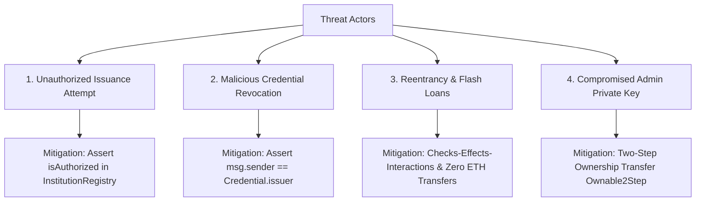

# CONTRACT_SECURITY.md — Smart Contract Threat Mitigations & Auditing

> **Document ID**: DOC-BLOCKCHAIN-006  
> **Status**: Confirmed Technical Specification

---

## 1. Security Architecture & Threat Vectors

The VERICRED Solidity contracts are engineered to be minimalist, auditable, and defensively coded against EVM exploit vectors.

---

## 2. Threat Scenarios & Contract Mitigations

### 2.1 Unauthorized Issuance Attack
- **Threat**: An unaccredited user or malicious actor attempts to call `CredentialRegistry.issueCredential` to forge a university degree.
- **Mitigation**: The contract queries `institutionRegistry.isAuthorized(msg.sender)`. Because the attacker's address is not in the approved state, the transaction reverts atomically before storage modification.

### 2.2 Malicious Revocation Hijack
- **Threat**: A disgruntled employee or competing university attempts to revoke a legitimate student's degree.
- **Mitigation**: `RevocationRegistry` queries `CredentialRegistry` to retrieve the original issuing address. If `msg.sender != originalIssuer`, the call immediately reverts with `OnlyOriginalIssuerCanRevoke`.

### 2.3 Reentrancy & Economic Manipulation
- **Threat**: Reentrant calls during state updates to drain funds or corrupt mappings.
- **Mitigation**:
  - The registry contracts hold **zero Ether/POL balances** and accept no payable deposits.
  - Strict adherence to the **Checks-Effects-Interactions** pattern.
  - No external dynamic contract calls to untrusted addresses.

### 2.4 Governance & Administrator Compromise
- **Threat**: Platform administrator's private key is compromised, allowing the attacker to corrupt the institutional directory.
- **Mitigation**:
  - Ownership is governed by OpenZeppelin's **`Ownable2Step`**, requiring pending owners to actively claim ownership.
  - Even a compromised administrator cannot forge credentials or sign credentials on behalf of universities because signing occurs with university BabyJubjub keys.

---

## 3. The Upgradeability Trade-Off: Simple vs. Proxy

> **Architectural Decision**: VERICRED Smart Contracts are **strictly non-upgradeable (Immutable)**.

| Dimension | Upgradeable Proxy (UUPS / Transparent) | Immutable Direct Contracts (VERICRED Choice) |
| :--- | :--- | :--- |
| **Audit Surface** | High (storage collision, proxy initialization bugs) | Low (pure, auditable Solidity bytecode) |
| **Trust Factor** | Low (admin can secretly alter contract logic) | High (guaranteed immutability for verifiers) |
| **Key Migration** | Via proxy code upgrades | Handled via built-in `updateIssuerKey()` method |
| **Bug Fixes** | Proxy repointing | Deploy new registry & update frontend resolver |

By choosing immutable contracts, VERICRED eliminates the largest attack surface present in modern Web3 protocols.

---

## 4. Automated Testing & Static Analysis Pipeline

Every pull request modifying Solidity code must pass:
1. **Unit Testing**: $100\%$ line and branch coverage in Hardhat using Chai matchers.
2. **Static Analysis**: Zero warnings in **Slither** (reentrancy, uninitialized state, shadow variables).
3. **Formal Verification (SMTChecker)**: Arithmetic overflow checks using the Z3 SMT solver integrated into the Solidity compiler.
