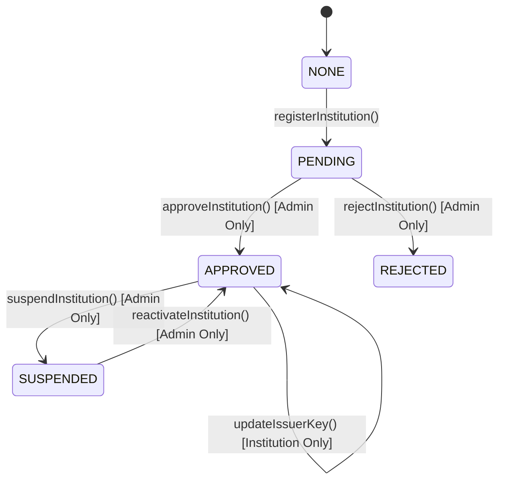

# INSTITUTION_REGISTRY.md — Institution Accreditation & Key Directory

> **Document ID**: DOC-BLOCKCHAIN-003  
> **Status**: Confirmed Technical Specification  
> **Contract**: `InstitutionRegistry.sol`

---

## 1. Purpose & Responsibilities

`InstitutionRegistry.sol` acts as the decentralized directory of verified higher education institutions. It binds legal university identities to their Ethereum addresses and authorized BabyJubjub public signing keys, forming the bedrock of trust for off-chain and in-circuit verification.



---

## 2. On-Chain Key Storage & Point Encoding

To support direct zero-knowledge proof verification inside Circom and snarkjs:
- Public keys are stored as **uncompressed BabyJubjub curve coordinates** ($X, Y$) represented as two `uint256` scalar field elements in $\mathbb{F}_q$.
- During contract registration, the contract verifies that $(X, Y)$ satisfies the BabyJubjub curve equation:
  $$168700 X^2 + Y^2 = 1 + 168696 X^2 Y^2 \pmod q$$
  Any coordinate pair failing this check is decisively rejected with `InvalidPublicKey()`.

---

## 3. Function Signatures & Gas Estimates

```solidity
function registerInstitution(
    string calldata legalName,
    string calldata shortCode
) external returns (bool);
// Gas: ~68,000

function approveInstitution(
    address instAddress
) external onlyOwner returns (bool);
// Gas: ~45,000

function suspendInstitution(
    address instAddress
) external onlyOwner returns (bool);
// Gas: ~32,000

function updateIssuerKey(
    uint256 keyX,
    uint256 keyY
) external returns (bool);
// Gas: ~52,000

function isAuthorized(
    address instAddress
) external view returns (bool);
// Gas: 0 (View / Free)
```

---

## 4. Querying Public Keys for ZK Verification

The public verification portal and Circom witness compiler query active institutional keys directly:
```typescript
const [legalName, shortCode, status, keyX, keyY] = 
  await institutionRegistryContract.institutions(institutionAddress);

if (status !== 2 /* APPROVED */) {
  throw new Error("Issuer institution is not currently approved");
}

const issuerPublicKey = [keyX.toString(), keyY.toString()];
```
These public key coordinates feed directly into public inputs $[C, T, \text{Ax}, \text{Ay}]$ during Groth16 proof validation.
