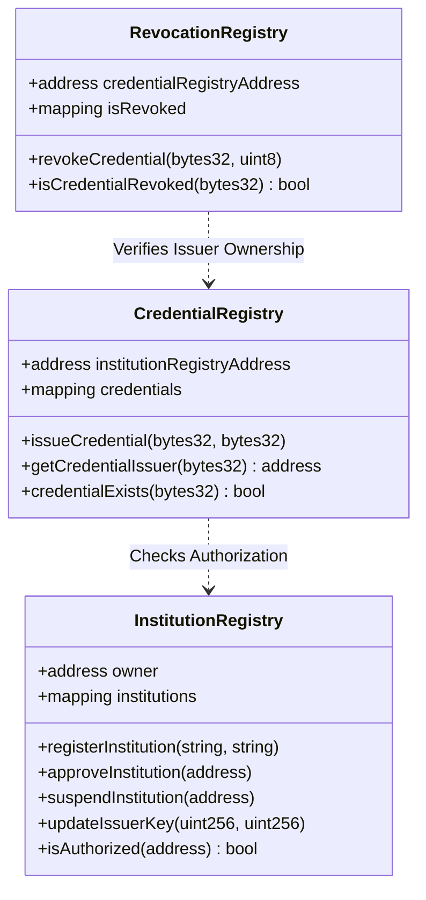

# SMART_CONTRACT_SPECIFICATION.md — Comprehensive Solidity Contract Interfaces

> **Document ID**: DOC-BLOCKCHAIN-002  
> **Status**: Confirmed Technical Specification  
> **Solidity Compiler**: `^0.8.24` / EVM Target: `cancun` / `shanghai`

---

## 1. Contract Overview & Governance Interfaces

VERICRED smart contracts enforce non-custodial credential anchoring and verification. Contracts are intentionally decoupled to preserve auditability and prevent monolithic proxy vulnerabilities.



---

## 2. Specification: `InstitutionRegistry.sol`

### 2.1 State Variables
```solidity
enum Status { NONE, PENDING, APPROVED, SUSPENDED }

struct Institution {
    string legalName;
    string shortCode;
    Status status;
    uint256 keyX; // BabyJubjub Public Key X coordinate
    uint256 keyY; // BabyJubjub Public Key Y coordinate
    uint64 registeredAt;
    uint64 approvedAt;
}

mapping(address => Institution) public institutions;
```

### 2.2 Custom Errors & Events
```solidity
error Unauthorized();
error InstitutionAlreadyExists(address instAddress);
error InstitutionNotApproved(address instAddress);
error InvalidPublicKey();

event InstitutionRegistered(address indexed instAddress, string legalName);
event InstitutionApproved(address indexed instAddress, uint256 approvedAt);
event InstitutionSuspended(address indexed instAddress, uint256 suspendedAt);
event IssuerKeyUpdated(address indexed instAddress, uint256 keyX, uint256 keyY);
```

### 2.3 Core Functions
- `registerInstitution(string calldata name, string calldata code)`: Callable by institution account. Sets status to `PENDING`.
- `approveInstitution(address instAddress)`: Callable only by contract `owner`. Sets status to `APPROVED`.
- `suspendInstitution(address instAddress)`: Callable only by contract `owner`. Sets status to `SUSPENDED`.
- `updateIssuerKey(uint256 keyX, uint256 keyY)`: Callable only by an approved institution to publish or rotate their active BabyJubjub signing key.
- `isAuthorized(address instAddress) external view returns (bool)`: Returns `true` if institution status is `APPROVED`.

---

## 3. Specification: `CredentialRegistry.sol`

### 3.1 State Variables
```solidity
struct CredentialRecord {
    address issuer;
    bytes32 commitment; // Poseidon commitment C
    uint64 issuedAt;
}

mapping(bytes32 => CredentialRecord) public credentials;
IInstitutionRegistry public immutable institutionRegistry;
```

### 3.2 Custom Errors & Events
```solidity
error IssuerNotAuthorized(address caller);
error CredentialAlreadyIssued(bytes32 credHash);
error CredentialNotFound(bytes32 credHash);

event CredentialIssued(
    bytes32 indexed credHash,
    address indexed issuer,
    bytes32 commitment,
    uint256 issuedAt
);
```

### 3.3 Core Functions
- `issueCredential(bytes32 credHash, bytes32 commitment)`:
  - Reverts with `IssuerNotAuthorized` if `!institutionRegistry.isAuthorized(msg.sender)`.
  - Reverts with `CredentialAlreadyIssued` if `credentials[credHash].issuedAt != 0`.
  - Records credential metadata and emits `CredentialIssued`.
- `getCredentialIssuer(bytes32 credHash) external view returns (address)`: Returns issuer address.
- `credentialExists(bytes32 credHash) external view returns (bool)`: Returns true if anchored.

---

## 4. Specification: `RevocationRegistry.sol`

### 4.1 State Variables
```solidity
struct RevocationStatus {
    bool revoked;
    uint8 reasonCode;
    uint64 revokedAt;
}

mapping(bytes32 => RevocationStatus) public revocations;
ICredentialRegistry public immutable credentialRegistry;
```

### 4.2 Custom Errors & Events
```solidity
error OnlyOriginalIssuerCanRevoke(address caller, address actualIssuer);
error CredentialAlreadyRevoked(bytes32 credHash);

event CredentialRevoked(
    bytes32 indexed credHash,
    address indexed issuer,
    uint8 reasonCode,
    uint256 revokedAt
);
```

### 4.3 Core Functions
- `revokeCredential(bytes32 credHash, uint8 reasonCode)`:
  - Queries `address issuer = credentialRegistry.getCredentialIssuer(credHash)`.
  - Reverts with `OnlyOriginalIssuerCanRevoke` if `msg.sender != issuer`.
  - Reverts with `CredentialAlreadyRevoked` if `revocations[credHash].revoked == true`.
  - Writes revocation record and emits `CredentialRevoked`.
- `isCredentialRevoked(bytes32 credHash) external view returns (bool)`: Returns current revocation flag.
