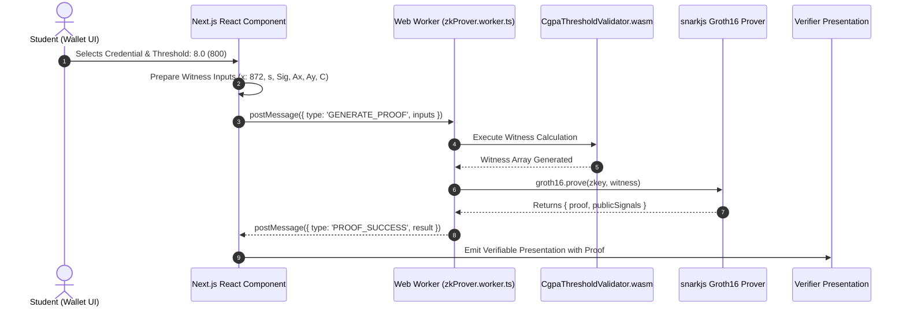

# ZK_PROOF_GENERATION.md — Client-Side Proof Generation Runbook

> **Document ID**: DOC-ZK-005  
> **Status**: Confirmed Technical Specification  
> **Client Runtime**: Browser WebAssembly / Web Worker / snarkjs

---

## 1. Browser-Based Proof Generation Architecture

To protect student privacy, zero-knowledge witness generation and Groth16 proving execute **entirely client-side** in the student's browser. At no point is the student's raw CGPA or blinding salt sent over the network during a threshold proof request.



---

## 2. Web Worker Implementation (`zkProver.worker.ts`)

Computing zk-SNARK proofs requires intense arithmetic operations that would freeze the browser's main UI thread if not offloaded to a Web Worker:

```typescript
// apps/web/features/zk/workers/zkProver.worker.ts
import * as snarkjs from 'snarkjs';

self.onmessage = async (event) => {
  const { inputs, wasmUrl, zkeyUrl } = event.data;

  try {
    self.postMessage({ type: 'STATUS', message: 'Calculating witness...' });

    // Step 1: Execute full prove (witness gen + Groth16 synthesis)
    const { proof, publicSignals } = await snarkjs.groth16.fullProve(
      inputs,
      wasmUrl,
      zkeyUrl
    );

    self.postMessage({
      type: 'SUCCESS',
      payload: { proof, publicSignals }
    });
  } catch (error: any) {
    self.postMessage({
      type: 'ERROR',
      message: error.message || 'Circuit constraint satisfaction failed'
    });
  }
};
```

---

## 3. Client Resource & Memory Optimization

- **Proving Key Size (`.zkey`)**: $\approx 2.4\,\text{MB}$ (small enough for instant download and IndexedDB browser caching).
- **WASM Size**: $\approx 420\,\text{KB}$ gzipped.
- **Memory Consumption**: Peak memory during prover execution is $\le 65\,\text{MB}$, easily operating within low-end mobile devices ($2\,\text{GB}$ RAM smartphones).
- **Prover Timeout Guard**: A 15-second timeout halts execution if browser resources are severely throttled.

---

## 4. Failure Modes & User Experience

If a student attempts to prove a threshold higher than their actual grade (e.g., Diya Roy with CGPA $7.65 \implies 765$ attempting to prove $T = 800$):
- Circom's `GreaterEqThan(14)` constraint fails during witness calculation.
- The Web Worker catches the constraint error and cleanly messages the UI:
  `"Academic requirement not met: Your credential does not satisfy the requested threshold."`
- No corrupt or invalid proof is generated or transmitted.
