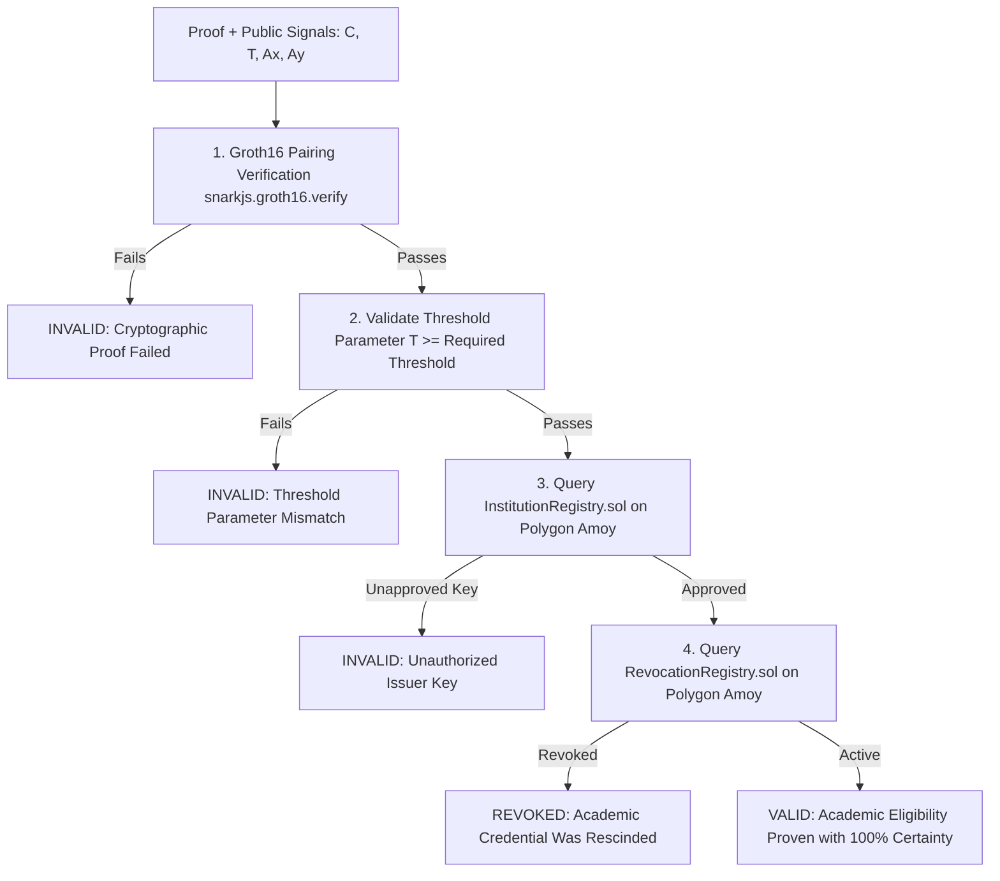

# ZK_PROOF_VERIFICATION.md — Verification Protocol & Status Binding

> **Document ID**: DOC-ZK-006  
> **Status**: Confirmed Technical Specification

---

## 1. Multi-Stage Verification Pipeline

Zero-knowledge proof verification within VERICRED combines algebraic pairing checks with decentralized smart contract assertions:



---

## 2. Groth16 Verification Equation

Verification relies on the Groth16 pairing check over elliptic curve groups $\mathbb{G}_1, \mathbb{G}_2, \mathbb{G}_T$ of the BN254 curve:

$$e(\pi_a, \pi_b) = e(\alpha, \beta) \cdot e\left(\sum_{i=0}^4 u_i \cdot \frac{\beta \cdot u_i(x) + \alpha \cdot v_i(x) + w_i(x)}{\gamma}, \gamma\right) \cdot e(\pi_c, \delta)$$

Where $u = (1, C, T, A_x, A_y)$ represents the public signals.
- **Verification Time**: $< 6\,\text{milliseconds}$.
- **Compute Overhead**: A single multi-pairing operation.

---

## 3. Verification Service Implementation

```typescript
import * as snarkjs from 'snarkjs';
import verificationKey from '../assets/CgpaThresholdValidator.vkey.json';
import { institutionRegistryContract, revocationRegistryContract } from '../blockchain';

export async function verifyZkCredentialPresentation(
  proof: any,
  publicSignals: string[],
  requiredThreshold: number
) {
  const [commitment, thresholdStr, issuerPubKeyX, issuerPubKeyY] = publicSignals;
  const provenThreshold = parseInt(thresholdStr, 10);

  // 1. Check proven threshold matches or exceeds verifier requirement
  if (provenThreshold < requiredThreshold * 100) {
    return {
      isValid: false,
      reason: 'PROVEN_THRESHOLD_BELOW_REQUIREMENT'
    };
  }

  // 2. Cryptographic Groth16 Proof Verification
  const isProofValid = await snarkjs.groth16.verify(
    verificationKey,
    publicSignals,
    proof
  );
  if (!isProofValid) {
    return {
      isValid: false,
      reason: 'CRYPTOGRAPHIC_PROOF_INVALID'
    };
  }

  // 3. On-Chain Issuer Key Verification
  const isIssuerValid = await institutionRegistryContract.isIssuerKeyAuthorized(
    issuerPubKeyX,
    issuerPubKeyY
  );
  if (!isIssuerValid) {
    return {
      isValid: false,
      reason: 'ISSUER_KEY_NOT_AUTHORIZED_ON_CHAIN'
    };
  }

  // 4. On-Chain Revocation Check
  const isRevoked = await revocationRegistryContract.isCommitmentRevoked(commitment);
  if (isRevoked) {
    return {
      isValid: false,
      reason: 'CREDENTIAL_REVOKED_ON_CHAIN'
    };
  }

  return {
    isValid: true,
    provenThreshold: provenThreshold / 100,
    issuer: 'Authorized Educational Institution',
    status: 'ACTIVE'
  };
}
```
