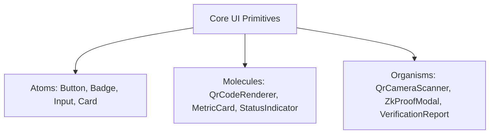

# COMPONENT_LIBRARY.md — Reusable UI Components & Props Specifications

> **Document ID**: DOC-UI-003  
> **Status**: Confirmed Technical Specification  
> **UI Primitives**: Radix UI / shadcn/ui / Tailwind CSS

---

## 1. Core Component Index

VERICRED applications share a standardized library of accessible, modular UI components located in `apps/web/components/ui/`.



---

## 2. Key Component Specifications

### 2.1 `CredentialCard`
- **Purpose**: Displays academic credential summaries across student wallets and institutional directories.
- **Props**:
  ```typescript
  interface CredentialCardProps {
    credential: {
      id: string;
      degreeName: string;
      department: string;
      institutionName: string;
      graduationYear: number;
      status: 'ACTIVE' | 'REVOKED' | 'EXPIRED';
      issuedAt: string;
    };
    onShare?: (id: string) => void;
    onViewDetail?: (id: string) => void;
    onRevoke?: (id: string) => void;
  }
  ```
- **States**: Default, Hover (subtle border illumination in `#458BFF`), Focus-Visible.

---

### 2.2 `QrCodeRenderer`
- **Purpose**: Renders high-contrast QR codes for ephemeral presentation URLs.
- **Props**:
  ```typescript
  interface QrCodeRendererProps {
    url: string;
    size?: number; // Default 256
    logoUrl?: string; // Central VERICRED shield mark
    expiresAt: string; // Triggers countdown timer
    onExpire?: () => void;
  }
  ```
- **Features**: Includes countdown ring showing remaining TTL (15 minutes). When expired, overlays a blurred backdrop with `"Presentation Expired — Click to Regenerate"`.

---

### 2.3 `QrCameraScanner`
- **Purpose**: Real-time webcam/mobile camera stream reader.
- **Props**:
  ```typescript
  interface QrCameraScannerProps {
    onScanSuccess: (decodedUrl: string) => void;
    onScanError?: (errorMessage: string) => void;
    facingMode?: 'environment' | 'user'; // Back vs front camera
  }
  ```
- **Features**: Visual aiming reticle with animated scanning laser effect; instant camera flip toggle.

---

### 2.4 `ZkProofModal`
- **Purpose**: Interactive modal coordinating in-browser witness generation and Groth16 proving.
- **Props**:
  ```typescript
  interface ZkProofModalProps {
    isOpen: boolean;
    onClose: () => void;
    credentialId: string;
    actualCgpa: number; // e.g., 8.72 (private to client)
    onProofGenerated: (proofPayload: object) => void;
  }
  ```
- **Components**: Threshold selector slider ($0.0$ to $10.0$ with $0.1$ step); live warning indicator if slider exceeds actual CGPA; progress bar tracking WebAssembly witness computation.

---

### 2.5 `VerificationReport`
- **Purpose**: Definitive cryptographic outcome view rendered on the public verification portal.
- **Props**:
  ```typescript
  interface VerificationReportProps {
    result: {
      status: 'VALID' | 'INVALID' | 'REVOKED' | 'EXPIRED';
      issuerName: string;
      degreeName: string;
      department: string;
      checks: {
        signature: boolean;
        issuerAuthorized: boolean;
        revocationStatus: boolean;
        expiration: boolean;
        zkProof?: boolean;
      };
      onChainTxHash?: string;
      verifiedAt: string;
    };
  }
  ```
- **Features**: Exploded accordion list allowing verifiers to inspect individual mathematical check outcomes and the underlying transaction on Polygonscan.
