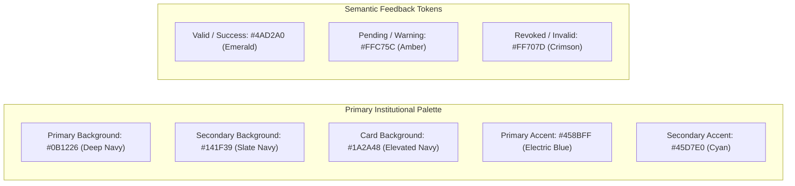

# DESIGN_SYSTEM.md — Visual Identity & Component Design Tokens

> **Document ID**: DOC-UI-001  
> **Status**: Confirmed Technical Specification  
> **Aesthetic Theme**: Modern Institutional Web3 SaaS (Dark Mode / High Contrast)

---

## 1. Design Philosophy & Aesthetic Direction

VERICRED avoids the speculative, neon-drenched, over-gradient aesthetic of retail crypto projects. Instead, it projects **institutional authority, cryptographic rigor, and corporate trust**. The interface prioritizes clean data density, WCAG 2.1 AA accessibility, purposeful motion, and crystal-clear verification state feedback.

---

## 2. Color Palette & Token Definitions

| Token Name | Hex Code | Tailwind Class | Contrast vs `#0B1226` | Usage Guidance |
| :--- | :--- | :--- | :--- | :--- |
| **`bg-primary`** | `#0B1226` | `bg-[#0B1226]` | $1:1$ | Root page background |
| **`bg-secondary`** | `#141F39` | `bg-[#141F39]` | $1.25:1$ | Sidebar, navbar, panel headers |
| **`bg-card`** | `#1A2A48` | `bg-[#1A2A48]` | $1.5:1$ | Elevate cards, modals, table rows |
| **`accent-primary`** | `#458BFF` | `text-[#458BFF]` / `bg-[#458BFF]` | $5.4:1$ (AA) | Primary CTAs, active tab indicators |
| **`accent-secondary`**| `#45D7E0` | `text-[#45D7E0]` / `bg-[#45D7E0]` | $11.2:1$ (AAA) | ZK highlights, status glows, badges |
| **`text-primary`** | `#F5F8FF` | `text-[#F5F8FF]` | $16.1:1$ (AAA) | Primary headings, body copy |
| **`text-muted`** | `#A9B7CF` | `text-[#A9B7CF]` | $7.8:1$ (AAA) | Subtitles, helper text, labels |
| **`state-success`** | `#4AD2A0` | `text-[#4AD2A0]` / `bg-[#4AD2A0]` | $10.5:1$ (AAA) | Verified credential, active status |
| **`state-warning`** | `#FFC75C` | `text-[#FFC75C]` / `bg-[#FFC75C]` | $10.1:1$ (AAA) | Expiring presentations, pending review |
| **`state-error`** | `#FF707D` | `text-[#FF707D]` / `bg-[#FF707D]` | $5.2:1$ (AA) | Invalid signatures, revoked degrees |

---

## 3. Typography System

VERICRED pairs two complimentary typefaces:
- **Headings & Metric Numbers**: `Space Grotesk` (Geometric, technical, authoritative).
- **Body, UI Controls & Tables**: `Inter` (Optimized for micro-reading, neutral, highly legible).

| Level | Font Family | Size | Weight | Line Height | Tracking |
| :--- | :--- | :--- | :--- | :--- | :--- |
| **Display H1** | Space Grotesk | $48\,\text{px}$ ($3\,\text{rem}$) | 700 (Bold) | $1.15$ | `-0.02em` |
| **H2 Section** | Space Grotesk | $32\,\text{px}$ ($2\,\text{rem}$) | 600 (SemiBold) | $1.25$ | `-0.01em` |
| **H3 Card** | Space Grotesk | $20\,\text{px}$ ($1.25\,\text{rem}$) | 600 (SemiBold) | $1.35$ | `0` |
| **Body Large** | Inter | $16\,\text{px}$ ($1\,\text{rem}$) | 400 (Regular) | $1.5$ | `0` |
| **Body Regular**| Inter | $14\,\text{px}$ ($0.875\,\text{rem}$) | 400 (Regular) | $1.5$ | `0` |
| **Caption / Code**| Inter / JetBrains Mono | $12\,\text{px}$ ($0.75\,\text{rem}$) | 500 (Medium) | $1.4$ | `+0.02em` |

---

## 4. Spacing, Grid & Breakpoints

- **Base Unit**: 4px scaling ($4, 8, 12, 16, 24, 32, 48, 64\,\text{px}$).
- **Container Max Width**: $1280\,\text{px}$ (`max-w-7xl`).
- **Responsive Breakpoints**:
  - `sm`: $640\,\text{px}$ (Mobile landscape / phablet)
  - `md`: $768\,\text{px}$ (Tablet portrait)
  - `lg`: $1024\,\text{px}$ (Tablet landscape / small laptop)
  - `xl`: $1280\,\text{px}$ (Standard desktop)
  - `2xl`: $1536\,\text{px}$ (Large monitor)

---

## 5. UI Elements & Form Components

1. **Buttons**:
   - `Primary`: Solid Electric Blue (`#458BFF`), hover state lightens to `#5E9CFF`, focus ring $2\,\text{px}$ Cyan (`#45D7E0`).
   - `Secondary`: Outline `$1.5\text{px}$` border in `#2A3F66`, transparent background, hover state `#1A2A48`.
   - `Destructive`: Solid Crimson (`#FF707D`), white text, used strictly for Revocations or Account Suspension.
2. **Input Fields**:
   - Background `#141F39`, border `$1\text{px}$` `#2A3F66`, active focus border `#458BFF`.
   - Clear validation error states rendering inline message in `#FF707D`.
3. **Status Badges**:
   - Small pill with dot indicator (`h-2 w-2 rounded-full` + text).
   - `VALID`: Emerald background `#4AD2A0`/15, text `#4AD2A0`.
   - `REVOKED`: Crimson background `#FF707D`/15, text `#FF707D`.
