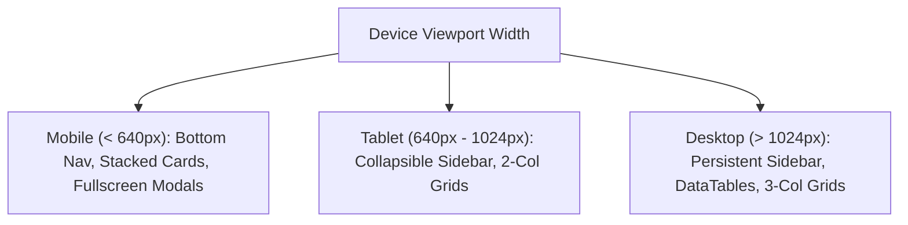

# RESPONSIVE_DESIGN.md — Viewport Breakpoints & Adaptive Layouts

> **Document ID**: DOC-UI-005  
> **Status**: Confirmed Technical Specification

---

## 1. Viewport Tier Matrix & Layout Adaptations

VERICRED is engineered as a mobile-first, responsive web platform providing seamless operational experiences across smartphones, tablets, laptops, and ultra-wide desktop monitors.

---

## 2. Navigation Behavior Across Devices

### 2.1 Mobile Viewports (`< 768px`)
- **Navigation**: Persistent Bottom Navigation Bar for Student Wallet (`Overview`, `Wallet`, `Scan`, `Settings`).
- **Institution Console**: Collapsible top-app-bar with sliding hamburger drawer powered by Radix UI Dialog.
- **Touch Targets**: All interactive buttons, tabs, and table actions enforce minimum touch targets of $44 \times 44\,\text{px}$ (Apple HIG / Android Material guidelines).

### 2.2 Desktop Viewports (`\ge 1024px`)
- **Navigation**: Fixed-width, persistent left sidebar ($260\,\text{px}$) with active item indicators, institution status pills, and user profile drawer.

---

## 3. Responsive Data Tables & Grids

1. **Desktop ($> 1024\,\text{px}$)**: Standard high-density tables displaying complete column sets (Student ID, Name, Department, Degree, Year, Status, Polygonscan Tx, Actions).
2. **Mobile ($< 768\,\text{px}$)**: Tables automatically transform into polymorphic **card stacks**:
   - Primary line: Student Name + Status Badge.
   - Secondary line: Degree Name & Graduation Year.
   - Expandable accordion drawer revealing transaction hashes and action buttons.

---

## 4. Mobile Camera Scanner UX

- **Full-Screen Viewport**: On mobile devices, the `/verify` QR scanner requests the rear-facing camera (`facingMode: "environment"`) and expands to fill the device viewport.
- **Haptic Feedback**: Emits a brief vibration (`navigator.vibrate(100)`) upon successful QR decode before rendering the verification report.
