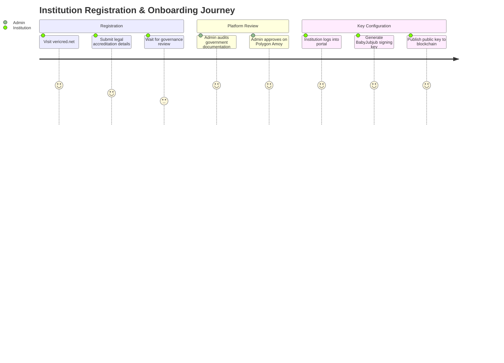

# USER_FLOWS.md — End-to-End User Journeys & Interaction Flows

> **Document ID**: DOC-UI-004  
> **Status**: Confirmed Technical Specification

---

## 1. Journey A: Institution Onboarding & Key Activation

1. **Submission**: Institution navigates to `/register`, selects "Educational Institution", enters legal details, official domain, and uploads accreditation PDF.
2. **Pending Notice**: Directed to `/institution/pending`, informing the officer that their account is awaiting platform admin approval.
3. **Approval Execution**: Admin visits `/admin/institutions`, inspects documentation, and clicks "Approve Institution". This submits an on-chain transaction to `InstitutionRegistry.sol`.
4. **Key Activation**: Once approved, the institution accesses `/institution/keys`, clicks "Provision Signing Key", which initializes an EdDSA keypair in the backend KMS and registers the public point $(A_x, A_y)$ on-chain.

---

## 2. Journey B: Credential Issuance & Student Delivery

1. **Roster Selection**: University registrar opens `/institution/issue` and selects enrolled student (Aarav Sen, `VC2026001`).
2. **Form Entry**: Inputs Degree: "Bachelor of Technology", Department: "Computer Science and Engineering", Graduation Year: "2026", CGPA: "8.72".
3. **Pre-flight Validation**: Client validates $0.0 \le \text{CGPA} \le 10.0$ and displays preview modal.
4. **Sign & Broadcast**: Registrar clicks "Sign & Issue". The backend computes fixed-point scaled grade ($872$), blinding salt ($s$), commitment ($C = \text{Poseidon}(872, s)$), signs the payload with the university's private key, writes the record to PostgreSQL, and submits `issueCredential(credHash, C)` to Polygon Amoy.
5. **Confirmation**: UI displays green banner with Amoy transaction hash and delivered status.

---

## 3. Journey C: Student Selective Disclosure & QR Sharing

1. **Open Wallet**: Student Aarav logs into `/student/wallet` and clicks his B.Tech Degree card.
2. **Configure Sharing**: Clicks "Share Credential". A modal opens with checkboxes for each claim.
3. **Hide Exact Marks**: Aarav unchecks "Disclose Raw CGPA" to prevent exposing his exact 8.72 marks.
4. **Render Presentation**: Clicks "Generate Presentation". An ephemeral QR code renders on screen showing an active 15-minute countdown clock.
5. **Physical Presentation**: Aarav presents the QR code on his phone screen to the recruiter.

---

## 4. Journey D: Recruiter Instant Public Verification

1. **Scan**: Recruiter opens `/verify` on their tablet or laptop and points the camera at Aarav's QR code.
2. **Instant Resolution**: The camera decodes the opaque URL (`https://vericred.net/verify/p/...`), queries the backend verification API, checks on-chain revocation and issuer status.
3. **Verification Report**: Within $< 500\,\text{ms}$, the screen transitions to a green `VALID CREDENTIAL` report, verifying that RCC-IIT issued the degree, the digital signature is intact, and the credential has not been revoked.

---

## 5. Journey E: Zero-Knowledge CGPA Eligibility Verification

1. **Requirement Prompt**: Recruiter informs candidate: *"Our graduate scheme requires a minimum CGPA of 8.0. Please provide a verified proof."*
2. **Launch ZK Wizard**: Aarav opens `/student/zk-prover/cred-8888`, enters Threshold: `8.0` (scaled to $800$).
3. **In-Browser Proof**: Client browser executes `snarkjs.groth16.fullProve` in a Web Worker, computing the witness against the circuit.
4. **Submit Proof**: Aarav shares the generated Groth16 proof presentation link with the recruiter.
5. **Recruiter Portal**: Recruiter enters the proof into `/verify`. The portal checks the proof against the verification key, checks the issuer's key on Polygon Amoy, and displays:  
   `ELIGIBILITY PROVEN: Candidate satisfies CGPA >= 8.0 (Actual grade remains private)`.
