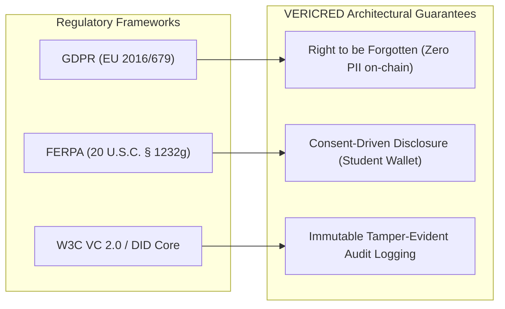

# AUDIT_AND_COMPLIANCE.md — Regulatory Frameworks & Compliance Auditing

> **Document ID**: DOC-SEC-005  
> **Status**: Confirmed Technical Specification

---

## 1. Regulatory Compliance Mapping

VERICRED is architectured to comply with international data privacy and educational record governance mandates:

### 1.1 GDPR (General Data Protection Regulation)
- **Article 5(1)(c) - Data Minimization**: No student names, emails, or personal identifiers are written to the public Polygon Amoy blockchain.
- **Article 17 - Right to Erasure ("Right to be Forgotten")**: Because academic records reside off-chain in PostgreSQL, user accounts can be scrubbed without conflicting with the immutability of the blockchain.
- **Article 25 - Data Protection by Design**: Zero-Knowledge Proofs allow students to satisfy job application criteria without disclosing underlying personal datasets.

### 1.2 FERPA (Family Educational Rights and Privacy Act)
- **Consent Prerequisite**: No educational institution or third-party recruiter can access a student's credential without the student explicitly signing a Verifiable Presentation.
- **Directory Information**: Public verification reports display only the minimal claims expressly approved by the holder.

---

## 2. Tamper-Evident Audit Logging Engine

All security-sensitive operations are captured in the append-only `AuditLog` table:
- **Captured Events**:
  - `INSTITUTION_APPROVED` / `INSTITUTION_SUSPENDED`
  - `ISSUER_KEY_ROTATED` / `ISSUER_KEY_COMPROMISED`
  - `CREDENTIAL_MINTED` / `CREDENTIAL_REVOKED`
  - `AUTHENTICATION_FAILURE` / `RATE_LIMIT_EXCEEDED`
- **Integrity Guarantee**: Each audit log entry includes a SHA-256 hash chained to the preceding log record:
  $$\text{Hash}_i = \text{SHA256}(\text{Hash}_{i-1} \parallel \text{EventData}_i)$$
  Any retroactive modification of historical database rows immediately breaks the cryptographic hash chain.

---

## 3. Log Retention & Periodic Access Review

- **Retention Window**: Operational verification logs are retained for **90 days** in hot storage, after which they are archived to encrypted cold storage with automated 1-year expiration.
- **Administrative Access Review**: Platform administrators must conduct monthly access reviews of active API keys, relayer balances, and institutional approval requests.
