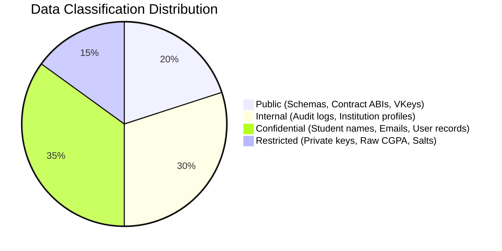

# DATA_PROTECTION.md — Encryption Standards & Sensitive Data Protection

> **Document ID**: DOC-SEC-004  
> **Status**: Confirmed Technical Specification

---

## 1. Data Classification Tiers

VERICRED categorizes all data items into four distinct sensitivity tiers, applying commensurate cryptographic protections:

1. **PUBLIC**: W3C JSON-LD contexts, Circom verification keys, public registry addresses. Unrestricted distribution.
2. **INTERNAL**: Platform operational telemetry, institution verification logs, non-sensitive audit records.
3. **CONFIDENTIAL**: Student names, email addresses, university enrollment IDs. Encrypted at rest; restricted to authenticated owners.
4. **RESTRICTED**: Private cryptographic keys, raw grades, blinding salts. Subject to hardware-enforced KMS isolation and field-level encryption.

---

## 2. Encryption at Rest & in Transit

### 2.1 Transit Security (TLS 1.3)
- Enforced across all external endpoints with HTTP Strict Transport Security (HSTS):
  `Strict-Transport-Security: max-age=63072000; includeSubDomains; preload`
- TLS 1.3 exclusively; legacy cipher suites (TLS 1.0, 1.1, 1.2 CBC) disabled.
- Minimum Cipher Suite: `TLS_AES_256_GCM_SHA384` and `TLS_CHACHA20_POLY1305_SHA256`.

### 2.2 Relational Storage Encryption (PostgreSQL)
- **Filesystem Level**: Full disk encryption via AWS EBS KMS (AES-256).
- **Field-Level Encryption**: Sensitive columns (e.g., `blindingSalt`, `cgpaRaw`) are encrypted at the application layer prior to insertion using AES-256-GCM with envelope encryption derived from the master KMS key.

---

## 3. Client-Side Browser Storage Security

In the student's browser:
- Credentials stored locally in **IndexedDB** are encrypted client-side using a key derived from the student's password or WebAuthn credential via PBKDF2 ($600,000$ iterations).
- Decrypted credentials exist exclusively in volatile Web Worker memory during active proof computation and are purged upon task termination.
