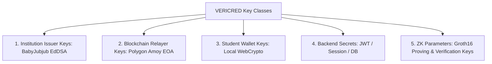

# KEY_MANAGEMENT.md — Cryptographic Key Management & Lifecycle Policy

> **Document ID**: DOC-SEC-003  
> **Status**: Confirmed Technical Specification

---

## 1. Key Taxonomy & Lifecycle Matrix

VERICRED manages five distinct classes of cryptographic keys, each governed by specific generation, storage, usage, and rotation rules:

| Key Class | Algorithm / Curve | Storage Location (Dev) | Storage Location (Prod) | Rotation Period |
| :--- | :--- | :--- | :--- | :--- |
| **Institution Issuer Key** | EdDSA / BabyJubjub ($\mathbb{F}_r$) | AES-256 Encrypted Keystore | AWS KMS / Vault Transit Engine | Annually / On-Demand |
| **Blockchain Relayer Key** | ECDSA / secp256k1 | Encrypted local environment | AWS Secrets Manager / KMS | Semi-Annually |
| **Student Wallet Key** | WebCrypto / P-256 or Ed25519 | Browser IndexedDB / WebCrypto | Browser WebCrypto / Passkey | User-Controlled |
| **Backend JWT Secrets** | HMAC-SHA256 (256-bit) | `.env.local` | AWS SSM Parameter Store | 90 Days |
| **ZK Verification Key** | Groth16 / BN254 Pairing | Public JSON repository | IPFS & Cloudflare CDN | Per Circuit Release |

---

## 2. Institutional Issuer Key Lifecycle

### 2.1 Generation & Activation
- In development: Generated via CSPRNG `crypto.randomBytes(32)` inside `@vericred/crypto`. Stored in local encrypted JSON keystores locked with PBKDF2 ($600,000$ iterations).
- In production: Generated directly inside a FIPS 140-2 Level 3 compliant Hardware Security Module (AWS KMS asymmetric key pair or HashiCorp Vault). The private key scalar is non-exportable; signing occurs via remote API attestation.

### 2.2 Key Rotation Protocol
1. Institution invokes `/institution/keys/rotate`.
2. Backend provisions a new BabyJubjub keypair $(sk_2, A_2)$.
3. Transaction submitted to `InstitutionRegistry.updateIssuerKey(A_{2x}, A_{2y})`.
4. Previous key $A_1$ transitions to `RETIRED` state with `validUntil = block.timestamp`.
5. Existing credentials signed by $A_1$ remain verifiable through historical validity checks.

---

## 3. Student Sovereign Wallet Keys

Students control their personal presentation signatures directly in the browser:
- Managed using the **Web Crypto API** (`SubtleCrypto`).
- Cryptographic private keys reside in non-extractable browser key storage, preventing malicious browser extensions from exfiltrating wallet keys.
- Supports biometric touch authorization (WebAuthn / Passkeys) in mobile environments.
