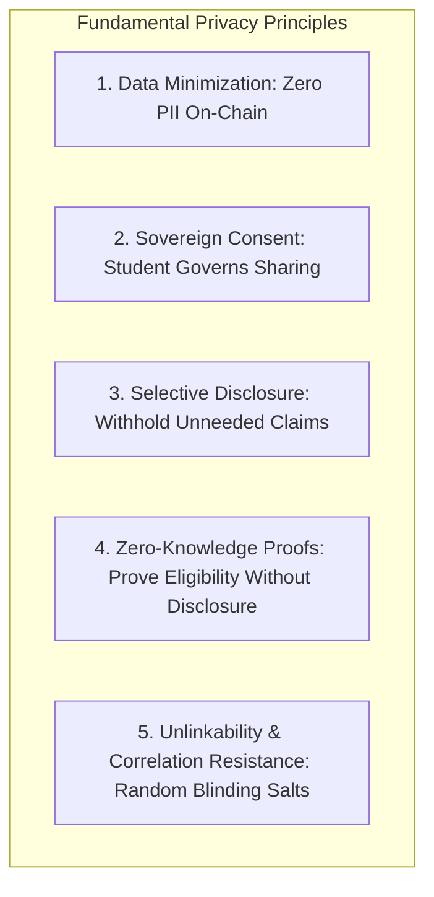

# PRIVACY_ARCHITECTURE.md — Privacy Engineering & Data Minimization

> **Document ID**: DOC-PRIV-001  
> **Status**: Confirmed Technical Specification  
> **Regulatory Benchmarks**: GDPR (Art. 5, 25, 32), FERPA, W3C DID/VC Privacy Considerations

---

## 1. Core Privacy Tenets

VERICRED is architectured on **Privacy by Design and Default** (PbD). Unlike conventional Web3 applications that treat the blockchain as a general-purpose storage layer, VERICRED treats the public ledger as an adversarial environment regarding personal privacy.

---

## 2. On-Chain Privacy & Unsalted Hash Prevention

A severe anti-pattern in early blockchain systems is publishing "hashes" of student records (e.g., `SHA256(student_name + cgpa)`). Because student grades have a tiny entropy space ($0.00$ to $10.00 \implies 1,001$ discrete values), an adversary can pre-compute a rainbow table in seconds to reverse the hash.

### VERICRED's Cryptographic Blinding Solution
To prevent brute-force dictionary attacks, every academic claim is bound using a **254-bit random field element blinding salt ($s$)**:
$$C = \text{Poseidon}(x, s) \quad \text{where } s \xleftarrow{\$} \mathbb{F}_p$$
- **Entropy Space**: $2^{254} \approx 2.89 \times 10^{76}$ combinations.
- **Guarantee**: Even if an adversary knows a student's name and university, it is mathematically impossible to brute-force the student's CGPA from the public on-chain commitment $C$.

---

## 3. Correlation Prevention & Unlinkability

When a student applies to multiple employers (e.g., Google, Microsoft, Amazon):
- If the student presented the identical raw commitment or identifier, the employers could collude to correlate the candidate's application activity across platforms.
- By using client-side **Zero-Knowledge Proofs with fresh randomized Groth16 blinding factors** ($\pi_a, \pi_b, \pi_c$), each submitted proof is statistically independent and uncorrelatable, preserving the candidate's cross-platform anonymity.

---

## 4. Verification Data Retention & Ephemeral Nonces

1. **Zero Witness Logging**: Verification services and public portals NEVER persist or log private witnesses ($x, s$) or client IP addresses without salting.
2. **Ephemeral TTL**: Verifiable presentations expire in **15 minutes**. Once expired or consumed, Redis automatically drops the presentation key, ensuring no persistent attack surface remains.
