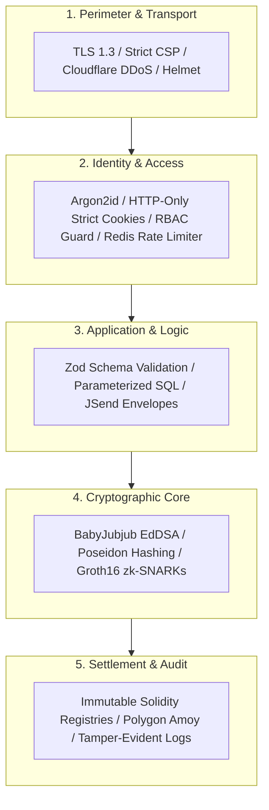

# SECURITY_ARCHITECTURE.md — Defense-in-Depth Security Framework

> **Document ID**: DOC-SEC-001  
> **Status**: Confirmed Technical Specification

---

## 1. Defense-in-Depth Model

VERICRED implements a multi-layered security architecture designed to prevent single points of failure across transport, application, cryptographic, persistent storage, and blockchain layers.

---

## 2. Security Boundaries & Enforcements

| Layer | Primary Threats | Implemented Defense Mechanism |
| :--- | :--- | :--- |
| **Edge / Perimeter** | DDoS, MITM, XSS, Clickjacking | Cloudflare WAF, TLS 1.3 only, strict Content-Security-Policy headers |
| **Authentication** | Brute-force, Session hijacking, Replay | Argon2id ($64\,\text{MB}$ memory cost), HTTP-Only SameSite cookies, JTI revocation |
| **API Gateway** | Injection, Mass assignment, Parameter tampering | Strict Zod validation on all inbound DTOs, Prisma parameterized SQL |
| **Cryptographic** | Forgery, Underconstrained circuits, Signature replay | EdDSA BabyJubjub signatures, 14-bit range constraints in Circom |
| **Blockchain** | Reentrancy, Unauthorized issuance/revocation | Zero-balance registry contracts, strict caller address assertions |

---

## 3. Cryptographic Invariants & Non-Negotiables

1. **Zero Private Key Exposure**: Private signing keys never leave their secure hardware enclave (AWS KMS or dev keystore) and are NEVER exposed to the frontend browser or unauthenticated APIs.
2. **Zero Academic PII On-Chain**: Raw student names, grades, roll numbers, or marks are strictly forbidden from on-chain storage or event emissions.
3. **No Unauthenticated Verification**: A zero-knowledge proof must always be cryptographically bound to an authorized institution public key validated against `InstitutionRegistry.sol`.
