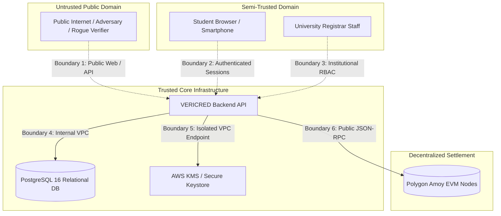

# THREAT_MODEL.md — Formal Threat Model & STRIDE Analysis

> **Document ID**: DOC-SEC-002  
> **Status**: Confirmed Technical Specification  
> **Methodology**: Microsoft STRIDE Framework & DREAD Risk Scoring

---

## 1. System Assets & Trust Boundaries

### 1.1 Critical Assets
1. **Institutional Private Signing Keys**: Highest-value asset; compromise allows arbitrary credential forgery.
2. **Student Academic Privacy (Grades/PII)**: Confidential asset protected under GDPR, FERPA, and ethical standards.
3. **Decentralized Registry Integrity**: State of `InstitutionRegistry`, `CredentialRegistry`, and `RevocationRegistry`.
4. **Platform Availability & Verifier Trust**: System uptime and mathematical reliability of verification outputs.

### 1.2 Trust Boundaries

---

## 2. Comprehensive STRIDE Threat Analysis

| Threat ID | STRIDE Category | Threat Scenario | Attack Vector & Impact | Technical Mitigation | Residual Risk |
| :--- | :--- | :--- | :--- | :--- | :--- |
| **TH-01** | **Spoofing** | Forged credential minted by unauthorized actor | Attacker generates fake degree claiming to be RCC-IIT | Smart contract asserts `isAuthorized(msg.sender)`. Verification checks issuer public key on-chain. | Low |
| **TH-02** | **Tampering** | Modification of student CGPA in transit or storage | Student edits degree JSON from 7.65 to 9.50 | Altering CGPA breaks EdDSA BabyJubjub signature and Poseidon commitment $C$. Verification fails. | Nil |
| **TH-03** | **Repudiation** | University denies issuing a valid degree | Corrupt registrar claims student forged certificate | EdDSA digital signature and on-chain block timestamp provide non-repudiable mathematical proof. | Nil |
| **TH-04** | **Information Disclosure** | Leakage of exact CGPA during ZK proof | Recruiter eavesdrops or reverse-engineers student grade | Groth16 zk-SNARK reveals zero knowledge of private witness $x$; salted commitment prevents dictionary lookup. | Nil |
| **TH-05** | **Denial of Service** | Flooding verification portal with bogus requests | Botnet exhausts API server memory or rate limits | Redis sliding-window rate limiting (60 req/min/IP), Cloudflare DDoS mitigation, CDN caching of vkeys. | Low |
| **TH-06** | **Elevation of Privilege** | Platform admin revokes legitimate degrees | Malicious admin attempts to cancel degrees of a university | `RevocationRegistry.sol` restricts revocation callers strictly to `msg.sender == originalIssuerAddress`. | Nil |
| **TH-07** | **Replay Attack** | QR screenshot reused by another student | Candidate presents a screenshot of a friend's verified QR code | Presentations bound to ephemeral 15-minute TTL and one-time nonces invalidated upon consumption. | Low |
| **TH-08** | **ZK Underflow** | Prime field wraparound ($x < T \implies x - T > 0$) | Student with low grade exploits modular arithmetic | Circom circuit decomposes inputs into 14-bit binary representations, preventing field wraparound exploits. | Nil |
| **TH-09** | **Key Compromise** | University registrar private signing key leaked | Attacker with key issues unauthorized credentials | On-chain key emergency suspension (`suspendIssuerKey`) immediately invalidates all future credentials. | Moderate |
| **TH-10** | **Database Breach** | Attacker dumps entire PostgreSQL database | PII exposed; attacker attempts to forge credentials | Passwords stored via Argon2id; private signing keys NEVER stored in database; sensitive fields encrypted. | Low |

---

## 3. DREAD Risk Assessment Matrix

| Threat | Damage | Reproducibility | Exploitability | Affected Users | Discoverability | DREAD Score (0-10) | Risk Tier |
| :--- | :---: | :---: | :---: | :---: | :---: | :---: | :---: |
| Key Compromise (TH-09) | 9 | 5 | 4 | 8 | 4 | **6.0** | **HIGH** |
| DoS API Flood (TH-05) | 5 | 8 | 8 | 7 | 8 | **7.2** | **HIGH** |
| Database Breach (TH-10) | 7 | 3 | 3 | 9 | 4 | **5.2** | **MEDIUM** |
| QR Replay (TH-07) | 4 | 6 | 7 | 2 | 7 | **5.2** | **MEDIUM** |
| Smart Contract Bug (TH-06)| 8 | 2 | 2 | 9 | 3 | **4.8** | **MEDIUM** |
