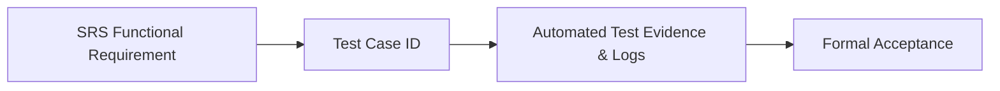

# ACCEPTANCE_CRITERIA.md — Requirements Traceability & Verification Matrix

> **Document ID**: DOC-QA-006  
> **Status**: Confirmed Technical Specification

---

## 1. Traceability Matrix & Acceptance Criteria

Every requirement defined in [SRS.md](../01_PROJECT_FOUNDATION/SRS.md) must be verified against measurable criteria before a feature is accepted into production:

---

## 2. Traceability & Acceptance Table

| Req ID | Requirement Summary | Verification Method | Acceptance Pass / Fail Condition | Linked Test Case |
| :--- | :--- | :--- | :--- | :--- |
| **FR-001** | Argon2id password hashing | Unit / Database Inspection | Password hash in DB starts with `$argon2id$`; brute force infeasible | `TC-AUTH-001` |
| **FR-004** | Institution approval gate | API Integration Test | Unapproved institution accounts receive `403` when attempting issuance | `TC-AUTH-002` |
| **FR-007** | Fixed-point scaled CGPA | Unit Test (`@vericred/crypto`)| CGPA $8.72$ scales deterministically to integer $872 \in [0, 1000]$ | `TC-ISSUE-001` |
| **FR-008** | Salted Poseidon commitment | Cryptographic Test | $C == \text{Poseidon}(872, s)$; salt has 254 bits entropy | `TC-ISSUE-001` |
| **FR-009** | EdDSA BabyJubjub signing | Cryptographic Test | Signature $(R8, S)$ verifies against issuer public key $(Ax, Ay)$ | `TC-ISSUE-001` |
| **FR-012** | On-chain institution registry| Hardhat Contract Test | Approved institution address recorded in `InstitutionRegistry.sol` | `TC-AUTH-002` |
| **FR-014** | Dynamic on-chain revocation | Hardhat & Integration Test | Only issuing address can revoke; status immediately yields `REVOKED` | `TC-REVOKE-001` |
| **FR-016** | Ephemeral presentation TTL | API Integration Test | Presentation fails with `410 Gone` after $15\,\text{minutes}$ or nonce reuse | `TC-VERIFY-003` |
| **FR-017** | No PII in QR payloads | QR Parser Inspection | QR payload contains strictly opaque URL; zero plaintext academic PII | `TC-VERIFY-001` |
| **FR-019** | ZK CGPA Threshold circuit | Circom Tester & snarkjs | Proof generated for $872 \ge 800$; rejected if $765 \not\ge 800$ or forged | `TC-ZK-001`, `TC-ZK-002` |
| **FR-022** | Multi-factor verification | API End-to-End Test | All 5 verification checks pass; tampering flips result to `INVALID` | `TC-VERIFY-001`, `TC-VERIFY-002` |
| **NFR-001**| Verification latency $\le 500\,\text{ms}$| Performance Benchmark | Public verification API responds in $\le 500\,\text{ms}$ under 50 concurrent users | Performance Suite |
| **NFR-002**| Browser ZK proving $\le 2.5\,\text{s}$ | Client Browser Benchmark | Web Worker computes witness & Groth16 proof in $\le 2.5\,\text{s}$ on standard laptop | Client ZK Suite |

---

## 3. Evidence-Based Sign-Off Rule

In accordance with [AGENTS.md](../../AGENTS.md) Directive 12:
> **No requirement may be marked as Completed without concrete automated test output and terminal logs demonstrating compliance with the criteria specified above.**
