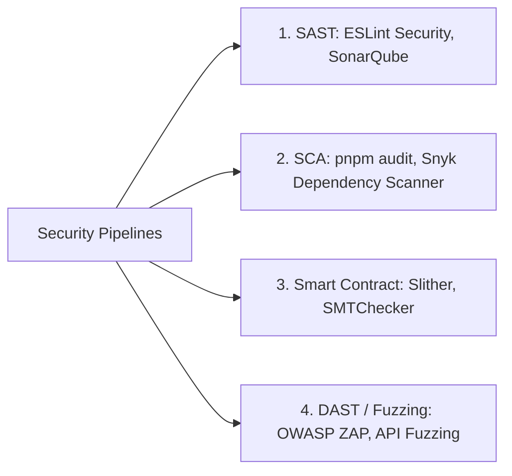

# SECURITY_TESTING.md — Vulnerability Auditing & Security Penetration Testing

> **Document ID**: DOC-QA-005  
> **Status**: Confirmed Technical Specification

---

## 1. Security Testing Methodology

VERICRED applies automated and manual security verification protocols across codebases, dependencies, smart contracts, and cloud infrastructure.

---

## 2. Automated Static Analysis (SAST & Slither)

### 2.1 Smart Contract Security Scan (`slither .`)
- Checks for reentrancy vulnerabilities, uninitialized storage pointers, arbitrary send calls, shadowing state variables, and tx.origin usage.
- **Enforcement**: Build fails if any High or Medium severity finding is reported by Slither.

### 2.2 Dependency Auditing (`pnpm audit`)
- Scans `pnpm-lock.yaml` against the GitHub Advisory Database.
- Zero known high/critical vulnerabilities tolerated in production builds.

---

## 3. OWASP Top 10 Penetration Checklist

| OWASP Category | Potential Vector | VERICRED Verification Protocol |
| :--- | :--- | :--- |
| **A01: Broken Access Control** | Student accessing `/admin/approve` | Execute integration test asserting status `403 Forbidden` for non-admin tokens. |
| **A02: Cryptographic Failures** | Plaintext password or private key leak | Verify Argon2id parameters; assert no private keys committed in source or logs. |
| **A03: Injection** | SQL injection in enrollment number query | Assert Prisma parameterized queries; test payload `' OR 1=1 --`. |
| **A04: Insecure Design** | Replay of intercepted QR presentation | Assert immediate rejection (`410 Gone`) upon nonce reuse in Redis. |
| **A05: Security Misconfig** | Stack traces in API 500 error responses | Send malformed requests; assert response matches sanitized JSend envelope. |
| **A07: Identification Failures** | Brute force password guessing | Assert rate limiter trips after 5 invalid attempts from same IP address. |
