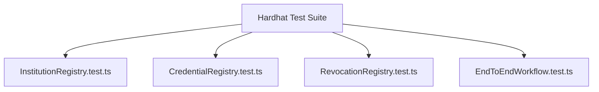

# SMART_CONTRACT_TESTING.md — Smart Contract Test Suite & Gas Profiling

> **Document ID**: DOC-QA-003  
> **Status**: Confirmed Technical Specification  
> **Framework**: Hardhat / Chai / Ethers.js v6 / Solidity-Coverage

---

## 1. Test Suite Architecture

Contract tests reside in `blockchain/test/` and validate functional state transitions, custom revert conditions, access controls, and event emissions.



---

## 2. Unit Test Matrix

### 2.1 `InstitutionRegistry.test.ts`
1. `it("should allow an institution to register with status PENDING")`
2. `it("should revert if an institution registers with duplicate shortCode")`
3. `it("should allow owner to approve institution and emit InstitutionApproved")`
4. `it("should revert if non-owner attempts to approve institution")`
5. `it("should allow approved institution to update BabyJubjub key coordinates")`
6. `it("should revert if public key coordinates fail curve equation")`

### 2.2 `CredentialRegistry.test.ts`
1. `it("should allow approved institution to anchor credential commitment")`
2. `it("should revert if unapproved address attempts to issue credential")`
3. `it("should revert if duplicate credentialHash is submitted")`
4. `it("should support batch credential issuance up to 100 records")`

### 2.3 `RevocationRegistry.test.ts`
1. `it("should allow original issuing institution to revoke its own credential")`
2. `it("should revert if a different institution attempts to revoke a credential")`
3. `it("should revert if attempting to revoke an already revoked credential")`
4. `it("should correctly report isCredentialRevoked status")`

---

## 3. Gas Profiling & Test Execution

```bash
# Execute contract test suite with gas profiling
pnpm --filter @vericred/blockchain hardhat test

# Run code coverage analysis (enforcing 100% target)
pnpm --filter @vericred/blockchain hardhat coverage
```
Target thresholds: **100% Statements, 100% Branches, 100% Functions, 100% Lines**.
