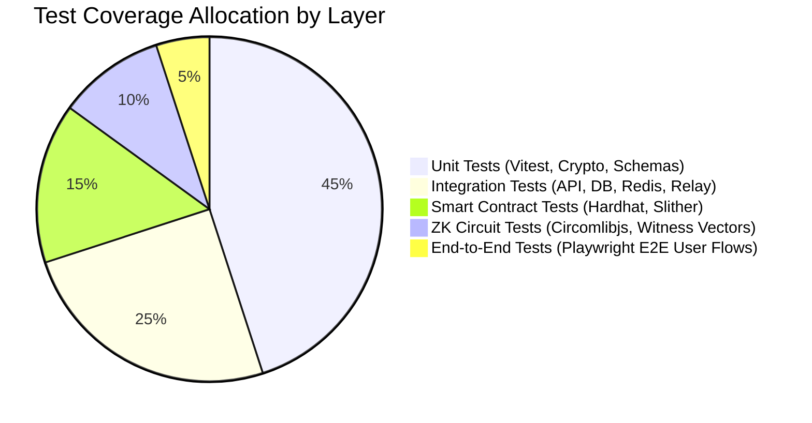

# TESTING_STRATEGY.md — Comprehensive Quality Assurance & Verification Plan

> **Document ID**: DOC-QA-001  
> **Status**: Confirmed Technical Specification

---

## 1. Quality Assurance Philosophy & Testing Pyramid

VERICRED enforces a rigorous multi-tier testing strategy to ensure mathematical correctness, gas efficiency, and flawless user experiences across the entire stack.

---

## 2. Testing Frameworks & Tooling

| Domain | Testing Tool / Harness | Coverage Objective | Target Metrics |
| :--- | :--- | :--- | :--- |
| **Backend API & Crypto** | Vitest, Supertest, `@vericred/crypto` | Unit & API Route Integration | $\ge 90\%$ line coverage |
| **Frontend UI & State** | Vitest, React Testing Library | Component rendering & form validation | $\ge 80\%$ line coverage |
| **Smart Contracts** | Hardhat, Chai, Ethers.js v6 | Contract state & access control | $100\%$ method & branch coverage |
| **ZK Circuits** | Circomlibjs, snarkjs, Mocha | Constraint satisfaction & witness boundary | $100\%$ valid & invalid vectors |
| **End-to-End (E2E)** | Playwright (Chromium, Firefox, WebKit) | 5 Master Demo Scenarios | $100\%$ scenario pass rate |
| **Static Security** | Slither, SonarQube, npm audit | Code vulnerabilities & CWE scans | Zero High/Critical findings |

---

## 3. Cryptographic & ZK Circuit Testing Strategy

Testing zero-knowledge circuits requires verifying both **completeness** (valid witnesses always produce valid proofs) and **soundness** (invalid witnesses are categorically rejected):
1. **Valid Witness Vectors**: Test positive cases ($x = 872, T = 800$, $x = 1000, T = 800$, $x = 800, T = 800$).
2. **Invalid Witness Vectors**: Assert circuit fails to solve constraints when:
   - Grade below threshold ($x = 765, T = 800$).
   - Salt does not match commitment ($C \ne \text{Poseidon}(x, s)$).
   - Signature forged or signed with unauthorized key ($A \ne A_{\text{auth}}$).
   - Value outside bounded range ($x = 1001$ or $x = -1$).
