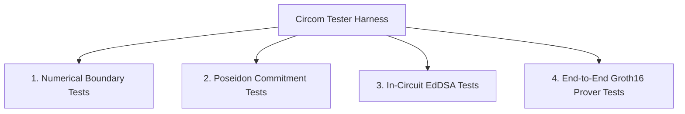

# ZK_TESTING.md — Zero-Knowledge Circuit Verification & Boundary Testing

> **Document ID**: DOC-QA-004  
> **Status**: Confirmed Technical Specification  
> **Harness**: `circom_tester` / `snarkjs` / Mocha

---

## 1. Circuit Test Methodology

Zero-knowledge circuits cannot be debugged with standard procedural breakpoints. VERICRED uses `circom_tester.wasm` to load compiled circuits directly into Node.js test harnesses, verifying constraint satisfaction across rigorous mathematical edge cases.



---

## 2. Boundary Condition Test Suite (`zk/test/CgpaCircuit.test.ts`)

| Test Vector ID | Witness Inputs ($x, T$) | Condition | Expected Outcome |
| :--- | :--- | :--- | :--- |
| **ZK-VEC-01** | $x = 872, T = 800$ | $x > T$ (Standard Pass) | **Constraints Satisfied** |
| **ZK-VEC-02** | $x = 800, T = 800$ | $x == T$ (Exact Threshold Boundary) | **Constraints Satisfied** |
| **ZK-VEC-03** | $x = 799, T = 800$ | $x = T - 1$ (One-Point Failure) | **REJECTED: Assert Failed** |
| **ZK-VEC-04** | $x = 1000, T = 800$ | $x = \text{Max Grade}$ ($10.00$) | **Constraints Satisfied** |
| **ZK-VEC-05** | $x = 0, T = 0$ | $x = \text{Min Grade}$ ($0.00$) | **Constraints Satisfied** |
| **ZK-VEC-06** | $x = 1001, T = 800$ | $x > 1000$ (Out-of-Domain Violation) | **REJECTED: RangeCheck Failed**|
| **ZK-VEC-07** | $x = 872, s \ne s_{\text{commit}}$ | Salt mismatch ($C \ne \text{Poseidon}(x, s)$) | **REJECTED: Commitment Failed**|
| **ZK-VEC-08** | $x = 872, \text{Sig} \ne \text{Sig}_{\text{valid}}$ | Forged EdDSA BabyJubjub signature | **REJECTED: EdDSA Failed** |

---

## 3. Circuit Test Code Example

```typescript
import { expect } from 'chai';
import path from 'path';
import { wasm as wasmTester } from 'circom_tester';
import { signAcademicCommitment, generateBlindingSalt, computePoseidonCommitment } from '@vericred/crypto';

describe("CgpaThresholdValidator Circuit Tests", () => {
  let circuit: any;

  before(async () => {
    circuit = await wasmTester(
      path.join(__dirname, "../circuits/CgpaThresholdValidator.circom")
    );
  });

  it("should successfully prove x = 872 >= T = 800 with valid signature", async () => {
    const x = 872;
    const T = 800;
    const salt = generateBlindingSalt();
    const commitment = computePoseidonCommitment(x, salt);
    
    // Institution signs commitment
    const instPrivKey = BigInt("0x123456789abcdef...");
    const sig = await signAcademicCommitment(instPrivKey, commitment);

    const witness = await circuit.calculateWitness({
      commitment: commitment.toString(),
      threshold: T.toString(),
      issuerPubKeyX: sig.issuerPubKeyX,
      issuerPubKeyY: sig.issuerPubKeyY,
      scaledCgpa: x.toString(),
      salt: salt.toString(),
      sigR8x: sig.sigR8x,
      sigR8y: sig.sigR8y,
      sigS: sig.sigS
    });

    await circuit.checkConstraints(witness);
  });

  it("should fail constraint satisfaction if x (765) < T (800)", async () => {
    const x = 765;
    const T = 800;
    const salt = generateBlindingSalt();
    const commitment = computePoseidonCommitment(x, salt);
    const instPrivKey = BigInt("0x123456789abcdef...");
    const sig = await signAcademicCommitment(instPrivKey, commitment);

    try {
      await circuit.calculateWitness({
        commitment: commitment.toString(),
        threshold: T.toString(),
        issuerPubKeyX: sig.issuerPubKeyX,
        issuerPubKeyY: sig.issuerPubKeyY,
        scaledCgpa: x.toString(),
        salt: salt.toString(),
        sigR8x: sig.sigR8x,
        sigR8y: sig.sigR8y,
        sigS: sig.sigS
      });
      expect.fail("Circuit should have thrown an error");
    } catch (err: any) {
      expect(err.message).to.include("Assert Failed");
    }
  });
});
```
