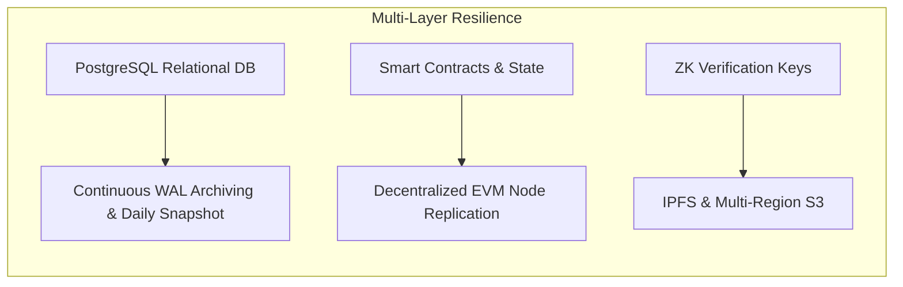

# BACKUP_AND_RECOVERY.md — Disaster Recovery & Business Continuity Plan

> **Document ID**: DOC-OPS-006  
> **Status**: Confirmed Technical Specification

---

## 1. Disaster Recovery Objectives

VERICRED defines strict Business Continuity objectives:
- **Recovery Point Objective (RPO)**: $\le 5\,\text{minutes}$ (maximum permissible data loss window).
- **Recovery Time Objective (RTO)**: $\le 30\,\text{minutes}$ (maximum permissible service interruption).

---

## 2. Backup Schedules & Procedures

### 2.1 PostgreSQL Database Backups
- **Continuous Archiving**: Write-Ahead Logging (WAL) shipped every 5 minutes to cross-region S3 bucket.
- **Daily Full Snapshot**: Automated RDS snapshot executed at 02:00 UTC, encrypted via AWS KMS, retained for 30 days.
- **Monthly Long-Term Cold Archive**: First-of-month snapshot archived to AWS Glacier (retained for 7 years for educational compliance).

### 2.2 Blockchain State Resilience
Because `InstitutionRegistry`, `CredentialRegistry`, and `RevocationRegistry` live on Polygon Amoy:
- The authoritative ledger state is replicated across thousands of independent validator nodes.
- Even in the catastrophic event of a complete database loss, **all public keys, issuance anchors, commitments, and revocations can be fully reconstructed** by replaying contract event logs (`CredentialIssued`, `CredentialRevoked`).

---

## 3. Disaster Recovery Restoration Runbook

In the event of a catastrophic primary region outage:
1. **Infrastructure Spin-up**: Execute Terraform in secondary AWS region (`us-west-2` or `eu-central-1`).
2. **Database Point-in-Time Restore**: Restore RDS instance from latest S3 WAL archive.
3. **Event Log Reconciliation**: Run `pnpm --filter @vericred/api sync:blockchain` to query Amoy RPC and sync any delta transactions minted between the backup timestamp and present block height.
4. **DNS Switchover**: Update Route 53 / Cloudflare DNS records to route traffic to the secondary ALB.
5. **Post-Restore Validation**: Run automated verification smoke test against demo credential (`VC2026001`).
