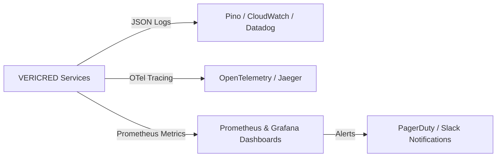

# MONITORING_AND_LOGGING.md — Observability, Telemetry & Health Checks

> **Document ID**: DOC-OPS-005  
> **Status**: Confirmed Technical Specification

---

## 1. Observability Stack Overview

VERICRED maintains comprehensive operational visibility through structured JSON logging, distributed OpenTelemetry tracing, and proactive metric alerting.



---

## 2. Health Check Specifications

Backend services expose dedicated liveness and readiness endpoints:

### 2.1 Liveness Probe (`GET /health/live`)
- **Status**: Returns `200 OK` if the Node.js event loop is responsive.
- **Payload**: `{ "status": "UP", "timestamp": "..." }`

### 2.2 Readiness Probe (`GET /health/ready`)
- **Status**: Evaluates upstream subsystem connectivity:
  1. PostgreSQL connection query (`SELECT 1`).
  2. Redis ping (`PING -> PONG`).
  3. Polygon Amoy RPC block number query (`eth_blockNumber`).
- **Response** (`200 OK` or `503 Service Unavailable`):
  ```json
  {
    "status": "READY",
    "checks": {
      "database": "UP",
      "redis": "UP",
      "polygonAmoy": "UP",
      "latestBlock": 14298102
    }
  }
  ```

---

## 3. Critical Alerting Thresholds

| Alert Rule | Condition | Severity | Action Triggered |
| :--- | :--- | :--- | :--- |
| **Relayer Balance Low** | POL balance $< 5.0\text{ POL}$ on Amoy | **P1 (High)** | Slack alert to ops team to fund relayer |
| **Verification Error Spike** | 5xx errors $> 1.0\%$ over 5 minutes | **P1 (High)** | PagerDuty call to on-call engineer |
| **RPC Node Failure** | Primary Polygon Amoy RPC timeout $> 3$ consecutive times | **P2 (Medium)** | Automatic failover to secondary RPC |
| **High Latency** | Public verification p95 latency $> 1000\,\text{ms}$ | **P2 (Medium)** | Auto-scale ECS Fargate tasks |
