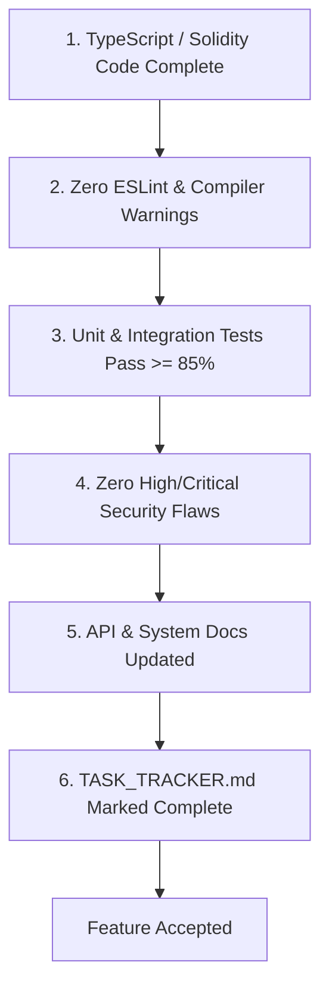

# DEFINITION_OF_DONE.md — Quality Gates & Release Criteria

> **Document ID**: DOC-PM-005  
> **Status**: Confirmed Technical Specification

---

## 1. Feature-Level Definition of Done (DoD)

A user story, API endpoint, or UI component is considered **Done** only when all of the following criteria are satisfied:

---

## 2. Subsystem Quality Checklists

### 2.1 Backend API Endpoints
- [ ] Zod schema validator enforced on request body, query params, and headers.
- [ ] JSend envelope returned consistently across success and error conditions.
- [ ] RBAC guard and JWT authentication middleware asserted.
- [ ] Integration tests verify status codes `200/201`, `400`, `401`, `403`, and `404`.
- [ ] Sensitive fields stripped from outgoing JSON responses.

### 2.2 Smart Contracts
- [ ] 100% line, branch, and function test coverage in Hardhat.
- [ ] Zero warnings or vulnerabilities reported by Slither.
- [ ] Custom errors utilized instead of string revert messages.
- [ ] Deployed and verified on Polygon Amoy testnet.
- [ ] TypeChain client bindings regenerated in `@vericred/contract-client`.

### 2.3 Zero-Knowledge Circuits
- [ ] Circuit compiles cleanly with zero unconstrained wire warnings.
- [ ] Boundary tests pass for exact threshold ($x == T$), below threshold ($x < T$), and range overflow ($x > 1000$).
- [ ] Browser proving time benchmarks $< 2.5\,\text{seconds}$ in Web Worker.
- [ ] Verification key exported and mirrored to CDN / IPFS.

### 2.4 Frontend Components
- [ ] Tested across mobile ($375\,\text{px}$) and desktop ($1280\,\text{px}$) viewports.
- [ ] Proper loading skeleton, empty state, and error alert rendered.
- [ ] Full keyboard navigation and ARIA accessibility labels verified.
- [ ] Zero unhandled React console warnings or hydration errors.
