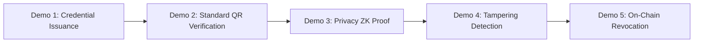

# DEVELOPMENT_PHASES.md — Detailed Phase Breakdowns & Demonstration Scenarios

> **Document ID**: DOC-PM-002  
> **Status**: Confirmed Technical Specification

---

## 1. Master Demonstration Scenarios

The VERICRED platform is designed to execute five interconnected, live demonstration workflows to prove technical excellence:



### Demonstration Scenario 1: Academic Credential Issuance
- **Actor**: Registrar Officer at RCC Institute of Information Technology.
- **Action**: Issues B.Tech in CSE to Aarav Sen (`VC2026001`) with CGPA $8.72$.
- **Observed Behavior**: Credential signed via BabyJubjub EdDSA; commitment $C = \text{Poseidon}(872, s)$ anchored to Polygon Amoy; credential delivered to Aarav's sovereign web wallet.

### Demonstration Scenario 2: Standard QR Verification
- **Actor**: Corporate Recruiter.
- **Action**: Scans Aarav's QR code on smartphone/webcam.
- **Observed Behavior**: Instant $< 500\,\text{ms}$ resolution; green `VALID CREDENTIAL` report confirming authentic RCC-IIT signature, intact integrity, and active status.

### Demonstration Scenario 3: Privacy-Preserving Zero-Knowledge Proof
- **Actor**: Corporate Recruiter & Student Aarav Sen.
- **Action**: Recruiter specifies: *"Prove CGPA $\ge 8.0$."* Aarav opens wallet, inputs threshold $8.0$ ($800$), and client-side snarkjs generates Groth16 proof.
- **Observed Behavior**: Verifier validates proof and on-chain issuer key; screen displays `ELIGIBILITY PROVEN: CGPA >= 8.0`. Aarav's exact CGPA ($8.72$) is never revealed.

### Demonstration Scenario 4: Tampering Detection
- **Actor**: Fraudulent Actor / Evaluator.
- **Action**: Edits a test copy of Aarav's credential JSON, changing CGPA from $8.72$ to $9.50$. Submits for verification.
- **Observed Behavior**: Cryptographic signature verification fails immediately; portal renders a red `INVALID CREDENTIAL (SIGNATURE MISMATCH)` warning.

### Demonstration Scenario 5: Dynamic On-Chain Revocation
- **Actor**: Institution Registrar.
- **Action**: Revokes Aarav's credential on-chain via `RevocationRegistry.sol` due to an administrative duplicate.
- **Observed Behavior**: Subsequent verification attempt dynamically reads the on-chain registry and returns a red `REVOKED CREDENTIAL` status with the revocation timestamp and reason.

---

## 2. Seed Data Catalog

```text
Institution:
  Legal Name: RCC Institute of Information Technology (RCC-IIT)
  Short Code: RCC-IIT
  Admin Account: registrar@rcciit.ac.in / InstitutePass123!
  Address: 0x71C83648E75C4782F485B8F9A1058D14881E995F

Student A:
  Name: Aarav Sen
  Enrollment: VC2026001
  Degree: B.Tech in Computer Science and Engineering
  Graduation: 2026 | CGPA: 8.72 (Scaled: 872)
  Account: aarav.sen@student.rcciit.ac.in / StudentPass123!

Student B:
  Name: Diya Roy
  Enrollment: VC2026002
  Degree: B.Tech in Information Technology
  Graduation: 2026 | CGPA: 7.65 (Scaled: 765)
  Account: diya.roy@student.rcciit.ac.in / StudentPass123!

Student C:
  Name: Rohan Das
  Enrollment: VC2026003
  Degree: B.Tech in Computer Science and Engineering
  Graduation: 2026 | CGPA: 9.12 (Scaled: 912)
  Account: rohan.das@student.rcciit.ac.in / StudentPass123!

Platform Admin:
  Account: admin@vericred.net / AdminPass123!
```
