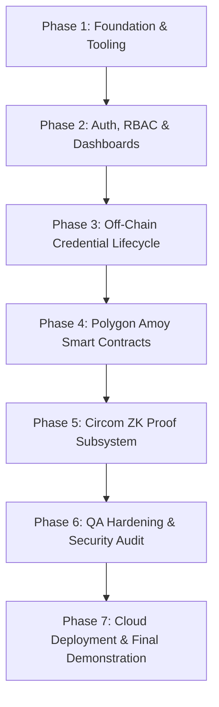

# IMPLEMENTATION_PLAN.md — Technical Sequencing & Engineering Execution

> **Document ID**: DOC-PM-001  
> **Status**: Confirmed Technical Specification

---

## 1. Execution Principles

VERICRED implementation follows an incremental, test-driven sequencing strategy designed to de-risk high-complexity cryptographic components before layering frontend user interfaces.

---

## 2. Technical Sequencing Runbook

### Step 1: Workspace Initialization (Phase 1)
- Initialize pnpm monorepo with Turborepo orchestrator.
- Establish shared packages (`@vericred/shared`, `@vericred/credential-schema`, `@vericred/crypto`, `@vericred/contract-client`).
- Configure Docker Compose with PostgreSQL 16 and Redis 7 containers.
- Author initial Prisma schema and execute baseline migration.

### Step 2: Authentication & Core Dashboard Shells (Phase 2)
- Implement Argon2id password hashing and HTTP-only JWT cookie middleware.
- Build RBAC guards for `ADMIN`, `INSTITUTION`, `STUDENT`, `VERIFIER`.
- Implement Admin Institution Approval workflow.
- Scaffold Next.js 14 App Router dashboard layouts.

### Step 3: Off-Chain Credential & QR Presentation Engine (Phase 3)
- Build W3C VC 2.0 schema validator and canonicalizer.
- Implement BabyJubjub curve utilities and EdDSA signing functions.
- Build student sovereign wallet UI and ephemeral presentation QR generator.
- Implement public verification portal resolving standard signatures.

### Step 4: Polygon Amoy Smart Contracts (Phase 4)
- Author `InstitutionRegistry.sol`, `CredentialRegistry.sol`, `RevocationRegistry.sol`.
- Write Chai/Hardhat test suites achieving $100\%$ branch coverage.
- Deploy to Polygon Amoy testnet and bind backend relay service.

### Step 5: Zero-Knowledge Circom Circuit (Phase 5)
- Compile `CgpaThresholdValidator.circom` and profile R1CS constraints.
- Execute trusted setup ceremony to generate proving and verification keys.
- Integrate in-browser `snarkjs` Web Worker inside student wallet UI.
- Bind public signals to on-chain registries during portal verification.

### Step 6: Security Hardening & End-to-End Testing (Phase 6)
- Run automated Playwright tests for all 5 demonstration scenarios.
- Run static security analysis with Slither and SonarQube.
- Enable Redis sliding-window rate limiting.

### Step 7: Final Demo & Release (Phase 7)
- Populate database with RCC-IIT fictional demo seed records.
- Deploy Next.js frontend to Vercel and API to AWS ECS / Render.
- Verify end-to-end evaluation flow.
