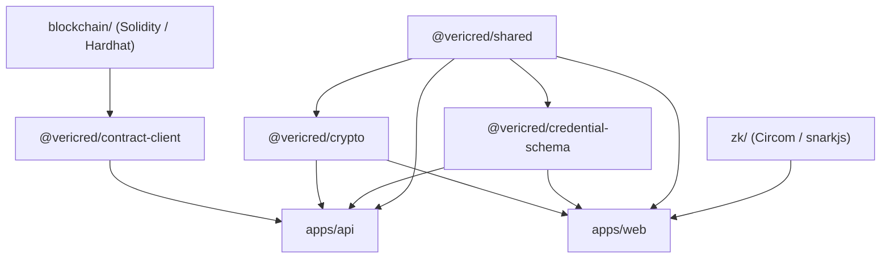

# MODULE_DEPENDENCIES.md — Monorepo Topology & Build Pipeline Dependencies

> **Document ID**: DOC-PM-003  
> **Status**: Confirmed Technical Specification

---

## 1. Monorepo Build Graph (Turborepo)

VERICRED enforces a strict directed acyclic graph (DAG) across workspace packages to guarantee deterministic compilation:



---

## 2. Package Dependency Definitions

| Package / Application | Internal Monorepo Dependencies | Key External Dependencies |
| :--- | :--- | :--- |
| **`@vericred/shared`** | None (Leaf node) | `zod` |
| **`@vericred/credential-schema`** | `@vericred/shared` | `zod`, `json-schema` |
| **`@vericred/crypto`** | `@vericred/shared` | `circomlibjs`, `ethers` |
| **`@vericred/contract-client`** | `@vericred/shared` | `ethers`, TypeChain output |
| **`apps/api`** | All shared packages | `express`, `prisma`, `argon2`, `bullmq`, `pino` |
| **`apps/web`** | `@vericred/shared`, `@vericred/crypto`, `@vericred/credential-schema` | `next`, `react`, `snarkjs`, `html5-qrcode`, `tailwindcss` |

---

## 3. Turborepo Pipeline Configuration (`turbo.json`)

```json
{
  "$schema": "https://turbo.build/schema.json",
  "pipeline": {
    "build": {
      "dependsOn": ["^build"],
      "outputs": [".next/**", "dist/**", "build/**", "typechain-types/**"]
    },
    "test": {
      "dependsOn": ["build"],
      "outputs": []
    },
    "lint": {
      "outputs": []
    },
    "dev": {
      "cache": false,
      "persistent": true
    }
  }
}
```
